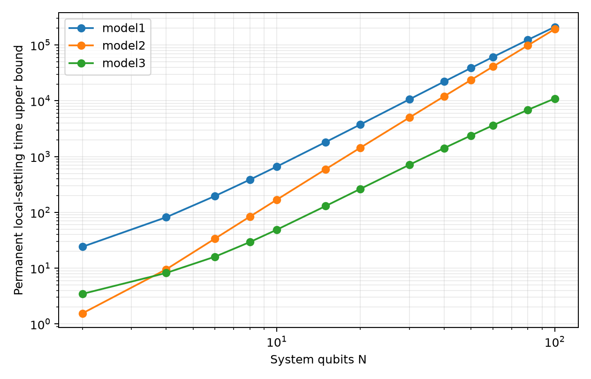

# Initial results and execution status

The offline experiment is implemented. The continuous reference sweep has
completed for all three models at 13 sizes through N=100 (39 cases).
Schedule selection and compiled resources have completed only for the N=2
pipeline pilot. The full size-dependent schedule/resource sweep has not run.
No hardware, account service or noisy simulator was used.

## Continuous references

The [full reference table](runs/scaling_f86137e3d449/Exact.md),
[CSV](runs/scaling_f86137e3d449/exact.csv), and
[PDF plot](runs/scaling_f86137e3d449/exact.pdf) use the default config.



| System qubits | Model1 | Model2 | Model3 |
|---:|---:|---:|---:|
| 10 | 661.007 | 168.350 | 48.803 |
| 50 | 38,729.472 | 23,662.838 | 2,388.790 |
| 100 | 210,742.186 | 192,578.690 | 10,972.024 |

These are **physical-time upper bounds for permanent local accuracy**, from
the monotone covariance Frobenius certificate crossing 0.016. They are not
earliest local settling times or digital step counts. Initial preparations,
rates and hopping normalization differ between models as specified in
[the protocol](Experiment1.md). No universal exponent or cross-model
algorithmic advantage is inferred from this table.

## End-to-end pilot

The pilot uses N=2, K<=128, four optimizer iterations, population multiplier
4, one optimizer seed (1729), and one resource path (seed 29). Other inputs
match the default configuration. This intentionally small search verifies
the pipeline; it is insufficient for optimality or scaling conclusions.

| Model | Fixed dt=0.05 steps | Searched constant steps | Warped-family steps |
|---|---:|---:|---:|
| Model1 | No passing prefix within 128 | 31 | 31 |
| Model2 | 29 | 6 | 6 |
| Model3 | 78 | 78 | 25 |

All selected schedules pass independent dense-channel output and full-node
forward-window validation at the mean tolerance. The warped family retains
the constant schedule when no shorter passing result is found. These are
bounded-search outcomes, not minimum-step claims. Sampling was not run.

See the [schedule table](runs/scaling_76a6a452f1c8/Schedules.md) and
[resource table](runs/scaling_76a6a452f1c8/Resources.md). Sixteen trajectory
circuits were compiled across accepted methods and two abstract topologies.
Their table includes actual native depth/CX counts and separately labelled
leading-order T estimates. For example, the Model3 warped pilot has native
depth 372 and 100 CX on the line for the selected path; neither number is a
physical duration or fault-tolerant runtime. The T estimates are not actual
Clifford+T synthesis results.

Reproduce the reference with the default `exact` command in the protocol.
To reproduce the bounded pilot from a fresh checkout, first create its config:

```bash
.venv/bin/python - <<'PY'
import json
from pathlib import Path
config = json.loads(Path('FinalModel/Experiment1/config.json').read_text())
config.update(sizes=[2], step_budget=128, iterations=4,
              population_multiplier=4, optimizer_seeds=[1729], resource_paths=1)
Path('/tmp/finalmodel_pilot.json').write_text(json.dumps(config, indent=2)+'\n')
PY
OPENBLAS_NUM_THREADS=1 OMP_NUM_THREADS=1 \
  .venv/bin/python FinalModel/Experiment1/study.py schedules --config /tmp/finalmodel_pilot.json
OPENBLAS_NUM_THREADS=1 OMP_NUM_THREADS=1 \
  .venv/bin/python FinalModel/Experiment1/study.py resources --config /tmp/finalmodel_pilot.json
```

Full local JSON checkpoints are intentionally ignored by Git. Compact
reports, tables and plots are retained. Source hashes and installed package
versions determine run directory names, which may differ after updates.

Ten tests pass, covering the fast mean against the existing channel, tiny
physical circuits against the reduced populations and currents, permanent
continuous certificates, independent schedule replay, acceptance caps,
baseline retention, native compilation and the T-estimate bookkeeping.

The next substantive computation is the N=2,4 schedule pilot with the
default search effort, followed by progressively larger N and explicit cap
increases when needed. The controlled equal-normalization panel, tolerance
sensitivity, sampling-cost estimates and actual rotation synthesis remain
separate follow-up studies.
