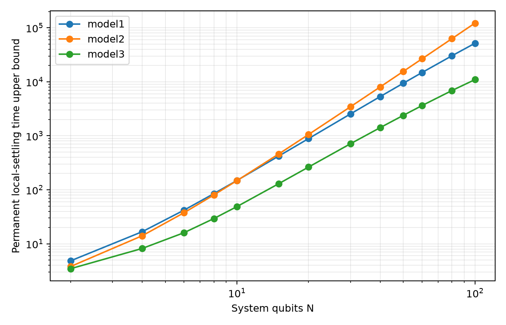
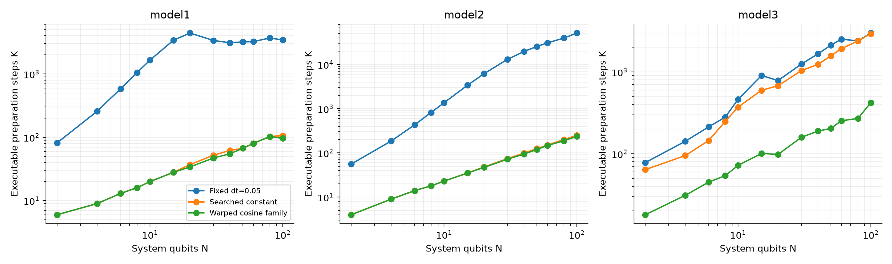
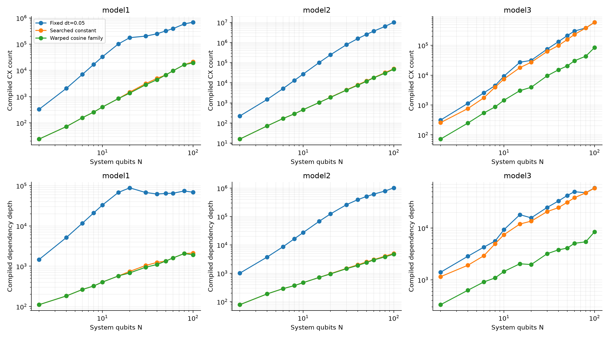
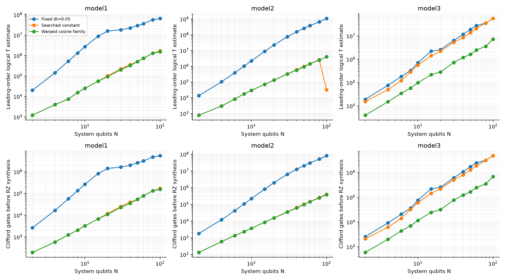
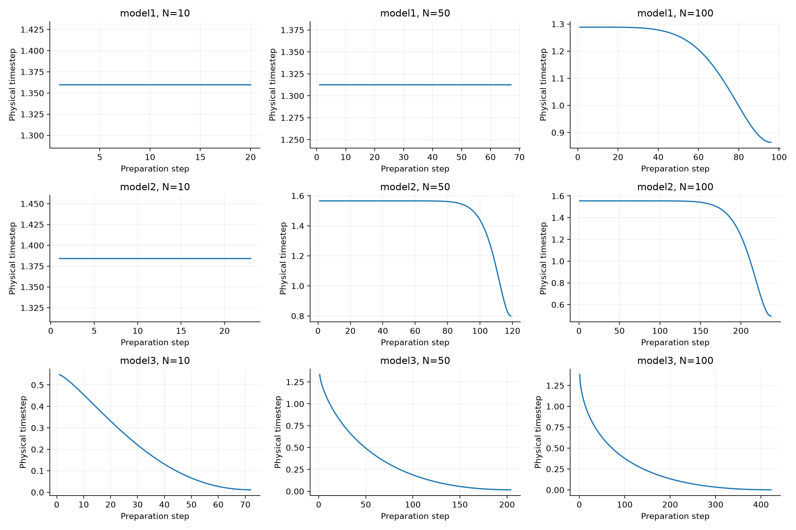

# Full scaling study: J=gamma=1, H=(J/2) sum(XX+YY)

Completed 39 model/size cases through N=100: 117 independently validated mean schedules and 234 compiled resource paths.

All models use J=gamma=1 and c=1/2. Reservoirs remain (0,0), (0.25,0.25), and (0.9,0.1). Model1 starts with a central excitation; Models2/3 start with a half mixture. These preparations remain different.

Times are physical evolution times in units of 1/J, not classical computation seconds. The continuous time is a sufficient permanent local-observable settling-time **upper bound**. Digital schedules pass every node of a finite continuation of at least 10 physical-time units. These are different guarantees. No many-body trace-distance mixing time, finite-trajectory accuracy, measurement-shot cost or hardware performance is claimed.

## N=100 results

| Model | Continuous time upper bound | Fixed steps | Constant steps | Warped-family steps | Warped physical time | Reduction vs fixed | Reduction vs constant |
|---|---:|---:|---:|---:|---:|---:|---:|
| model1 | 51698.8 | 3431 | 106 | 96 | 113.158 | 97.20% | 9.43% |
| model2 | 122169 | 51280 | 250 | 237 | 335.766 | 99.54% | 5.20% |
| model3 | 10972 | 2984 | 2939 | 422 | 100.981 | 85.86% | 85.64% |

These are the best passing schedules found, not globally minimal counts. The warped family includes constant schedules and retains a constant incumbent if no shorter schedule is found.





## Compiled resources and logical Clifford+T estimates

The compiler transpiles symbolic two-qubit exchange blocks to the native RZ/SX/X/CX basis, then binds angles and composes blocks without inter-block optimization. Counts and dependency depths are computed exactly by streaming the compiled instructions' dependencies; no full-circuit size cap or large-N extrapolation is used. All interactions lie on the line with boundary-local ancillas, so line and all-to-all costs coincide for this compiler. Depth is not a pulse duration.

| Model at N=100 | Logical qubits | Warped CX | Warped native depth (path mean) | Base Clifford gates | Leading-order T estimate |
|---|---:|---:|---:|---:|---:|
| model1 | 102 | 19200 | 1923.0 | 153601 | 1516800 |
| model2 | 102 | 47400 | 4747.0 | 379362 | 3934200 |
| model3 | 102 | 84400 | 8447.0 | 675514 | 7174000 |

Resources are per Z-readout path, averaged over two fixed random paths. This is a compilation sample, not a converged trajectory ensemble. Preparation measurements, K bath resets and terminal measurements are included.

Base Clifford counts exclude every RZ awaiting classification/synthesis. T estimates use exact T-angle detection plus the leading 3 log2(1/eta) model from [Ross and Selinger](https://arxiv.org/abs/1403.2975), with eta=0.001/[2 max(1,4c) R] for R generic rotations. Omitted terms mean these estimates are neither synthesized counts nor certified bounds. Exact post-synthesis Clifford counts, T-depth and physical error-correction costs are not computed.





## Full accepted step-count table

| Model | N | Continuous time upper bound | Fixed steps | Constant steps | Warped-family steps | Warped max forward error |
|---|---:|---:|---:|---:|---:|---:|
| model1 | 2 | 4.82831 | 82 | 6 | 6 | 0.01163215 |
| model1 | 4 | 16.7241 | 258 | 9 | 9 | 0.01454513 |
| model1 | 6 | 42.033 | 583 | 13 | 13 | 0.01518926 |
| model1 | 8 | 84.7962 | 1051 | 16 | 16 | 0.01514478 |
| model1 | 10 | 148.62 | 1651 | 20 | 20 | 0.01577328 |
| model1 | 15 | 422.103 | 3400 | 28 | 28 | 0.01480772 |
| model1 | 20 | 887.394 | 4412 | 37 | 34 | 0.01584490 |
| model1 | 30 | 2540.06 | 3376 | 52 | 47 | 0.01565422 |
| model1 | 40 | 5326.86 | 3102 | 62 | 55 | 0.01585929 |
| model1 | 50 | 9403.42 | 3202 | 67 | 67 | 0.01590175 |
| model1 | 60 | 14877.6 | 3237 | 80 | 80 | 0.01453148 |
| model1 | 80 | 30266.5 | 3691 | 103 | 103 | 0.01589771 |
| model1 | 100 | 51698.8 | 3431 | 106 | 96 | 0.01588950 |
| model2 | 2 | 3.78859 | 56 | 4 | 4 | 0.01570278 |
| model2 | 4 | 14.075 | 186 | 9 | 9 | 0.01502381 |
| model2 | 6 | 37.6291 | 431 | 14 | 14 | 0.01547497 |
| model2 | 8 | 80.1867 | 823 | 18 | 18 | 0.01583063 |
| model2 | 10 | 147.509 | 1361 | 23 | 23 | 0.01558376 |
| model2 | 15 | 461.941 | 3381 | 35 | 35 | 0.01589426 |
| model2 | 20 | 1057.08 | 6165 | 48 | 47 | 0.01588708 |
| model2 | 30 | 3449.35 | 13024 | 74 | 72 | 0.01587333 |
| model2 | 40 | 8044.05 | 19646 | 99 | 94 | 0.01589908 |
| model2 | 50 | 15560.9 | 25457 | 125 | 119 | 0.01587717 |
| model2 | 60 | 26719.7 | 30718 | 150 | 147 | 0.01575242 |
| model2 | 80 | 62842 | 39558 | 200 | 188 | 0.01584803 |
| model2 | 100 | 122169 | 51280 | 250 | 237 | 0.01591877 |
| model3 | 2 | 3.45388 | 78 | 64 | 18 | 0.01096077 |
| model3 | 4 | 8.18651 | 142 | 95 | 31 | 0.01395715 |
| model3 | 6 | 16.0584 | 213 | 145 | 45 | 0.01571869 |
| model3 | 8 | 29.296 | 280 | 248 | 54 | 0.01565917 |
| model3 | 10 | 48.8028 | 463 | 371 | 72 | 0.01514702 |
| model3 | 15 | 130.009 | 904 | 596 | 101 | 0.01569713 |
| model3 | 20 | 263.609 | 785 | 678 | 98 | 0.01547980 |
| model3 | 30 | 712.433 | 1248 | 1038 | 159 | 0.01588223 |
| model3 | 40 | 1416.95 | 1663 | 1237 | 189 | 0.01535448 |
| model3 | 50 | 2388.79 | 2122 | 1570 | 204 | 0.01448831 |
| model3 | 60 | 3637.96 | 2514 | 1923 | 253 | 0.01549219 |
| model3 | 80 | 6875.6 | 2395 | 2389 | 270 | 0.01582587 |
| model3 | 100 | 10972 | 2984 | 2939 | 422 | 0.01537309 |

## Validation and interpretation

All 117 output covariances are physical in floating point, and every saved continuation node passes the 0.016 mean tolerance. Selection used a 0.5% numerical margin. The largest accelerated-versus-independent dense output discrepancy was 8.99e-14; the largest stationary-equation residual was 4.97e-14.

The 0.003 sampling allowance and 0.001 synthesis allowance remain separate from mean validation. No sampled-trajectory or hardware execution is included. Schedules optimize stationary-observable preparation without imposing a transient-matching tolerance. Large reductions versus dt=0.05 are not all attributable to cosine warping; the searched-constant comparison isolates the additional schedule-family benefit.

In Model1, small local errors can coexist with a nonzero total excitation. The CSV retains the output total excitation so a local-observable pass cannot be mistaken for full vacuum-state preparation.

| Model1 N | Total excitation at warped output |
|---:|---:|
| 10 | 0.07848606 |
| 50 | 0.22244074 |
| 100 | 0.30494325 |



## Empirical fits

Log-log fits use N>=20. They summarize this range and protocol; they do not establish asymptotic laws. The continuous certificate and digital finite window may produce different apparent exponents.

| Model | Quantity | Fitted exponent | Log-space R squared |
|---|---|---:|---:|
| model1 | settling_time_upper_bound | 2.5290 | 0.99981 |
| model1 | fixed_steps | -0.0921 | 0.18427 |
| model1 | constant_steps | 0.6676 | 0.98496 |
| model1 | warped_cosine_steps | 0.7047 | 0.96761 |
| model1 | warped_cosine_native_cx | 1.7047 | 0.99431 |
| model1 | warped_cosine_T_estimate | 1.7995 | 0.99445 |
| model2 | settling_time_upper_bound | 2.9528 | 0.99998 |
| model2 | fixed_steps | 1.2727 | 0.97822 |
| model2 | constant_steps | 1.0234 | 0.99983 |
| model2 | warped_cosine_steps | 1.0034 | 0.99927 |
| model2 | warped_cosine_native_cx | 2.0034 | 0.99982 |
| model2 | warped_cosine_T_estimate | 2.1169 | 0.99975 |
| model3 | settling_time_upper_bound | 2.3208 | 0.99926 |
| model3 | fixed_steps | 0.8075 | 0.93524 |
| model3 | constant_steps | 0.9042 | 0.99669 |
| model3 | warped_cosine_steps | 0.8004 | 0.95552 |
| model3 | warped_cosine_native_cx | 1.8004 | 0.99088 |
| model3 | warped_cosine_T_estimate | 1.8999 | 0.99123 |

## Reproduce

```bash
OPENBLAS_NUM_THREADS=1 OMP_NUM_THREADS=1 MKL_NUM_THREADS=1 MPLCONFIGDIR=/tmp/finalmodel_mpl \
  .venv/bin/python FinalModel/Experiment1/full_study.py --workers 4
OPENBLAS_NUM_THREADS=1 MPLCONFIGDIR=/tmp/finalmodel_mpl .venv/bin/python FinalModel/Experiment1/analyze_full.py FinalModel/Experiment1/runs/full_a029bea5f96d
```

Configuration, source/package provenance and full numerical checkpoints are saved locally. Compact tables, reports and PNG/PDF figures are portable. This report was generated from audited checkpoints.
