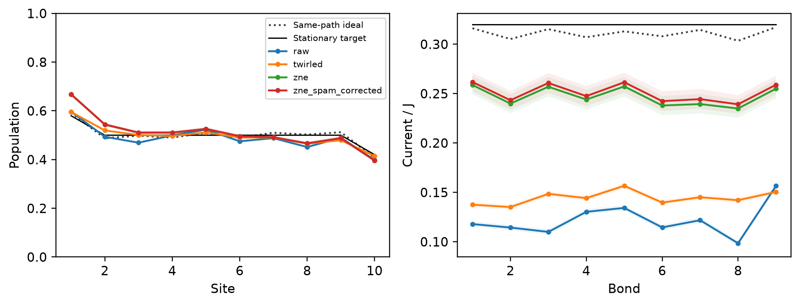

# Model 3 hardware populations and currents

R=16384; S=16 per basis and arm/factor.

| Method | Same-path ideal MAE | Maximum population target error | Maximum current target error |
|---|---:|---:|---:|
| raw | 0.0991203 | 0.0486031 | 0.221516 |
| twirled | 0.0865251 | 0.0345459 | 0.184872 |
| zne | 0.044807 | 0.0871422 | 0.0850789 |
| raw_spam_corrected | 0.0982415 | 0.0495617 | 0.219698 |
| twirled_spam_corrected | 0.0855314 | 0.0347158 | 0.182957 |
| zne_spam_corrected | 0.0431148 | 0.088245 | 0.0808396 |

Paired path bootstrap stratified by observed job, with joint control-count resampling shared across noise factors. No second resampling of evolution shots. Pointwise descriptive intervals, not simultaneous; drift and calibration-model bias excluded.

Same marginal zero/one affine SPAM model extended to pairs assuming local product response. Not a correlated-readout inverse; basis-rotation and evolution errors are not removed. No clipping or target fitting.
