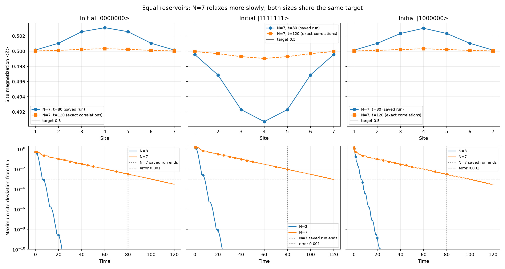

# Analysis of the exact N=3 and N=7 runs

Both runs use J=1, delta=0, Gamma=2, p=0.25 and exchange prefactor 0.25. The stationary target is Z=0.5 at every site with zero current.

The saved N=3 run ends at t=20; the saved N=7 run ends at t=80. This report describes that snapshot.

| Preparation | N=3 error at t=20 | N=7 error at t=20 | N=7 error at t=40 | N=7 error at t=80 | N=7 error at t=120 |
|---|---:|---:|---:|---:|---:|
| All zeros | 2.58e-09 | 0.10057 | 0.03199 | 0.003093 | 0.000320 |
| All ones | 7.74e-09 | 0.30170 | 0.09597 | 0.009279 | 0.000959 |
| Leftmost spin excited | 1.36e-09 | 0.09954 | 0.02837 | 0.003016 | 0.000314 |

Errors above are the maximum absolute deviation of any site's Z from 0.5. Values beyond the saved run come from the exact XX correlation equations, which reproduce the saved populations and currents within 1e-15.

N=3 has equilibrated by t=20. N=7 relaxes more slowly because dissipation acts only at the boundaries and the interior couples to them through Hamiltonian transport. The nonuniform finite-time profile continues approaching the uniform target.

The slowest correlation decay time is 1.000 for N=3 and 17.237 for N=7. This concerns the correlation sector; a full Liouvillian gap was not computed.

Uniform initial preparations retain reflection symmetry. The all-zero preparation has currents flowing inward as reservoirs inject excitations, while the all-one preparation has currents flowing outward as reservoirs remove them. For this XX model at p=1/4, their local Z deviations are exactly related by Z_all-one - 0.5 = -3 (Z_all-zero - 0.5), following from linear correlation evolution.

At the last saved time t=80:

| N=7 preparation | Largest site error | Largest absolute current | Trace distance from product target |
|---|---:|---:|---:|
| `0000000` | 0.00309283 | 0.000143033 | 0.00398613 |
| `1111111` | 0.0092785 | 0.0004291 | 0.011874 |
| `1000000` | 0.00301558 | 0.000163098 | 0.00376084 |

Trace, Hermiticity and continuity errors are at floating-point scale. The tiny negative N=7 density-matrix eigenvalue is roundoff. The error-versus-exact values of zero in the original diagnostics are self-comparisons; agreement with the separately solved correlation equations provides an additional check.

The original observation grids are sparse, so straight segments in their plots are interpolation rather than the actual transient waveform. The comparison below uses dense exact correlation curves and marks the saved observations.



The extension solves C(t)=p I+exp(t A)(C(0)-p I)exp(t A)^dagger, with A=-i h-G/2, hopping h_j,j+1=2*c*J and boundary rates G=Gamma. It computes populations and currents rather than full density matrices. At t=120, all three preparations have every site within 0.001 of Z=0.5.

For full density matrices with a denser grid through t=120:

```bash
.venv/bin/python Model2/Experiment1/exact.py --n-qubits 7 --t-final 120 --num-times 241 --output-dir Model2/Experiment1/results/N7_long_time
```

The exact solver does not use max_dt; that parameter affects dilation only.

Regenerate this report, diagnostics and comparison plot from the saved runs:

```bash
.venv/bin/python Model2/Experiment1/analysis/analyze_exact.py
```
