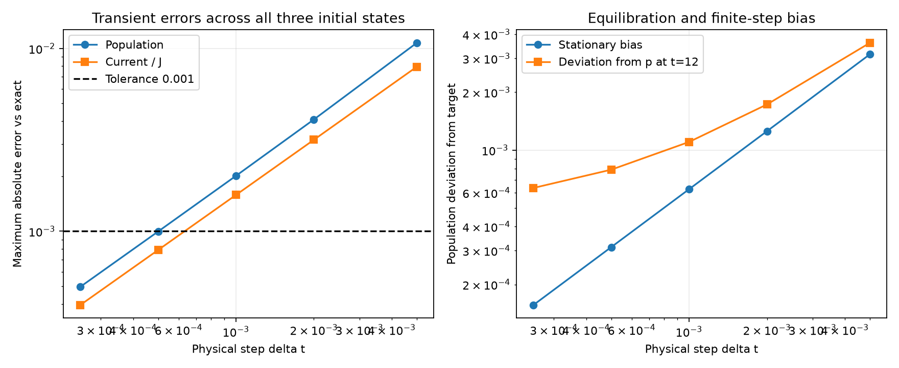

# Lie dilation step selection

Parameters: N=7, J=10, Gamma=20, p=0.25, delta=0, exchange prefactor=0.25, final time=12.

The error criterion is maximum absolute population error <=0.001 and maximum absolute error in I/J <=0.001, over all sites/bonds, the three initial states, and the tested observation grid. A factor-of-two margin in population error is used for the recommendation when a tested step achieves it.

The tested grid resolves t=0 through t=1 every 0.01 and includes every saved exact observation time thereafter. This is a sampled error assessment, not a rigorous uniform-in-time or arbitrary-initial-state bound.

When present, early_transient_check.json additionally samples every actual Lie step through t=0.1. The population and Z errors below include that finer check.

| Maximum step | Number of steps | Max population error | Max Z error | Max current error | Max current error / J | Stationary population bias |
|---|---:|---:|---:|---:|---:|---:|
| 0.005 | 2400 | 0.0107315 | 0.0214629 | 0.0794051 | 0.00794051 | 0.00314856 |
| 0.002 | 6000 | 0.00408642 | 0.00817285 | 0.0316412 | 0.00316412 | 0.00125376 |
| 0.001 | 12000 | 0.0020099 | 0.0040198 | 0.0158018 | 0.00158018 | 0.000625938 |
| 0.0005 | 24000 | 0.000996757 | 0.00199351 | 0.00789632 | 0.000789632 | 0.000312734 |
| 0.00025 | 48000 | 0.00049634 | 0.00099268 | 0.00394703 | 0.000394703 | 0.000156309 |

Recommended tested step: **delta t=0.00025**. This uses 48000 ancilla trace/reset steps through the final time.

```bash
.venv/bin/python Model2/Experiment1/lie_trotter.py \
  --n-qubits 7 --J 10 --gamma 20 \
  --p 0.25 --delta 0 --exchange-prefactor 0.25 \
  --t-final 12 --num-times 121 --max-dt 0.00025 \
  --output-dir Model2/Experiment1/results/N7_lie_step_selected
```

At the final time, the largest population deviation from the reservoir target is 0.000635031. Deviation from the target includes both finite-time relaxation and numerical channel error.

The shared-ancilla Lie formula contains both finite-step dilation error and unitary ordering error; all quoted transient errors compare the complete channel against exact Lindblad evolution, not merely against the unsplit dilation.

For constant steps, define q_plus=sin^2(sqrt(Gamma*p*dt)) and q_minus=sin^2(sqrt(Gamma*(1-p)*dt)). The uniform product state with population p_eff=q_plus/(q_plus+q_minus) is exactly stationary for this Lie channel. It differs from the physical target p. Checking the plateau alone can underestimate the larger transient error.

Scaling J and Gamma by a common factor s requires dividing dt by s to preserve the same dimensionless dilation step and accuracy. Thus dt=0.00025 for J=10, Gamma=20 corresponds to dt=0.0025 for J=1, Gamma=2. The number of steps needed for corresponding final times is unchanged.

The sweep propagates excitation-number blocks and applies the analytical bit-flip Kraus actions of the same Lie channel. One-step and two-step comparisons with the original enlarged-Hamiltonian implementation pass at floating-point precision. The exact XX correlation reference is also checked against the saved full density-matrix run. This optimization applies to the number-block-diagonal states used in this benchmark.



Reproduce the sweep:

```bash
.venv/bin/python Model2/Experiment1/analysis/lie_step_sweep.py
```
