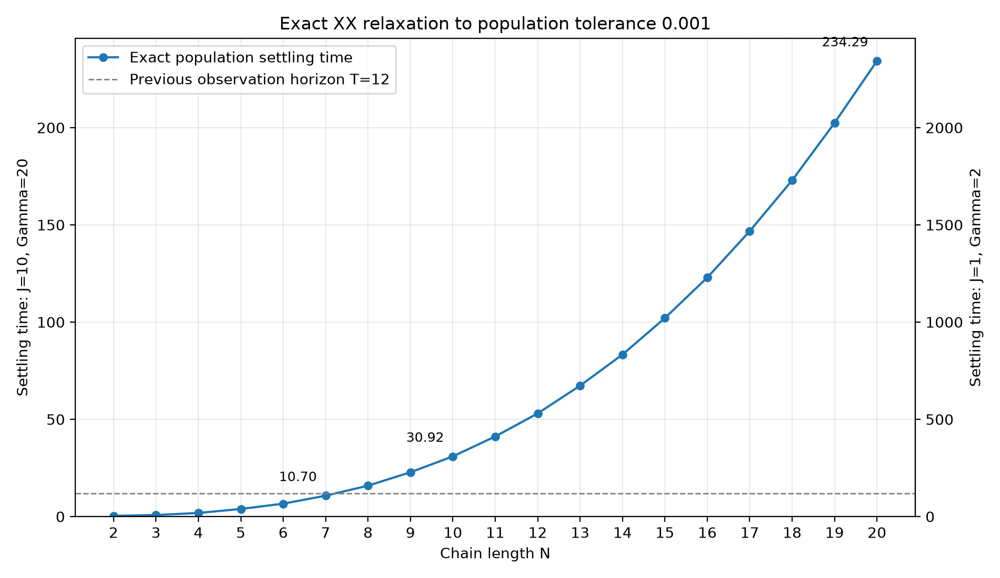
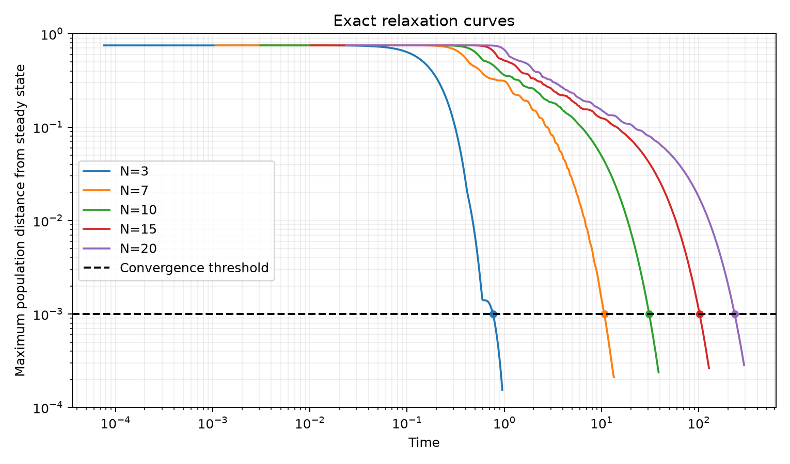

# Exact steady-state population convergence versus N

Parameters: J=10, Gamma=20, p=0.25, Delta=0, H=(J/4) sum(XX+YY).

Convergence means every site is within the population tolerance, for all three benchmark preparations, and remains within it at all later times:

$$t_{\rm ss}(N)=\inf\{t\ge0:\max_{s,j}|\langle n_j(u)\rangle_s-p|\le\varepsilon\ \text{for all }u\ge t\},\qquad\varepsilon=10^{-3}.$$

This is a population convergence criterion. The full density-matrix distance and excitation current are not part of its threshold.



| N | Settling time | Time with J and Gamma both divided by 10 |
|---:|---:|---:|
| 2 | 0.331004 | 3.310037 |
| 3 | 0.763482 | 7.634822 |
| 4 | 1.832926 | 18.329256 |
| 5 | 3.876373 | 38.763726 |
| 6 | 6.608987 | 66.089870 |
| 7 | 10.703272 | 107.032717 |
| 8 | 15.864912 | 158.649120 |
| 9 | 22.763050 | 227.630501 |
| 10 | 30.921046 | 309.210460 |
| 11 | 41.171091 | 411.710909 |
| 12 | 53.011112 | 530.111120 |
| 13 | 67.305367 | 673.053674 |
| 14 | 83.302340 | 833.023398 |
| 15 | 102.072146 | 1020.721464 |
| 16 | 122.907629 | 1229.076287 |
| 17 | 146.780065 | 1467.800645 |
| 18 | 172.894067 | 1728.940668 |
| 19 | 202.429858 | 2024.298577 |
| 20 | 234.288781 | 2342.887812 |

A log-log fit over N=6–20 gives t_ss approximately 0.034164 N^2.9534. This describes the computed range and is not a universal scaling law.

## Exact reduction and permanent convergence

For the XX model, $C_{ij}=\langle c_j^\dagger c_i\rangle$ obeys

$$C(t)=pI+E(t)[C(0)-pI]E(t)^\dagger,\quad E(t)=e^{tA},\quad A=-ih-\frac\Gamma2(\Pi_1+\Pi_N),\quad h_{j,j+1}=J/2.$$

The three initial covariance matrices are 0, I, and diag(1,0,...,0). At p=1/4, the all-ones preparation gives the largest population deviation for every time. Consequently the exact worst-case deviation is

$$d_N(t)=\frac34\max_j\sum_k|E_{jk}(t)|^2.$$

Since $A+A^\dagger=-\Gamma(\Pi_1+\Pi_N)\le0$, $E(s)$ is a contraction. The relation $E(t+s)=E(t)E(s)$ makes each row norm nonincreasing. Thus d_N(t) is nonincreasing: the root is permanent convergence, without a later recrossing. Bisection brackets each threshold crossing to 1e-9 in time; the reported value is the upper endpoint.

Only an N-by-N matrix exponential is required. These populations are exact continuous Lindblad observables up to floating-point numerical error. There is no Trotter step or dilation approximation and no reconstruction of the exponentially large density matrix. The reduction requires Delta=0.

Dividing both J and Gamma by 10 divides the entire generator by 10. Every settling time is therefore exactly multiplied by 10. The right plot axis and CSV provide that second rate convention.



A population tolerance of 1e-3 corresponds to a Z-magnetization tolerance of 2e-3. A Z tolerance of 1e-3 would require population tolerance 5e-4.

Reproduce:

```bash
MPLCONFIGDIR=/tmp/model2_mpl OPENBLAS_NUM_THREADS=1 OMP_NUM_THREADS=1 \
  .venv/bin/python Model2/Experiment1/analysis/steady_state_scaling.py
```
