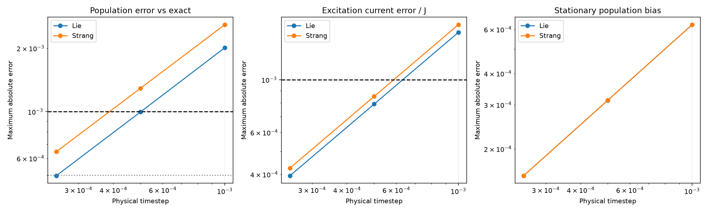

# Lie and Strang dilation: seven-qubit timestep comparison

N=7, J=10, Gamma=20, p=0.25, delta=0, exchange prefactor=0.25, final time=12.

Both methods use the existing first-order Ding–Li–Lin shared-ancilla dilation. Each jump factor is a unitary coupling to its label in the same ancilla. The ancilla is traced/reset only after the complete step. Strang uses half jump rotations, the full Hamiltonian factor, and reversed half jump rotations.

The criterion is maximum population error <=0.001 and maximum excitation-current error divided by J <=0.001, across all sites/bonds and all three initial states. For the recommended step, require population error <=0.0005 as a margin.

The common observation grid samples every 0.01 through t=1 and the saved exact times thereafter. Every actual step through t=0.1 is additionally checked for both populations and currents. These are sampled observable errors, not a uniform-in-time, arbitrary-state, or full-density-matrix error bound.

| Method | Maximum step | Reset steps | Max population error | Max current error / J | Stationary population bias | Propagation time (s) |
|---|---:|---:|---:|---:|---:|---:|
| strang | 0.001 | 12000 | 0.00258662 | 0.00170279 | 0.000626523 | 23.16 |
| strang | 0.0005 | 24000 | 0.00129135 | 0.000850641 | 0.000312881 | 35.03 |
| strang | 0.00025 | 48000 | 0.000645172 | 0.000425123 | 0.000156345 | 29.80 |
| lie | 0.001 | 12000 | 0.0020099 | 0.0015805 | 0.000625938 | 32.60 |
| lie | 0.0005 | 24000 | 0.000996757 | 0.00078979 | 0.000312734 | 31.53 |
| lie | 0.00025 | 48000 | 0.00049634 | 0.000394779 | 0.000156309 | 25.73 |

Tested step selections:

| Method | Largest passing tested step | Tested step with population margin |
|---|---:|---:|
| lie | 0.0005 | 0.00025 |
| strang | 0.00025 | None |

For this benchmark, Lie has smaller maximum transient population error at every common tested step. Strang does not justify increasing the timestep. Keep the tested Lie step 0.00025 for the population margin.


The stationary biases come from a trace-constrained fixed-point solve of each constant-step channel, rather than treating t=12 as infinite time. Full stationary and final populations/currents, fixed-point residuals, trace, Hermiticity, minimum eigenvalues, and validation checks are saved in comparison.json.

Runtimes use the same number-sector channel-power evaluation for both methods with one BLAS thread. They exclude channel preparation, exact-reference evaluation, stationary solves, early direct-iteration checks and reporting. They are classical timings, not measured compiled circuit costs. Lie has five unitary factors per reset; Strang has nine. The ancilla resets prevent simply merging jump half-factors across neighboring steps.

The exact XX covariance reference agrees with the saved full Liouvillian run. The optimized Kraus factors are checked against the original enlarged-unitary implementation, and block propagation is checked against full-density Kraus propagation after two steps. This is a full density-matrix channel simulation within invariant number blocks, not an approximate covariance evolution.

Sparse channel entries below 1e-18 are omitted. The measured omitted vector 1-norm gives an accumulated trace-norm truncation bound saved for every run; the runner requires that bound to remain below 1e-8. It concerns this sparsification only, not all floating-point roundoff or the physical dilation error.

The default Krylov propagation evaluates integer powers of the same discrete channel. Its Arnoldi residual is checked at every integer step to obtain an a posteriori trace-norm bound below 1e-9 in exact arithmetic, with the tiny sparse-map norm excess included. Each early step through t=0.1 is also compared against direct sparse-channel iteration to check numerical roundoff. These calculations accelerate the classical simulator; the displayed reset counts still describe the original dilation algorithm. Use --propagation steps to perform literal repeated channel applications.



Reproduce:

```bash
OPENBLAS_NUM_THREADS=1 OMP_NUM_THREADS=1 .venv/bin/python \
  Model2/Experiment1/analysis/dilation_step_comparison.py
```

Observed population-error order from the two finest lie steps: 1.0059.

Observed population-error order from the two finest strang steps: 1.0011.
