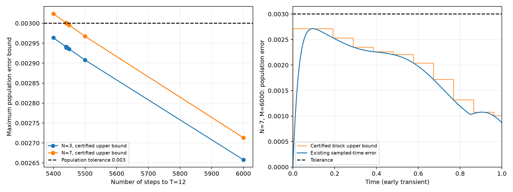

# Certified step count for Model 2 Experiment 2

**5,441 steps are sufficient** for the mean rate-weighted, jump-first Ding–Li–Lin dilation at population tolerance 0.003. This covers N=3 and N=7, all sites, all three benchmark initial preparations, and every algorithm step through T=12. At N=7, 5,440 steps have a certified violating observation.

Parameters: J=10, Gamma=20, p=1/4, Delta=0, H=(J/4) sum(XX+YY). For a setting with more margin, use **5,500 steps** and dt=12/5500. The previously selected **6,000 steps / dt=0.002 are certified** too.

| N | Steps M | dt=12/M | Population error upper bound | Current error / abs(J) upper bound |
|---:|---:|---:|---:|---:|
| 3 | 6,000 | 0.002 | 0.002658030696 | 0.001966431310 |
| 7 | 6,000 | 0.002 | 0.002713196000 | 0.002121163582 |
| 3 | 5,500 | 0.00218181818182 | 0.002907858880 | 0.002143947071 |
| 7 | 5,500 | 0.00218181818182 | 0.002967309880 | 0.002312451389 |
| 3 | 5,441 | 0.00220547693439 | 0.002938691900 | 0.002162009220 |
| 7 | 5,441 | 0.00220547693439 | 0.002999956571 | 0.002334751744 |

The smallest certified count in these checks is about 9.3% below the 6,000-step simulation choice. These are sufficient bounds on ensemble bias, not guarantees for an individual random sequence, finite-shot accuracy, hardware noise, arbitrary preparations, or arbitrary physical times between steps.

## How close is the mathematical bound?

At N=7 and 6,000 steps, the existing sampled-time simulation found maximum population error 0.002713145970. The mathematical certificate bounds every step by 0.002713196000, a difference of about 5.0e-8. The certificate is computed independently of that saved error.

| N=7 step count | Population upper bound | Certified lower witness | Decision |
|---:|---:|---:|---|
| 5,400 | 0.003023954201 | 0.003023155050 | Violation |
| 5,440 | 0.003001041963 | 0.003000485621 | Violation |
| 5,441 | 0.002999956571 | 0.002999917753 | Pass |
| 5,442 | 0.002999903962 | 0.002999350101 | Pass |
| 5,443 | 0.002999335216 | 0.002998782595 | Pass |
| 5,450 | 0.002995360549 | 0.002994814789 | Pass |
| 5,500 | 0.002967309880 | 0.002966772292 | Pass |
| 6,000 | 0.002713196000 | 0.002713145962 | Pass |

At 5,440 steps the all-ones preparation, site 1, at step 43 has population error at least 0.003000485621. At 5,441, every tested preparation/site and every integer step is enclosed below 0.003. This checks an adjacent threshold; no global monotonicity or optimality claim over all smaller counts is made.



## What makes this a bound?

The exact covariance maps P (implemented mean dilation) and Q (continuous Lindblad reference over one step) are enclosed with bounded Taylor arithmetic. On each block, the exact binomial expansions of P^k and Q^k give an error polynomial. Its Bernstein coefficients enclose every step in that block, and a positive tail bounds omitted terms. Arithmetic uncertainty is included. It retains the signed contributions that simple norm bounds discard.

This is a model-specific **computer-assisted mathematical certificate**, conditional on the stated IEEE binary64 arithmetic model. It uses validated matrix propagation at block boundaries, so it is not a universal a-priori closed-form inequality for M. It is also not an empirical fit to simulation error or another Monte Carlo run.

The 6,000 and 5,500 certificates use blocks of up to 48 steps, expansion degree 24, and Bernstein degree 128. The tighter 5,441 certificate uses blocks of up to 16 steps, expansion degree 16 (the full binomial polynomial on each block), and Bernstein degree 512. Its binomial tail is zero; only a negligible arithmetic padding remains. For N=7 the final propagation radius is below 2.01e-10.

[Complete derivation and arithmetic assumptions](Proof.md)

## Reproduce

```bash
OPENBLAS_NUM_THREADS=1 OMP_NUM_THREADS=1 \
  .venv/bin/python Model2/Experiment2/analysis/population_bound.py \
  --n-qubits 3 7 --steps 6000 5500 5440

OPENBLAS_NUM_THREADS=1 OMP_NUM_THREADS=1 \
  .venv/bin/python Model2/Experiment2/analysis/population_bound.py \
  --n-qubits 3 7 --steps 5441 --block-steps 16 --degree 16 --bernstein-degree 512

MPLCONFIGDIR=/tmp/model2_mpl OPENBLAS_NUM_THREADS=1 \
  .venv/bin/python Model2/Experiment2/analysis/make_bound_report.py
```

Five certification tests passed. They include comparisons against the original complex-channel evaluator and exact XX reference at every one of the 6,001 algorithm times, plus an independently checked violating witness.
