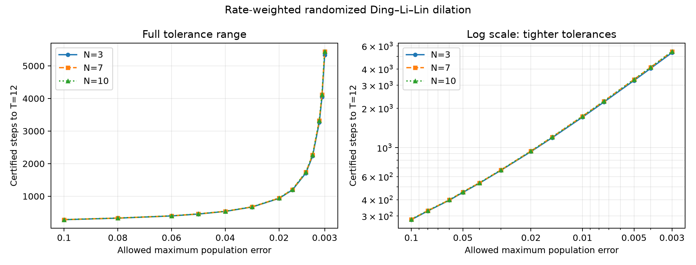
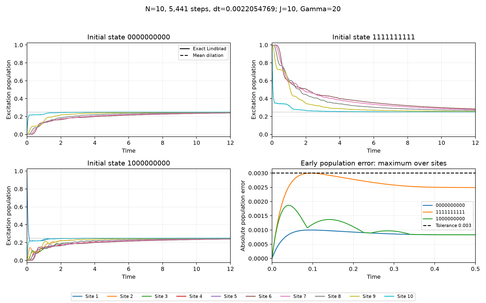

# Population-error tolerance versus certified steps

Fixed parameters: J=10, Gamma=20, p=1/4, Delta=0, T=12; H=(J/4) sum(XX+YY). Rate-weighted, jump-first randomized Ding–Li–Lin dilation.

Each selected M has a certified upper bound below its requested tolerance. At M-1 a certified observation exceeds that tolerance. These are adjacent thresholds found by search; global monotonicity and optimality over all smaller counts are not proved.

| Population tolerance | N=3 steps | N=3 dt | N=7 steps | N=7 dt | N=10 steps | N=10 dt |
|---:|---:|---:|---:|---:|---:|---:|
| 0.1 | 281 | 0.042704626 | 283 | 0.042402827 | 283 | 0.042402827 |
| 0.08 | 328 | 0.036585366 | 330 | 0.036363636 | 330 | 0.036363636 |
| 0.06 | 396 | 0.03030303 | 398 | 0.030150754 | 398 | 0.030150754 |
| 0.05 | 454 | 0.026431718 | 458 | 0.026200873 | 458 | 0.026200873 |
| 0.04 | 535 | 0.022429907 | 538 | 0.022304833 | 538 | 0.022304833 |
| 0.03 | 670 | 0.017910448 | 674 | 0.017804154 | 674 | 0.017804154 |
| 0.02 | 933 | 0.012861736 | 942 | 0.012738854 | 942 | 0.012738854 |
| 0.015 | 1,194 | 0.010050251 | 1,208 | 0.0099337748 | 1,208 | 0.0099337748 |
| 0.01 | 1,712 | 0.0070093458 | 1,739 | 0.0069005175 | 1,739 | 0.0069005175 |
| 0.0075 | 2,231 | 0.0053787539 | 2,268 | 0.0052910053 | 2,268 | 0.0052910053 |
| 0.005 | 3,265 | 0.0036753446 | 3,326 | 0.0036079375 | 3,326 | 0.0036079375 |
| 0.004 | 4,041 | 0.002969562 | 4,119 | 0.0029133285 | 4,119 | 0.0029133285 |
| 0.003 | 5,333 | 0.0022501406 | 5,441 | 0.0022054769 | 5,441 | 0.0022054769 |



Smaller population-error budgets require more steps. For the selected settings, logical cost per sequence is 2M unitary factors and M ancilla resets, using one ancillary qubit. This excludes transpilation and measurement shots.

The bound covers the ensemble-mean population bias for all sites, all three benchmark preparations, and every algorithm step through T=12. It does not bound individual sequence fluctuations or finite-shot errors.

The certificates use the same validated maps and contraction propagation as [the derivation](../Proof.md). Here one-step blocks use the complete degree-one binomial polynomial. Its endpoints are the actual algorithm steps, so the Bernstein enclosure introduces no time-interpolation excess. Arithmetic radii and matrix Taylor remainders remain included under the stated IEEE assumptions.

The cosine remainder now allows larger positive angles: only the omitted alternating terms must decrease. The physical reservoir channel has not changed.

CSV contains the upper bound and the preceding count's lower witness. Full selected/preceding certificates are saved in `certificates/`.

## Independent N=10 simulation

Every numerical check evaluates the ensemble-mean populations and excitation currents at all algorithm steps against the exact continuous XX covariance solution. A direct complex-channel iteration independently checks the largest-error step and final endpoint. No shot noise or finite random-seed sampling is included. The covariance closure is exact for these observables; it does not reconstruct the complete density matrix.



At tolerance 0.003, M=5,441 gives measured maximum population error 0.0029999177856. M-1 gives 0.00300048563025. The peak is at {'initial_state': '1111111111', 'site': 1, 'step': 43, 'time': 0.09483550817864364}. All 13 selected counts coincide with N=7.

At T=12 the exact N=10 population differs from the steady value 0.25 by up to 0.03390543. Thus the time-step accuracy criterion does not imply equilibration at this time. For comparison, N=7 differs by at most 0.00047949563 at the same time.

N=10 certificates are saved here; N=3/N=7 certificates remain in [the previous sweep](../tolerance_sweep/Results.md). [Measured N=10 errors](simulation.csv) and per-count population/current trajectories in `trajectories/` are saved separately.

Reproduce from the repository root:

```bash
MPLCONFIGDIR=/tmp/model2_mpl OPENBLAS_NUM_THREADS=1 OMP_NUM_THREADS=1 \
  .venv/bin/python Model2/Experiment2/analysis/simulate_n10.py --workers 2
```
