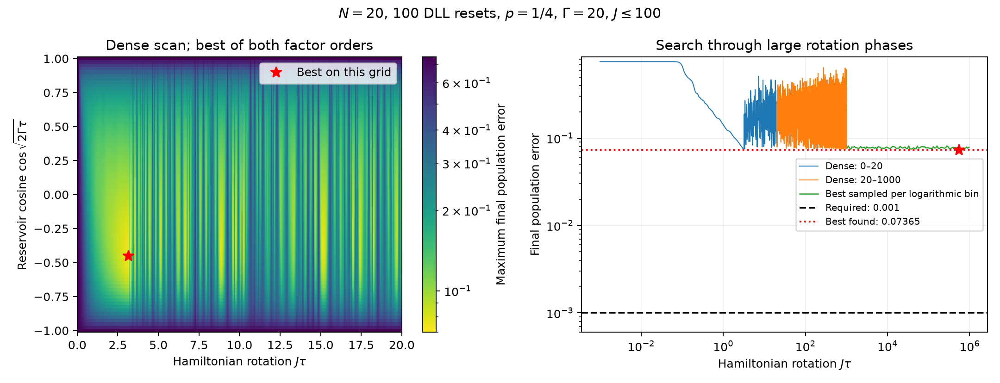

# Broader N=20, 100-reset final-population search

Fixed Gamma=20, J<=100, p=1/4, Delta=0. Rate-weighted independently randomized single-jump Ding–Li–Lin dilation; exact Hamiltonian factor. Both factor orders are searched. The criterion is the maximum final population deviation from 1/4 across all sites and the three benchmark preparations. These are ensemble means, not finite-shot guarantees.

Dense/scattered scan candidates: 826,025. Local refinements: 360. Independent differential-evolution runs: 24.

Total evaluations including refinements and validation: 995,103. Elapsed: 549.9 seconds.

Best found final error: 0.0736542096162. Required: 0.001. Pass: False.

J*tau=542235.393628, cosine=-0.43782988796, order=jump-first.

Physical realization: J=99.4607806575, Gamma=20, tau=5451.75083127, T=545175.083127. Repeated reservoir cycles are allowed to honor J<=100.

Existing channel implementation agreement: 1.11e-10.

| Scan | Evaluations | Best grid/sample error |
|---|---:|---:|
| dense_0_20 | 162,081 | 0.0740408675 |
| dense_20_1000 | 401,800 | 0.0745666994 |
| sobol_log_1000_1e6 | 131,072 | 0.0743913132 |
| sobol_linear_1000_1e6 | 131,072 | 0.0746636791 |

The finite numerical search does not prove a global minimum. Tau has no specified upper bound, so a literal exhaustive search is not possible. The saved arrays include both factor orders and the full cosine range [-1,1], with Hamiltonian phase J*tau searched densely through 1000 and by independent space-filling samples through 1e6. The conversion to physical parameters chooses the shortest reservoir angle cycle satisfying J<=100. No exact-reservoir channel was substituted.

