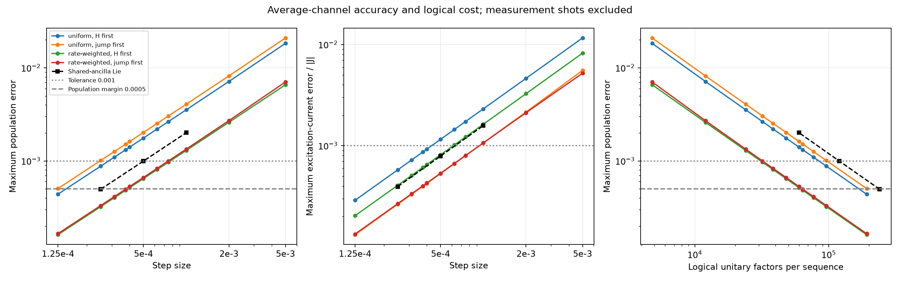
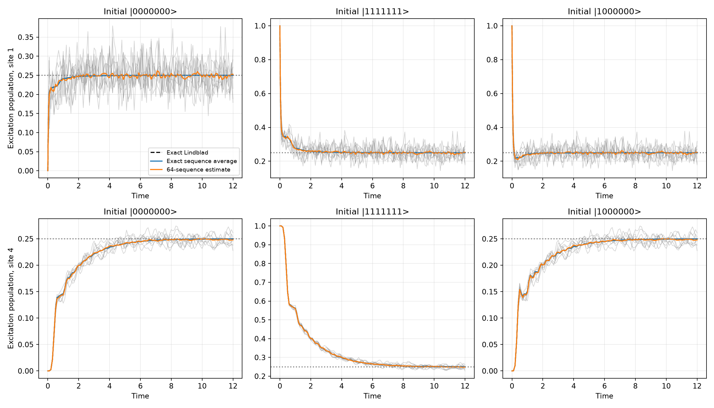

# Randomized single-jump Ding–Li–Lin dilation

N=7, J=10, Gamma=20, p=0.25, Delta=0, exchange prefactor=0.25, T=12. This is a numerical-method experiment on the same equal-reservoir problem as Experiment 1.

The implementation follows the randomized Lindbladian framework and single-ancilla first-order implementation in Appendix B of [Chen, Li, Lu and Ying](https://arxiv.org/html/2407.06594v5). Its general convergence results distinguish the mean channel from one sampled realization. We benchmark observables here; we do not certify diamond-norm accuracy or apply the paper's Gibbs-sampler guarantees.

## Construction

Write $\mathcal L=-i[H,\cdot]+\sum_{a=1}^4\mathcal D[V_a]$. Draw $a$ independently with probability $\mu_a$ and use $\mathcal L_a=-i[H,\cdot]+\mathcal D[V_a/\sqrt{\mu_a}]$. Then $\sum_a\mu_a\mathcal L_a=\mathcal L$; the Hamiltonian is applied once per step, with its original strength.

The sampled interaction is $W_a=\exp[-i\sqrt{\tau}(|1\rangle\langle0|\otimes V_a/\sqrt{\mu_a}+|0\rangle\langle1|\otimes V_a^\dagger/\sqrt{\mu_a})]$. Prepare the ancilla in zero, apply this interaction and the separate $U_H=\exp(-i\tau H)$ factor, trace/reset the ancilla. Both factor orders are tested. No exact boundary-reservoir exponential is used.

Uniform sampling uses mu=(1/4,1/4,1/4,1/4). Rate-weighted sampling uses mu=(p/2,(1-p)/2,p/2,(1-p)/2), in left-pump, left-loss, right-pump, right-loss order.

For jump rate $r_a$, the boundary rotation angle is $\theta_a=\sqrt{r_a\tau/\mu_a}$, and its transition probability is $\sin^2\theta_a$, not $1-e^{-r_a\tau/\mu_a}$. Rate weighting equalizes all four angles. In the mean channel, this makes the pumping/loss transition ratio exactly p/(1-p), so the product target is fixed for either factor order. Individual sequences do not fix that target. Uniform sampling instead selects $p_{\rm eff}=\mu_+\sin^2\theta_+/(\mu_+\sin^2\theta_++\mu_-\sin^2\theta_-)$.

## Measured accuracy

Maximum errors below cover all three initial preparations, all sites/bonds, every step through t=1, and observations approximately 0.1 apart afterwards. Late observations are rounded to actual step boundaries; no fractional steps are inserted. These are sampled-time errors, not uniform-time bounds. The previous Lie baseline checks every step through t=0.1 and a dense observation grid afterwards; its known maximum is in that early window.

| Sampling | Order | Step | Population error | Current error / abs(J) | Steps | Logical factors |
|---|---|---:|---:|---:|---:|---:|
| rate-weighted | hamiltonian-first | 0.005 | 0.00658463 | 0.00822482 | 2400 | 4800 |
| rate-weighted | hamiltonian-first | 0.002 | 0.002601 | 0.00326718 | 6000 | 12000 |
| rate-weighted | hamiltonian-first | 0.001 | 0.00129509 | 0.00162972 | 12000 | 24000 |
| rate-weighted | hamiltonian-first | 0.00075 | 0.000970316 | 0.00122156 | 16000 | 32000 |
| rate-weighted | hamiltonian-first | 0.000625 | 0.000808181 | 0.00101765 | 19200 | 38400 |
| rate-weighted | hamiltonian-first | 0.0005 | 0.00064621 | 0.000813881 | 24000 | 48000 |
| rate-weighted | hamiltonian-first | 0.0004 | 0.000516755 | 0.000650947 | 30000 | 60000 |
| rate-weighted | hamiltonian-first | 0.000375 | 0.000484408 | 0.000610226 | 32000 | 64000 |
| rate-weighted | hamiltonian-first | 0.0003125 | 0.000403569 | 0.000508445 | 38400 | 76800 |
| rate-weighted | hamiltonian-first | 0.00025 | 0.000322772 | 0.000406695 | 48000 | 96000 |
| rate-weighted | hamiltonian-first | 0.000125 | 0.000161303 | 0.000203286 | 96000 | 192000 |
| rate-weighted | jump-first | 0.005 | 0.00705783 | 0.00520455 | 2400 | 4800 |
| rate-weighted | jump-first | 0.002 | 0.00271315 | 0.00211966 | 6000 | 12000 |
| rate-weighted | jump-first | 0.001 | 0.00133919 | 0.00106592 | 12000 | 24000 |
| rate-weighted | jump-first | 0.00075 | 0.00100119 | 0.000800581 | 16000 | 32000 |
| rate-weighted | jump-first | 0.000625 | 0.000833002 | 0.000667623 | 19200 | 38400 |
| rate-weighted | jump-first | 0.0005 | 0.000665344 | 0.000534473 | 24000 | 48000 |
| rate-weighted | jump-first | 0.0004 | 0.0005316 | 0.000427817 | 30000 | 60000 |
| rate-weighted | jump-first | 0.000375 | 0.000498218 | 0.000401135 | 32000 | 64000 |
| rate-weighted | jump-first | 0.0003125 | 0.000414853 | 0.000334396 | 38400 | 76800 |
| rate-weighted | jump-first | 0.00025 | 0.00033162 | 0.00026761 | 48000 | 96000 |
| rate-weighted | jump-first | 0.000125 | 0.000165548 | 0.000133898 | 96000 | 192000 |
| uniform | hamiltonian-first | 0.005 | 0.0183326 | 0.0116261 | 2400 | 4800 |
| uniform | hamiltonian-first | 0.002 | 0.00714519 | 0.00463418 | 6000 | 12000 |
| uniform | hamiltonian-first | 0.001 | 0.00354089 | 0.0023142 | 12000 | 24000 |
| uniform | hamiltonian-first | 0.00075 | 0.00264979 | 0.00173511 | 16000 | 32000 |
| uniform | hamiltonian-first | 0.000625 | 0.00220569 | 0.0014457 | 19200 | 38400 |
| uniform | hamiltonian-first | 0.0005 | 0.00176258 | 0.00115638 | 24000 | 48000 |
| uniform | hamiltonian-first | 0.0004 | 0.0014088 | 0.000924985 | 30000 | 60000 |
| uniform | hamiltonian-first | 0.000375 | 0.00132045 | 0.000867145 | 32000 | 64000 |
| uniform | hamiltonian-first | 0.0003125 | 0.00109976 | 0.000722563 | 38400 | 76800 |
| uniform | hamiltonian-first | 0.00025 | 0.000879315 | 0.000578005 | 48000 | 96000 |
| uniform | hamiltonian-first | 0.000125 | 0.000439165 | 0.000288956 | 96000 | 192000 |
| uniform | jump-first | 0.005 | 0.0209653 | 0.00555649 | 2400 | 4800 |
| uniform | jump-first | 0.002 | 0.0081971 | 0.00215296 | 6000 | 12000 |
| uniform | jump-first | 0.001 | 0.00406732 | 0.00106531 | 12000 | 24000 |
| uniform | jump-first | 0.00075 | 0.00304467 | 0.000796912 | 16000 | 32000 |
| uniform | jump-first | 0.000625 | 0.0025348 | 0.000663236 | 19200 | 38400 |
| uniform | jump-first | 0.0005 | 0.0020259 | 0.000529903 | 24000 | 48000 |
| uniform | jump-first | 0.0004 | 0.00161948 | 0.000423485 | 30000 | 60000 |
| uniform | jump-first | 0.000375 | 0.00151797 | 0.000396914 | 32000 | 64000 |
| uniform | jump-first | 0.0003125 | 0.00126437 | 0.000330549 | 38400 | 76800 |
| uniform | jump-first | 0.00025 | 0.00101101 | 0.000264269 | 48000 | 96000 |
| uniform | jump-first | 0.000125 | 0.000505024 | 0.000131964 | 96000 | 192000 |

Selection criteria: population error <=0.001 and current error/abs(J) <=0.001. The recommendation additionally requires population error <=0.0005.

```json
{
  "uniform/hamiltonian-first": {
    "largest_passing_tested_step": 0.00025,
    "recommended_tested_step": 0.000125
  },
  "uniform/jump-first": {
    "largest_passing_tested_step": 0.000125,
    "recommended_tested_step": null
  },
  "rate-weighted/hamiltonian-first": {
    "largest_passing_tested_step": 0.0005,
    "recommended_tested_step": 0.000375
  },
  "rate-weighted/jump-first": {
    "largest_passing_tested_step": 0.000625,
    "recommended_tested_step": 0.000375
  }
}
```



## Cost and sequence fluctuations

A sampled step uses one Hamiltonian and one jump-interaction factor, one ancilla qubit, and one reset cycle. The previous shared-ancilla Lie step uses one Hamiltonian and four jump-interaction factors, three binary ancilla qubits encoding five levels, and one reset cycle. Counts are logical factors per sequence, not compiled gate counts, circuit depth, total measurement cost, or a hardware speedup. The full Hamiltonian factor is treated as an exact oracle in both methods.

For rate-weighted jump-first sampling, the largest passing tested step is 0.000625; the largest tested step with the additional population margin is 0.000375.

At that population margin, the old Lie dt=0.00025 uses 48,000 steps and 240,000 logical factors; the randomized dt=0.000375 uses 32,000 steps and 64,000 factors. This is 33.3% fewer reset cycles and 3.75 times fewer logical factors per sequence.

The 64-sequence Monte Carlo mean has maximum population error 0.01286, while the largest measured sequence standard deviation is 0.04806. That finite collection of random sequences does not reach the 0.001 accuracy target, even though the analytically evaluated ensemble does. This is a material distinction for the cost comparison.

Random-sequence diagnostics (conditional channel expectations, no shot noise):

```json
{
  "seed": 20261011,
  "realizations": 64,
  "realized_sampling_probabilities": [
    0.12473095703125,
    0.375703125,
    0.12482958984375,
    0.374736328125
  ],
  "dt": 0.000375,
  "policy": "rate-weighted",
  "order": "jump-first",
  "maximum_population_sequence_standard_deviation": 0.04806166809108464,
  "maximum_population_standard_error": 0.00600770851138558,
  "maximum_normalized_current_sequence_standard_deviation": 0.011917546679173309,
  "maximum_sample_mean_population_error_vs_ensemble": 0.012860990584091153,
  "maximum_sample_mean_population_error_vs_exact": 0.012859713850177895,
  "final_population_standard_deviations": [
    [
      0.03623795361744965,
      0.010223827033520734,
      0.00898564671969357,
      0.008624133155613278,
      0.007145953493769483,
      0.010098338556005995,
      0.03336429064633385
    ],
    [
      0.03623814669242387,
      0.010222534733043923,
      0.008986422907209591,
      0.008624080159026026,
      0.007144995673173061,
      0.010098956119609554,
      0.033364105918971265
    ],
    [
      0.03623795461518275,
      0.010223842143618711,
      0.008985767271687995,
      0.008624160414891892,
      0.007146057431334123,
      0.010098351794894283,
      0.03336429174878002
    ]
  ],
  "pointwise_seed_count_estimate_for_population_standard_error_0p001": 2310
}
```



Reusing one random sequence across many shots measures that sequence's channel. Resample the entire sequence per measurement shot to estimate the average channel directly. For population measurements, the marginal outcome remains Bernoulli with the averaged population, so the observed sequence variance is not automatically an extra multiplier in the fundamental shot cost. Averaging conditional channel expectations over a fixed, small collection of seeds is a different estimator and can have substantial sampling error. Standard errors here are pointwise, not simultaneous confidence bounds over every observation.

## Numerical validation and scope

XX covariance evolution exactly closes for these boundary channels, including non-Gaussian ensemble states. We use powers of its n^2-dimensional affine map to evaluate the exact sequence average to roundoff; this is a classical evaluation shortcut, not an extra quantum implementation. We do not reconstruct full density matrices or certify trace distances. The fast runner requires Delta=0 and equal reservoirs. Full two-level ancilla Kraus construction is also available in randomized.sampled_kraus.

Tests compare all four branches with full density-matrix dilation on a coherent mixed three-spin state, enumerate all 16 two-step sequences, check the complete product target, and compare continuous reference covariances with the full Liouvillian. Eigenchannel powers are checked against 100 direct steps and their decomposition residual. Residual bounds concern exact-arithmetic propagation of the measured residual; they do not rigorously bound all floating-point operations.

## Reproduce

```bash
MPLCONFIGDIR=/tmp/model2_mpl OPENBLAS_NUM_THREADS=1 OMP_NUM_THREADS=1 \
  .venv/bin/python Model2/Experiment2/qdrift.py --n-qubits 7 \
  --J 10 --gamma 20 --p 0.25 --t-final 12 \
  --realizations 64
```
