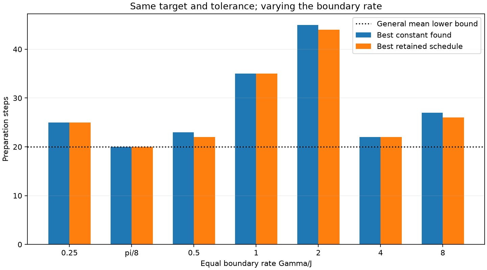
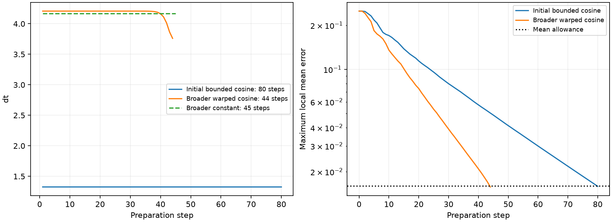

# Broader parameter study: annealing does help in some cases

**At the original Gamma/J=2, the best saved warped cosine uses 44 steps versus 45 for the best constant schedule found.** The earlier 80-step result was restricted to dt<=2. Its separate wider-bound optimizer also missed a better basin: a direct scan already finds 47 constant steps with dt<=4. The historical report is retained with that correction.

All cases retain N=10, the requested half-mixture, p_L=p_R=0.25, Model2's exchange prefactor 1/4, Delta=0, rate-weighted single-jump sampling, jump-first ordering and even/odd Hamiltonian layers. Total tolerance stays 0.02, split as 0.016 mean + 0.004 sampling. Changing Gamma/J changes relaxation while preserving the same stationary target. Changing J and Gamma together merely rescales time when timesteps are rescaled too.

## Isolating the timestep bound

The physical ratio remains Gamma/J=2 in this table. A batched timestep scan followed by local refinement replaces reliance on one joint integer optimizer.

| Maximum dt | Best constant steps found | Constant dt | Mean output error |
|---|---:|---:|---:|
| 2 | 80 | 1.32734679 | 0.0158855166 |
| 4 | 47 | 4 | 0.0152722151 |
| 8 | 45 | 4.16849749 | 0.0152380996 |

The new dt<=4 fixed-count cosine/warped trials did not beat 47. With dt<=8, ordinary cosine at 44 steps reaches approximately 0.0160523, just outside the allowance; the warped cosine passes. The large 80-to-44 reduction combines better bounds/search with annealing. The annealing gain against its matching constant baseline is **one step, or 2.22%**.

## Varying the equal boundary rate

The common endpoint-step range is [0.001,8] at J=1. Constant steps use roughly 400 scanned values including analytically identified collision/swap points, followed by multiple local refinements. Ordinary and warped cosines are fit at fixed counts, avoiding the original discontinuous integer-count objective. Global seeds 2718/3141 and targeted 1729/1730/3141 runs use 24–64 iterations. Warped exponents are explored over [0.03,12] and [0.03,64]. Initial challenges include one step below the constant baseline, about 10% below and about 25% below; targeted runs fill adjacent shorter counts. Every trial's actual count and settings are retained.

| Gamma/J | Best constant count found | Best retained count | Schedule | Forward mean maximum |
|---|---:|---:|---|---:|
| 0.25 | 25 | 25 | constant | 0.012369914 |
| pi/8 | 20 | 20 | constant | 0.015625 |
| 0.5 | 23 | 22 | warped_cosine | 0.0146844147 |
| 1 | 35 | 35 | constant | 0.0156942189 |
| 2 | 45 | 44 | warped_cosine | 0.0157326862 |
| 4 | 22 | 22 | constant | 0.0159345698 |
| 8 | 27 | 26 | warped_cosine | 0.0156251119 |

Only the 20-step construction has a matching general lower-bound argument under this mean criterion; other counts remain numerical-search results. A failed fixed-count optimizer is not an infeasibility proof. The shorter schedules prepare acceptable outputs; no transient Lindblad-accuracy claim is made. Large collision steps retain their signed cosine and are not replaced by exact-reservoir damping.

## Separate sampling validation

The following selected schedules were frozen using means before replay. All three fixed seeds 29,30,31 passed at the displayed R; all smaller attempted ensembles and their failures remain saved.

| Gamma/J | Steps | R per seed | Maximum sampled target error | Maximum sampling distance | Maximum two SE |
|---|---:|---:|---:|---:|---:|
| 0.392699082 | 20 | 131072 | 0.0183372498 | 0.00284957886 | 0.00234864475 |
| 0.5 | 22 | 32768 | 0.0168401345 | 0.00247766688 | 0.00303426517 |
| 2 | 44 | 16384 | 0.0188730234 | 0.00314033718 | 0.00273554227 |

The 20-step candidate uses Gamma/J=pi/8 and dt=pi. It aligns full population swaps with zero bath cosine, giving C_output=0.265625 I and mean error 1/64=0.015625. A determinant argument shows that fewer than 20 steps cannot meet the 0.016 mean allowance in this equal-rate, one-collision channel class with half-mixture input. See [the derivation and scope](StepLowerBound.md). This changes the physical rate; it is not an annealing improvement at Gamma/J=2.

The 44-step schedule's forward mean check covers at least 10 physical-time units at its final dt; unlike the historical 80-step example, the extra permanent matrix-order check does not pass. No permanent extension is inferred for it. The 20-step construction instead passes the permanent spectral-norm bound because its deviation is scalar. Initial mixture bits are analytically averaged. Two-SE checks are descriptive, not simultaneous confidence guarantees. Measurement shots, hardware noise and native compiled depth are excluded. Larger R reduces sampling uncertainty and increases total workload while leaving per-trajectory depth unchanged.

Accelerated normalized-covariance propagation is checked against the original affine channel over chain lengths 2/3/10, both factor orders, rates .25/2/8 and reservoir populations .1/.25/.4. The reported selected means and every forward node were then reconstructed with the separate explicit four-branch verifier. Agreement is within 2e-16 for the three replayed candidates. 32 relevant tests pass (13 experiment tests, five Model2 randomized tests and fourteen shared-reservoir tests).

## Saved validation and reproduction

- Gamma/J=0.5: [results](runs/parameter_validation_4067e085d3c0/Study.md), [independent check](runs/parameter_validation_4067e085d3c0/Verified.md).
- Gamma/J=2: [results](runs/parameter_validation_515961587af3/Study.md), [independent check](runs/parameter_validation_515961587af3/Verified.md).
- Gamma/J=0.392699082: [results](runs/parameter_validation_d0de232cb42f/Study.md), [independent check](runs/parameter_validation_d0de232cb42f/Verified.md).

The compact [summary JSON](parameter_summary.json) and [CSV](parameter_summary.csv) retain source hashes and selected settings. Full local studies are under `runs/parameter_study_*/study.json`. The historical [initial result](Results.md) is preserved. Reproduction commands are in [Experiment4.md](Experiment4.md).
