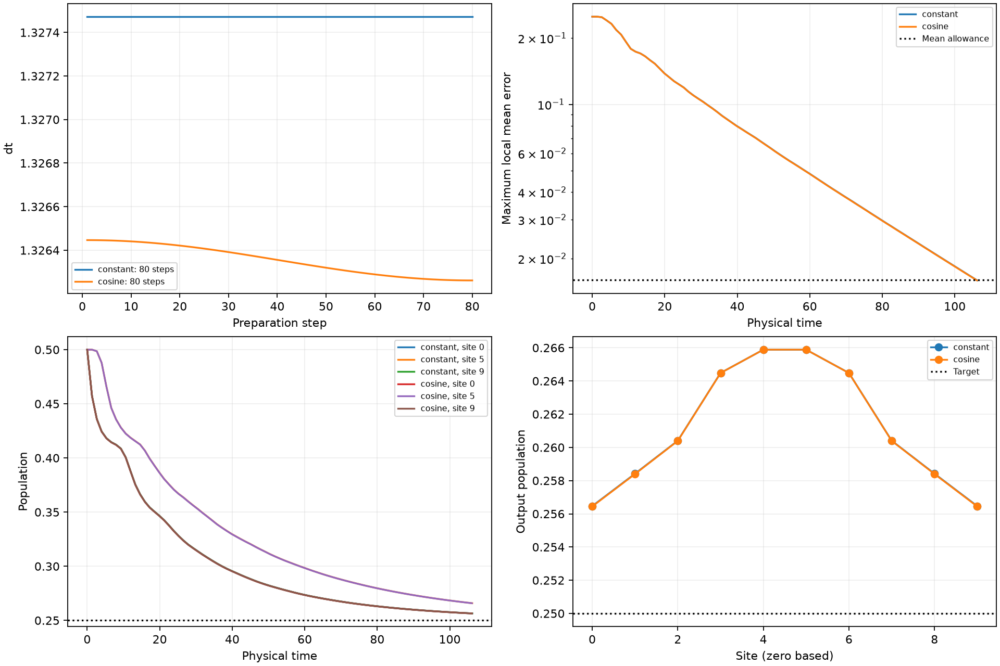
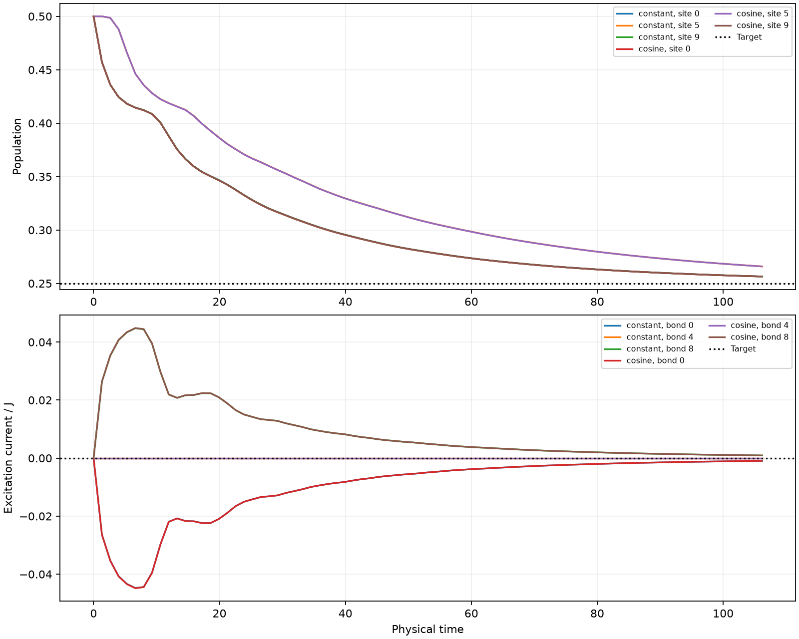

# Executed Model2 cosine-schedule search

**Updated:** the [broader parameter study](ParameterStudy.md) supersedes the
80-step headline below. At the original rate ratio, wider steps give a
44-step warped cosine versus a 45-step constant baseline. The earlier
dt<=4 optimizer also missed a better basin. This page preserves the initial
bounded search and its provenance.

**The smallest passing preparation found in the initial dt<=2 search was 80 steps.** Ordinary cosine and
warped cosine did not reduce the step count below the optimized constant
baseline for this configuration. This is a bounded-search result, not a
proof that every shorter schedule is impossible.

The initial state is the requested half-mixture. Parameters are **N=10,
J=1, gamma=2, p_L=p_R=0.25, Delta=0**, with Model2's exchange prefactor
1/4, rate-weighted single-jump dilation, jump-first ordering and even/odd
Hamiltonian layers. The target populations are all 0.25 and all excitation
currents are zero. All ten populations and nine currents/J enter the metric.
These results use the split Hamiltonian, rather than the exact Hamiltonian
factor used by default in earlier Model2 randomized studies.

The total tolerance remains **0.02 = 0.016 mean + 0.004 sampling**.

| Schedule | Steps | Initial dt | Final dt | Physical output time | Worst forward mean error |
|---|---:|---:|---:|---:|---:|
| Optimized constant | 80 | 1.327472455 | 1.327472455 | 106.1977964 | 0.015885518 |
| Ordinary cosine | 80 | 1.326446413 | 1.326261235 | 106.1083059 | 0.015886281 |
| Warped cosine, retained q=1 incumbent | 80 | 1.326446413 | 1.326261235 | 106.1083059 | 0.015886281 |

The ordinary cosine is

```
dt_k = 1.3262612352712728
     + (1.3264464127373754 - 1.3262612352712728)/2
       * [1 + cos(pi*k/79)],  k=0,...,79.
```

Its endpoints differ by only **0.01396%**. This is effectively a constant
schedule. Unlike unequal-reservoir Model3, this rate-weighted equal-reservoir
channel preserves `pI` at every timestep; annealing has no stationary bias
to remove. That does not preclude faster preparation with annealing: the
subsequent broader search does find a step saving. The initial result is
specific to its bounds and search effort.





## Shorter-count challenges and bounds

The principal search used step counts 1–256, endpoint bounds [0.01,2], warped
powers [0.1,4], maximum physical preparation time 500, and optimizer seeds
1729 and 1730. Ordinary cosine and constant steps used 45 global iterations
per search plus local refinement. Each of the counts 79, 78, 77 and 76 was
explicitly challenged with both seeds.

The initial long comparison stopped after completing constant and ordinary
cosine. Its unfinished warped search is not used as a saved result. The
completed, checkpointed warped follow-up starts from the saved ordinary
cosine, which is exactly the q=1 member of its family. It challenges all
four smaller counts with both seeds, 16 global iterations per trial and
two local starts. All eight trials completed. Their best values agree
with the constant/cosine challenges at the precision below:

| Preparation steps | Best observed forward/output objective | Mean allowance | Outcome |
|---|---:|---:|---|
| 79 | 0.0163960455 | 0.016 | no passing schedule found |
| 78 | 0.0169185482 | 0.016 | no passing schedule found |
| 77 | 0.0174603815 | 0.016 | no passing schedule found |
| 76 | 0.0180172836 | 0.016 | no passing schedule found |

Failing candidates already violate the allowance at the prepared output.
These optimizer failures are not lower-bound proofs. Counts below 76 were
included in joint searches, not individually exhausted. The result also
depends on the fixed mean/sampling allocation: a different allocation of
the same total tolerance could permit fewer preparation steps and require
more trajectories.

A separate wider-bound search, dt up to 4 and optimizer seed 2026, found
80-step ordinary cosine and 81-step warped cosine. It therefore found no
shorter schedule. That search was plan-only; its candidates are not used
as sampling-validated replacements.
The subsequent direct constant scan finds 47 steps already at dt=4:
the earlier wider-bound optimizer missed that region. Its 80-step outcome
was a search failure, not evidence that the larger bound was unhelpful.

## Sampling and independent checks

All three retained schedules pass at **R=16,384**, for seeds 29, 30 and 31.
The warped q=1 incumbent has the identical executable step list to ordinary
cosine; it was nevertheless replayed again in the completed follow-up.

| Schedule | Largest sampled target error | Largest sampled-minus-mean distance | Largest two SE |
|---|---:|---:|---:|
| Constant | 0.0173356785 | 0.0031218310 | 0.0026438561 |
| Ordinary cosine | 0.0173456392 | 0.0031295279 | 0.0026478324 |
| Warped q=1 | 0.0173456392 | 0.0031295279 | 0.0026478324 |

The earlier R=8192 attempt failed the sampling-distance check at seed 31;
all attempts remain in the saved studies. Sampling seeds and schedules
were not reselected to obtain passes. The initial mixture is averaged
analytically. Two-SE values and these three replays are descriptive checks,
not simultaneous confidence guarantees. Measurement shots and hardware
noise are excluded.

Every selected mean was independently reconstructed as an explicit weighted
sum of the four affine jump branches. Covariance and complete forward-node
agreement are within **2e-16**. The forward check covers every node for at
least ten physical-time units at the same final dt; this continuation adds
no preparation steps.

The independent verifier also passes the stronger permanent matrix-order
check: the positive covariance deviation and its one-step decrease have
strictly positive minimum eigenvalues. Thus the ideal mean remains within
the 0.016 local-observable allowance at every subsequent constant-final-step
node. This is a floating-point matrix-order argument, not an interval
certificate, a many-body state-distance claim or permanent finite-ensemble
accuracy. The coarser spectral-norm bound reported in the original study is
above the allowance; the matrix-order check is the stronger argument.

**29 tests passed:** ten new experiment/validation/resumption tests, five
existing Model2 randomized-dilation tests, and fourteen shared-reservoir
tests. No hardware jobs were submitted or noisy-device simulations run.

## Saved evidence

- [Constant and ordinary-cosine results](runs/cosine_8e274c92c265/Study.md),
  [independent verification](runs/cosine_8e274c92c265/Verified.md),
  [80-step cosine CSV](runs/cosine_8e274c92c265/cosine_schedule.csv),
  [constant CSV](runs/cosine_8e274c92c265/constant_schedule.csv).
- [Completed warped follow-up](runs/warped_refinement_c0cc22fad2ac/Study.md),
  [independent verification](runs/warped_refinement_c0cc22fad2ac/Verified.md),
  [warped CSV](runs/warped_refinement_c0cc22fad2ac/warped_cosine_schedule.csv).
- [Wider timestep-bound search](runs/cosine_2e50e1e377dc/Study.md),
  [independent verification](runs/cosine_2e50e1e377dc/Verified.md).
- [Experiment specification and reproduction commands](Experiment4.md).

Full studies, checks and replay summaries are in local `study.json` and
`verification.json` files beside these reports, following the repository's
artifact policy. Reports, figures and portable schedule CSVs are retained.
