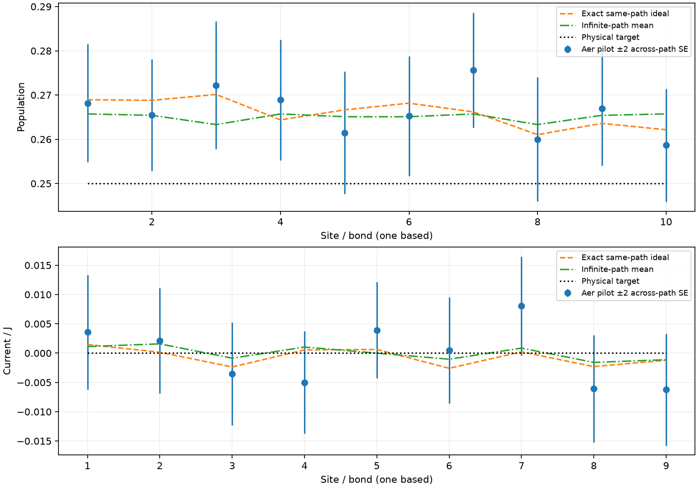

# Aer validation and trajectory/shot sufficiency

**The 1024-trajectory, 8-shot hardware pilot is insufficient for the original 0.02 accuracy / 0.004 sampling criteria.** Aer confirms substantial preparation/reset/final-measurement fluctuations in addition to the known finite-path discrepancy. It remains a device diagnostic, not a precision configuration.

All calculations preserve the exact 44-step schedule, N=10, J=1, Gamma=2, p=.25, half-mixture, jump-first even/odd order and fixed path seed 29. No schedule, seed or paths were reselected using the Aer outcome. No IBM account, live calibration or hardware job was used.

## Actual Aer evidence

The complete pilot simulated 1024 paths x 8 shots x all three bases: **24576 actual evolution-shot outcomes**, at simulator seed 2026. Freshly reset baths were traced into exact one-site Kraus maps, retaining the same system channel and shot distribution. Initial ignored measurements become their nonselective dephasing channel, which Aer statevector unravels stochastically. Counts come from final measurements; no expectation snapshots replace measurement shots.

| Pilot quantity | Result |
|---|---:|
| Maximum Aer error to physical stationary target | 0.0256347656 |
| Maximum Aer error to infinite-path mean channel | 0.00990207938 |
| Maximum Aer error to its own finite-path ideal | 0.00943353111 |
| Maximum descriptive across-path two SE, including shots | 0.0144168247 |
| Original empirical checks passed | False |



The exact finite-path ideal already has target error 0.0201363873 and mean-channel distance 0.00680954294, above the respective allowances before shot noise. Increasing shots with these same 1024 paths cannot repair that expected finite-path profile.

Two independent reference checks support the bath reduction and circuit implementation:

- Exact ten-qubit Aer density propagation at paths 0 and 1 agrees with the covariance predictions for every population, current and both individual XY/YX correlators to **9.24e-15**. Density traces are within 3e-14 of one.
- Full **twelve-qubit** circuits at paths 0 and 1, 128 shots per basis, seed 2027, retain both actual bath resets and preparation records: **768 actual outcomes**. Their maximum observed same-path discrepancy is 0.0737349; this low-path reference is not an accuracy-validated ensemble. Small-system exact density tests separately prove equality of original, lowered and bath-traced circuits for all four jump types at the actual large angles.

Actual Aer controls also ran all 21 short preparation circuits for seven pilot jobs at 2048 shots each. Largest local discrepancy: **0.0302734**. For a half-mixture, nominal pointwise two SE is 0.0220971; these controls are diagnostics, not a simultaneous 0.02 calibration certificate.

## Larger-run recommendation: calculated, not a completed full Aer replay

Use **16384 trajectories x 32 shots per basis, fixed path seed 29**, when assessing the original precision criteria in the ideal model. The entire 1.57-million-shot configuration was **not** replayed in Aer. Its statistical sufficiency is established using the exact finite-path probabilities, validated channel construction, and the conditional bound below. The Aer pilot and the analytic recommendation are distinct evidence.

| Paths | Shots per basis | Conditional failure-probability upper bound | At least 95% ideal-shot coverage? | Total hardware shots incl. controls |
|---|---:|---:|---|---:|
| 1024 | 8 | 1 | False | 67584 |
| 4096 | 128 | 1 | False | 1726464 |
| 8192 | 64 | 0.11561949 | False | 1873920 |
| 8192 | 128 | 0.0111091468 | True | 3446784 |
| 16384 | 8 | 0.587883678 | False | 989184 |
| 16384 | 16 | 0.0791019895 | False | 1382400 |
| 16384 | 24 | 0.0130209247 | True | 1775616 |
| 16384 | 32 | 0.00224530895 | True | 2168832 |
| 16384 | 64 | 2.49637187e-06 | True | 3741696 |

A bound above 0.05 means this calculation does not certify that configuration; it is not an exact failure probability. The 24-shot option also meets the 95% condition, while 32 shots gives more margin. The recommended configuration has:

- Ideal same-path target error **0.0174127367** and mean-channel distance **0.00195097497**.
- Probability at most **0.00224530895** of violating either local-observable requirement, jointly over all ten populations and nine currents, conditional on this exact finite ensemble, independent ideal shots and the verified channel.
- **97 jobs**, **1572864 evolution shots**, **2168832 shots including the existing three 2048-shot controls per job** at batch size 512.

```powershell
python Model2/Experiment5/run_hardware.py --execute --backend ibm_phoenix --trajectory-count 16384 --seed 29 --shots 32 --bases z xy yx --batch-size 512 --control-shots 2048
```

The pilot defaults remain unchanged to avoid silently expanding a run from 67584 to over two million hardware shots. This command is explicit about that larger workload. The bound excludes hardware bias, drift, preparation/readout defects and correlated device shots. More shots cannot remove those effects. No hardware accuracy guarantee follows from noiseless Aer.

## Conditional probability calculation

For fixed path r, the final Z bit is Bernoulli with its exact covariance-predicted population n_r. The current estimator combines two independent Pauli measurements. Number conservation gives <YX>=-<XY>=2 C_(j,j+1) in the stored real gauge; the density checks verify both correlators individually. Thus the conditional variances of the averaged observables are

```text
V_population = mean_r[n_r(1-n_r)] / (R*S)
V_current/J = 2*c^2 * mean_r[1-4*C_r,j,j+1^2] / (R*S),  c=1/4.
```

A centered shot contribution is bounded by b=1/(R*S) for population and b=2*c/(R*S) for current/J. Bernstein's inequality bounds each one-sided tail by exp(-d^2/[2*(V+b*d/3)]); see Theorem 2.9.5 in [Vershynin's author manuscript](https://www.math.uci.edu/~rvershyn/papers/HDP-book/HDP-2.pdf). The application and numerical thresholds here are our calculation.

For each observable, intersect the allowed physical-target interval ±0.02 with its infinite-path-mean interval ±0.004. Compute the upper and lower distances from that observable's exact finite-path expectation to this intersection, then sum all 38 one-sided bounds. A nonpositive distance gives an uncertified bound of one. This union bound allows arbitrary correlations between observables measured in the same shot; independence is required across ideal shots and the separately measured bases. Conditional shot variance already includes preparation and reservoir-reset randomness; it is not added again.

The saved budget JSON also contains a simpler uniform-confidence-width diagnostic. For 16384x32 its scalar sampling upper bound is 0.004018, slightly above 0.004. That shortcut is more conservative: the passing decision uses the summed actual per-observable tail bounds, not the worst uniform-width scalar. The latter does not invalidate the sharper joint bound. These confidence statements apply to the prescribed fixed ensemble and configuration, not jointly to every configuration in the table.

## Reproduction and artifacts

```bash
python Model2/Experiment5/aer_sampling.py --resume
python Model2/Experiment5/aer_sampling.py --paths 2 --shots 128 --full --aer-seed 2027 --resume
python Model2/Experiment5/aer_reference.py
python -m Model2.Experiment5.summarize_aer
```

Aer runs checkpoint every 16 paths. NPZ files store actual packed final-register outcomes; metadata includes sample hashes, simulator settings and per-chunk times. Full and reduced circuits preserve the initial mixture and intended bath channel. Reformatting preparation bits cannot change final-bit decoding. Tests cover exact channel equivalence, final-register offsets, both current parities, insufficient fixed ensembles, confidence/workload calculations and verified resume.

Actual pilot: `runs/aer_sampling/aer_835e2010383c/study.json`. Full-bath reference: `runs/aer_sampling/aer_ce1ac0a2f574/study.json`. Exact density and shot-budget files are under `runs/aer_sampling/`; raw generated data stay local. A compact [summary](aer_validation_summary.json) is retained. Simulator version: **Aer 0.17.2**.
