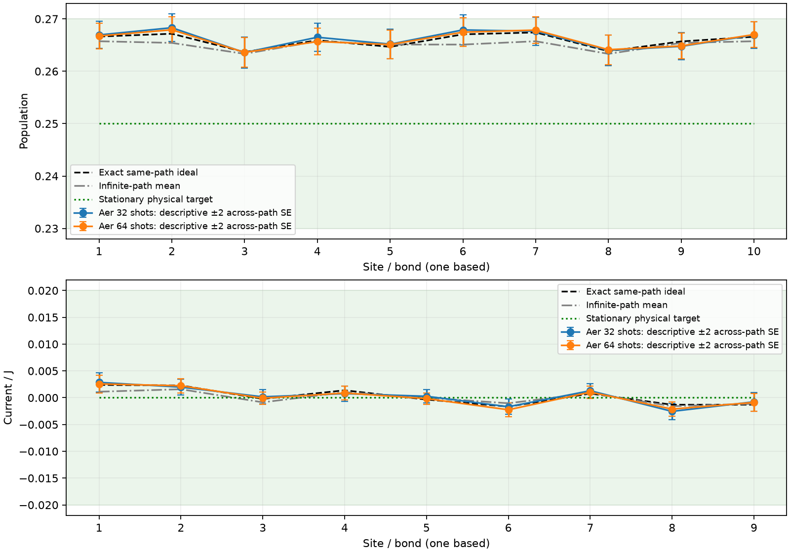

# Recovered Aer shot analysis

**Verified all 1,024 checkpoints: 16,384 trajectories and 3,145,728 actual saved outcomes.** No simulation was rerun.

The original study and source files, checkpoint metadata and NPZ samples remain unchanged. The original complete flag describes the interrupted analysis; this separate report records successful recovery.

| Shots per basis | Outcomes used | Max target error | Max mean-channel error | Max same-path error | Max descriptive 2 SE | Empirical checks passed |
| --- | ---: | ---: | ---: | ---: | ---: | --- |
| 32 | 1,572,864 | 0.0183162689 | 0.0028981522 | 0.0012386452 | 0.0029603829 | True |
| 64 | 3,145,728 | 0.0179204941 | 0.0025023774 | 0.0008577312 | 0.0028414473 | True |

Original criteria: maximum local-observable error to the stationary target ≤0.02, distance to the infinite-path mean ≤0.004, and maximum descriptive across-path two SE ≤0.004. Observables are ten populations and nine currents/J.

The smaller-shot profiles use the first requested outcomes from every trajectory and basis in the saved run. They are matched analyses of actual Aer shots, rather than new simulator executions. These realizations do not estimate a repeated-experiment failure frequency. Across-path error bars include both path and shot fluctuations and are descriptive, rather than simultaneous coverage guarantees.

Exact same-path target error: 0.0174127367; same-path distance to the infinite-path mean: 0.0019509750.

Analyzer wall time (excluding imports): 16.40 s. Peak process RSS: 185.29296875 MiB (when supported).

Input study: `/storage/home/aks8134/OpenQuantumSystem/Model2/Experiment5/runs/aer_sampling/aer_415156585c7c/study.json`. SHA256: `4e1b5f980ee7055c986502d42ebea73da2974d76949f499cf65bd8a6d20dd7d1`.

[Detailed JSON](analysis.json), [comparison CSV](shot_comparison.csv), [site and bond values](observables.csv).

