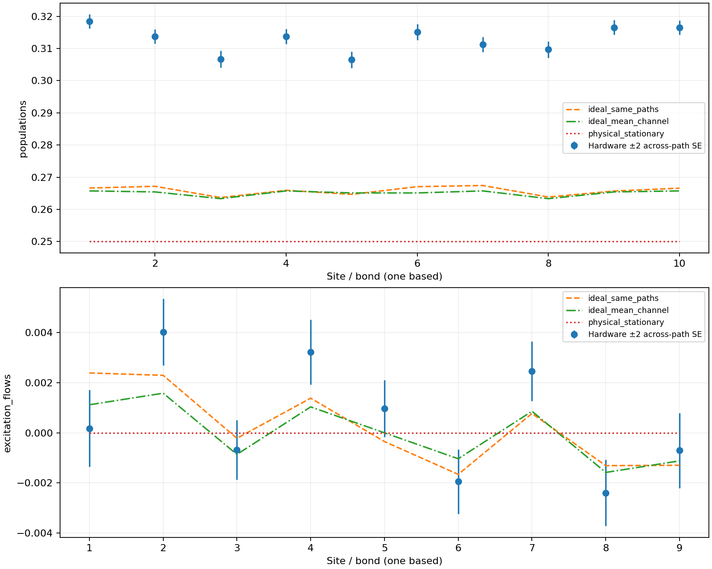

# Model2 Experiment5 hardware results

44 preparation steps; 16384 paths, 32 shots per basis, 97 jobs.
Measured bases: ['z', 'xy', 'yx']. Physical path: [68, 69, 59, 58, 57, 56, 66, 76, 86, 96, 97, 98].

| Reference | Maximum population/current-over-J discrepancy |
|---|---:|
| physical_stationary | 0.0683937073 |
| ideal_mean_channel | 0.052661021 |
| ideal_same_paths | 0.0517650911 |

These are observed point estimates, not a hardware accuracy certificate. The default smaller path ensemble does not inherit the 16384-path validation. Compare the same-path ideal to separate device/measurement discrepancy from ideal path sampling and preparation bias.

| Job | Zero max error | One max error | Half-mixture max error | Held-out mixture response residual |
|---|---:|---:|---:|---:|
| dbkn2md6p51s73cn0ae0 | 0.019043 | 0.0166016 | 0.0209961 | 0.0192871 |
| dbknhs0nceqs73am9fr0 | 0.019043 | 0.0161133 | 0.0322266 | 0.0373535 |
| dbko0hgnceqs73amai3g | 0.0112305 | 0.0288086 | 0.0507812 | 0.0380859 |
| dbkq270nceqs73amec20 | 0.019043 | 0.0200195 | 0.0185547 | 0.0163574 |
| dbkq5ognceqs73amegog | 0.0136719 | 0.027832 | 0.0405273 | 0.0290527 |
| dbkq9r56p51s73cn6g90 | 0.0136719 | 0.0136719 | 0.0244141 | 0.0258789 |
| dbkqbe0nceqs73ameoh0 | 0.0131836 | 0.0131836 | 0.0424805 | 0.0478516 |
| dbkqcld6p51s73cn6ju0 | 0.0131836 | 0.0170898 | 0.0219727 | 0.0227051 |
| dbkqeo0nceqs73amesm0 | 0.0170898 | 0.0161133 | 0.0375977 | 0.0351562 |
| dbkqoronceqs73amfalg | 0.0224609 | 0.0146484 | 0.0180664 | 0.0178223 |
| dbkqqllgg49c73djfogg | 0.0136719 | 0.0175781 | 0.0102539 | 0.00708008 |
| dbkr7btgg49c73djgjgg | 0.0195312 | 0.0175781 | 0.0273438 | 0.0297852 |
| dbkrcr0nceqs73amgi70 | 0.0146484 | 0.0185547 | 0.0209961 | 0.0192871 |
| dbkrjht6p51s73cn8ohg | 0.0214844 | 0.0180664 | 0.0205078 | 0.0268555 |
| dbks2ptgg49c73dji6u0 | 0.0161133 | 0.0170898 | 0.0214844 | 0.0244141 |
| dbkscutgg49c73djiqt0 | 0.015625 | 0.105957 | 0.141113 | 0.0898438 |
| dbksgsgnceqs73aminq0 | 0.0185547 | 0.120605 | 0.118652 | 0.0600586 |
| dbksnjl6p51s73cnau80 | 0.0146484 | 0.125488 | 0.14209 | 0.0817871 |
| dbkssa0nceqs73amjdu0 | 0.0146484 | 0.102539 | 0.126465 | 0.078125 |
| dbksvadgg49c73djjugg | 0.0136719 | 0.100586 | 0.116699 | 0.0673828 |
| dbktb80nceqs73amk2cg | 0.019043 | 0.11084 | 0.133789 | 0.0791016 |
| dbktebonceqs73amk6m0 | 0.0170898 | 0.100586 | 0.153809 | 0.105957 |
| dbkthvtgg49c73djkro0 | 0.0151367 | 0.109375 | 0.158691 | 0.106201 |
| dbktl9l6p51s73cncd60 | 0.0126953 | 0.102539 | 0.134766 | 0.0852051 |
| dbktnst6p51s73cncg6g | 0.0131836 | 0.0996094 | 0.151855 | 0.104492 |
| dbktrft6p51s73cnckc0 | 0.0136719 | 0.110352 | 0.144531 | 0.0927734 |
| dbku1eonceqs73aml2l0 | 0.0131836 | 0.113281 | 0.130371 | 0.076416 |
| dbku65lgg49c73djloh0 | 0.0107422 | 0.0771484 | 0.0805664 | 0.0444336 |
| dbku97pkdqps73937fe0 | 0.0146484 | 0.0961914 | 0.138672 | 0.0935059 |
| dbkumpd6p51s73cndvg0 | 0.0131836 | 0.117676 | 0.123535 | 0.0712891 |
| dbkv43onceqs73ammpj0 | 0.012207 | 0.390137 | 0.378906 | 0.189941 |
| dbkve7d6p51s73cnf9pg | 0.0112305 | 0.0878906 | 0.0883789 | 0.0483398 |
| dbkvq2onceqs73amo73g | 0.0180664 | 0.0146484 | 0.0209961 | 0.019043 |
| dbl0bul6p51s73cnh5ig | 0.00878906 | 0.0126953 | 0.0205078 | 0.0209961 |
| dbl0econceqs73amphbg | 0.0146484 | 0.0141602 | 0.0234375 | 0.0214844 |
| dbl0gp8nceqs73ampmcg | 0.0126953 | 0.0141602 | 0.0146484 | 0.0175781 |
| dbl11jgnceqs73amqkkg | 0.0136719 | 0.0185547 | 0.0327148 | 0.03125 |
| dbl1cr9kdqps7393dag0 | 0.0112305 | 0.0170898 | 0.0439453 | 0.0419922 |
| dbl21ol6p51s73cnkapg | 0.0170898 | 0.0136719 | 0.0161133 | 0.0146484 |
| dbl2tmd6p51s73cnlj10 | 0.0161133 | 0.0175781 | 0.0356445 | 0.0324707 |
| dbl300d6p51s73cnlnj0 | 0.015625 | 0.0185547 | 0.0229492 | 0.017334 |
| dbl359pkdqps7393g260 | 0.0131836 | 0.015625 | 0.0297852 | 0.0273438 |
| dbl3h19kdqps7393gthg | 0.0151367 | 0.00976562 | 0.0268555 | 0.0251465 |
| dbl3r4t6p51s73cnnd60 | 0.0107422 | 0.012207 | 0.015625 | 0.013916 |
| dbl49956p51s73cno5bg | 0.0117188 | 0.012207 | 0.0268555 | 0.0253906 |
| dbl4c9lgg49c73dk0rig | 0.0185547 | 0.0126953 | 0.0244141 | 0.0253906 |
| dbl4nk1kdqps7393iqgg | 0.015625 | 0.0131836 | 0.0297852 | 0.0317383 |
| dbl50hu74qds73dpndqg | 0.0146484 | 0.0131836 | 0.0253906 | 0.0217285 |
| dbl5dme74qds73dpo9kg | 0.0117188 | 0.0185547 | 0.0258789 | 0.0273438 |
| dbl5q8674qds73dpp96g | 0.0146484 | 0.0166016 | 0.0166016 | 0.015625 |
| dbl97jl8ft8s738skem0 | 0.0112305 | 0.0136719 | 0.0170898 | 0.0148926 |
| dbl9uku74qds73dq3a2g | 0.0136719 | 0.0161133 | 0.0332031 | 0.0322266 |
| dblbmql8mdtc73d5s4pg | 0.0131836 | 0.0180664 | 0.0317383 | 0.0273438 |
| dbldlvt8mdtc73d5vsf0 | 0.012207 | 0.0136719 | 0.0253906 | 0.0239258 |
| dbldugu74qds73dqaoi0 | 0.0170898 | 0.0200195 | 0.0258789 | 0.0214844 |
| dble3ue74qds73dqb1fg | 0.0112305 | 0.0200195 | 0.0239258 | 0.0227051 |
| dble7ul8ft8s738su47g | 0.0146484 | 0.015625 | 0.0283203 | 0.0258789 |
| dblegt674qds73dqbkag | 0.0161133 | 0.0161133 | 0.0258789 | 0.0246582 |
| dblekfd8ft8s738sukq0 | 0.0141602 | 0.0180664 | 0.0273438 | 0.027832 |
| dblep958mdtc73d61mq0 | 0.0136719 | 0.0136719 | 0.0249023 | 0.0239258 |
| dblf3cm74qds73dqcnl0 | 0.012207 | 0.0136719 | 0.0322266 | 0.0314941 |
| dblf9c9kbkrc73cnkpa0 | 0.0131836 | 0.0131836 | 0.0341797 | 0.0344238 |
| dblfdjl8mdtc73d632d0 | 0.012207 | 0.0180664 | 0.0405273 | 0.0356445 |
| dblfkrhkbkrc73cnld10 | 0.0200195 | 0.0166016 | 0.0351562 | 0.032959 |
| dblfp5d8mdtc73d63lfg | 0.0126953 | 0.0131836 | 0.0209961 | 0.0209961 |
| dblfrtl8mdtc73d63pr0 | 0.0136719 | 0.0136719 | 0.0166016 | 0.0146484 |
| dblg0k1kbkrc73cnm0a0 | 0.0151367 | 0.0170898 | 0.0102539 | 0.0148926 |
| dblisbhkbkrc73cnpi4g | 0.0180664 | 0.0170898 | 0.0170898 | 0.020752 |
| dblj11t8mdtc73d67q20 | 0.0136719 | 0.0166016 | 0.0263672 | 0.0268555 |
| dblj4u9kbkrc73cnq2ag | 0.0126953 | 0.0151367 | 0.0351562 | 0.03125 |
| dblj9cu74qds73dqir6g | 0.0146484 | 0.0209961 | 0.0375977 | 0.0341797 |
| dbljhhm74qds73dqjdr0 | 0.0166016 | 0.0146484 | 0.015625 | 0.0192871 |
| dblk481kbkrc73cns6c0 | 0.0136719 | 0.0151367 | 0.0258789 | 0.0231934 |
| dblkdpe74qds73dqlb7g | 0.0136719 | 0.0161133 | 0.0361328 | 0.0341797 |
| dbll0ue74qds73dqmpk0 | 0.0131836 | 0.0180664 | 0.0390625 | 0.0349121 |
| dbllk3e74qds73dqo100 | 0.0185547 | 0.0161133 | 0.0268555 | 0.0251465 |
| dbllrmm74qds73dqoct0 | 0.0126953 | 0.0180664 | 0.0332031 | 0.0319824 |
| dblm08t8mdtc73d6e6vg | 0.0126953 | 0.0170898 | 0.03125 | 0.0285645 |
| dblm4he74qds73dqonb0 | 0.0166016 | 0.0151367 | 0.019043 | 0.0183105 |
| dblr7ot8mdtc73d6nm4g | 0.0107422 | 0.0180664 | 0.0239258 | 0.0195312 |
| dblrlb674qds73dr2gl0 | 0.0146484 | 0.012207 | 0.0244141 | 0.0244141 |
| dbm2hvd8ft8s738u1hug | 0.0205078 | 0.0146484 | 0.0214844 | 0.0241699 |
| dbm4u9d8ft8s738u6ttg | 0.0185547 | 0.0146484 | 0.0317383 | 0.0292969 |
| dbm56658mdtc73d7ahag | 0.0151367 | 0.0385742 | 0.0239258 | 0.0244141 |
| dbm5gdm74qds73drln0g | 0.015625 | 0.0141602 | 0.0205078 | 0.0192871 |
| dbm7sjhkbkrc73cp12tg | 0.0136719 | 0.012207 | 0.0205078 | 0.0244141 |
| dbm7uihkbkrc73cp15ng | 0.0166016 | 0.0170898 | 0.0229492 | 0.0209961 |
| dbm9ihl8mdtc73d7i55g | 0.019043 | 0.012207 | 0.0170898 | 0.0209961 |
| dbma46674qds73drtr10 | 0.015625 | 0.0102539 | 0.0209961 | 0.0219727 |
| dbmb6f58ft8s738uhvpg | 0.0151367 | 0.0166016 | 0.0273438 | 0.026123 |
| dbmb8khkbkrc73cp6qmg | 0.0126953 | 0.0170898 | 0.0302734 | 0.0317383 |
| dbmbq3e74qds73ds0v8g | 0.0205078 | 0.0146484 | 0.0249023 | 0.0251465 |
| dbmbvjpkbkrc73cp874g | 0.0170898 | 0.019043 | 0.0258789 | 0.027832 |
| dbmchct8mdtc73d7nqfg | 0.0185547 | 0.0166016 | 0.0253906 | 0.0253906 |
| dbmcr558ft8s738ul3jg | 0.0131836 | 0.0146484 | 0.0224609 | 0.0214844 |
| dbmct7u74qds73ds2vt0 | 0.0141602 | 0.0136719 | 0.0112305 | 0.0131836 |
| dbmh87hkbkrc73cpgabg | 0.0117188 | 0.0126953 | 0.0195312 | 0.0168457 |

The held-out mixture is compared with (zero+one)/2 inside each job. These are preparation/readout diagnostics; no affine correction is applied to evolution. Same-job controls do not establish stable response throughout the job.

Raw output populations and currents when all bases measured. Preparation measurement bits ignored. No mitigation or clipping. Conditional shot SE excludes branch resampling; across-path SE includes path, preparation, shot and observed device variation. Do not add the two. SEs descriptive, no simultaneous or drift guarantee. Z-only data do not measure currents.
