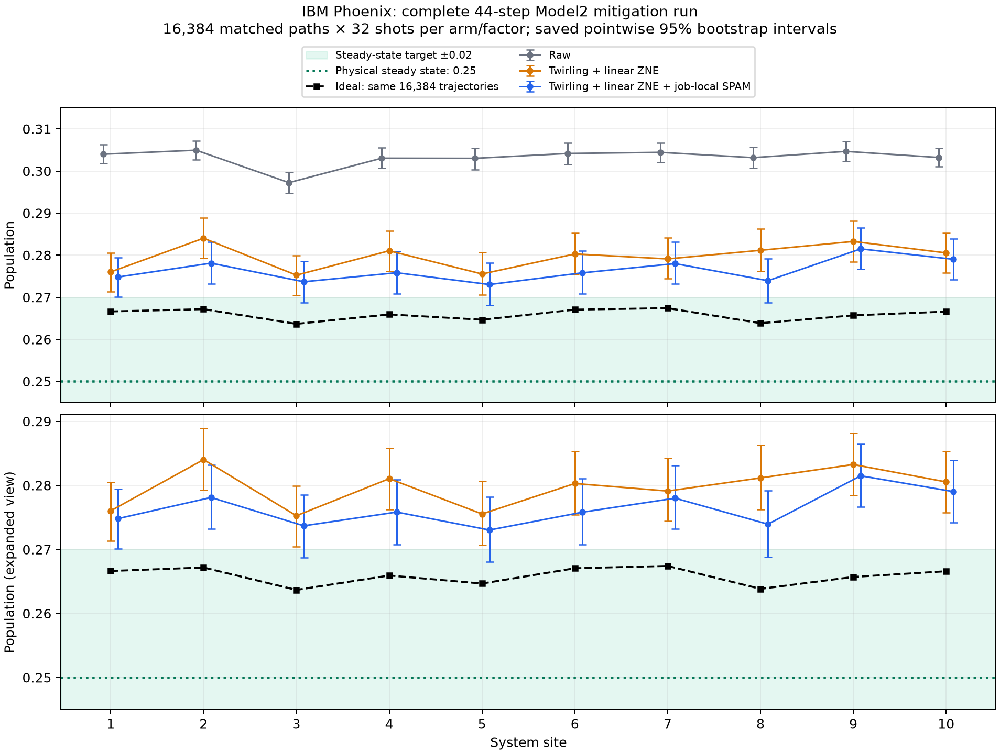

# Complete Model2 mitigation hardware results

All 20 jobs and all 16,384 trajectories are present: 213,292 circuits and 2,342,912 shots including controls. Each trajectory has 32 shots in the raw arm and 32 at each twirled factor, split across four variants. This review reads saved counts and statistics only; no hardware, simulator, or account calls were made.

**Linear ZNE substantially improved agreement with the same-path ideal. ZNE plus job-local SPAM correction has the lowest observed errors. The physical stationary-state tolerance of 0.02 is still unmet.**

| Method | Mean absolute error vs same-path ideal | Max error vs same-path ideal | Max error vs stationary 0.25 |
| --- | ---: | ---: | ---: |
| Raw | 0.037322 | 0.039340 | 0.054939 |
| Raw + SPAM | 0.037850 | 0.040466 | 0.056163 |
| Twirling | 0.038853 | 0.043024 | 0.060192 |
| Twirling + SPAM | 0.036038 | 0.038945 | 0.055032 |
| Twirling + ZNE | 0.013757 | 0.017557 | 0.034019 |
| Twirling + ZNE + SPAM | 0.010505 | 0.015793 | 0.031490 |

Relative to raw, ZNE plus SPAM reduces same-path MAE by 71.85%, same-path maximum error by 59.86%, and maximum error from the stationary target by 42.68%. Raw SPAM correction alone slightly increases MAE; twirling alone also increases the observed error. The main improvement comes from extrapolation across CZ factors 1, 1.25, and 1.5.

For ZNE plus SPAM versus raw, the saved paired-bootstrap MAE difference is −0.026817 (95% interval [−0.028239, −0.025476]); the maximum-error difference is −0.023547 (95% interval [−0.026925, −0.019275]). Both intervals exclude zero under the saved analysis assumptions. ZNE without SPAM also improves both metrics versus raw. These intervals condition on the observed jobs and variants and omit calibration-model bias and drift; they are not simultaneous coverage guarantees.

The ideal 44-step output for these same trajectories has populations 0.26367–0.26741, already up to 0.017413 above the stationary value of 0.25. The best mitigated populations are 0.27302–0.28149; their largest stationary discrepancy is 0.031490 at site 9 (physical qubit 81). Thus a same-path maximum error below 0.02 does not establish the final steady-state target. This is a population-only run; currents were not measured.

All ten raw twirled population curves increase monotonically over the three noise factors. The saved maximum absolute linear-fit residual is 0.001520, small relative to the scale changes but not proof of linearity toward zero noise. The fixed ZNE weights are [17/6, 1/3, −13/6], with shot-SE amplification 3.58 relative to one equally sampled scale. Per-site conditional shot SE rises from about 0.0006 for raw to 0.0022–0.0023 for ZNE plus SPAM.

**The held-out controls show limitations of the SPAM model in several jobs.** The worst corrected half-mixture population is 0.40434 instead of 0.5 in job 14, twirled arm, site 2 (qubit 115), with pointwise 95% interval [0.38051, 0.42761]. Job 19, twirled arm, site 4 (qubit 113) gives 0.40515, interval [0.37295, 0.43827]. Its zero/one errors reach 0.12646/0.15283 and minimum response contrast is 0.72070. Numerical inversion remains possible, but a simple zero/one affine correction does not validate these held-out preparations.

Across all 40 job/arm control sets, 57/400 pointwise mixture intervals exclude 0.5; 32/40 sets have at least one exclusion. These are unadjusted descriptive counts, not a multiple-comparison test. All jobs are retained and no additional correction or target fitting was applied. The improvement from ZNE without SPAM helps separate the principal observed gain from reliance on the affine readout/preparation model.

Verification independently reproduces every per-trajectory mean, all six job-local and final population profiles, the same-path ideal, and all point error metrics from the archived final-register counts after decoding terminal masks. The manifest plan digest, source digest, frozen spec digest, job IDs, coverage and shots match. The two saved report copies match byte for byte. The saved bootstrap intervals are reported without rerunning bootstrap. Compiled QPY files were excluded from the bundle and were not audited here.

The separate DD pilot used four paths and a different physical chain. These two experiments do not provide a matched comparison of DD versus ZNE. Their within-experiment contrasts are the comparisons supported by their designs.

Files: `profile_errors.csv`, `error_comparisons.csv`, `heldout_controls.csv`, `job_profiles.csv`, and `verification.json`. Original exported analysis and figures are preserved with the `saved_` prefix.
