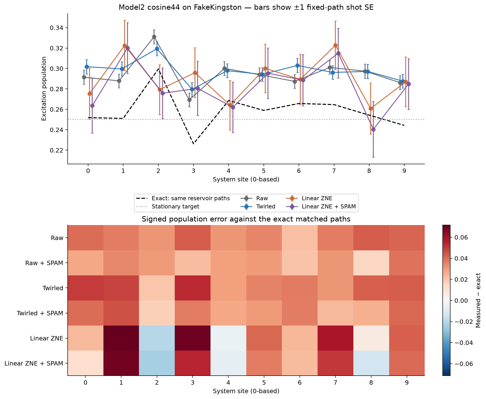
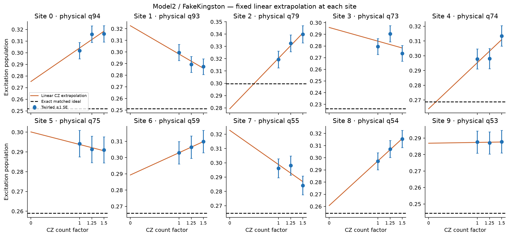

# Model2: FakeKingston mitigation pilot

Completed actual noisy Aer simulations for **32 matched reservoir paths × 128 shots per path per arm/factor**, with 4 twirl variants (32 shots each). The run contains **431 circuits and 28,672 actual shots**, including controls. This is a population-only pilot, not the proposed 16,384-path hardware experiment.

## Result

All errors below are absolute excitation-population errors. The matched noiseless reference averages the same reservoir paths, analytically averaging the half-mixed preparation; it isolates circuit noise and shots from finite path sampling.

| Method | Mean error vs matched ideal | Max error vs matched ideal | Max error vs stationary 0.25 |
| --- | ---: | ---: | ---: |
| Raw | 0.036033 | 0.043052 | 0.081055 |
| Raw + SPAM | 0.027998 | 0.038996 | 0.079692 |
| Twirled | 0.039085 | 0.053306 | 0.069336 |
| Twirled + SPAM | 0.032322 | 0.045726 | 0.066337 |
| Linear ZNE | 0.036124 | 0.071465 | 0.072713 |
| Linear ZNE + SPAM | 0.032929 | 0.068926 | 0.070052 |

### Paired comparisons

Differences are method error minus reference error; negative favors the method. Intervals are descriptive paired trajectory bootstrap intervals (2,000 replicates), including independently resampled preparation-control counts for corrected methods. They are not simultaneous confidence bounds.

| Method vs reference | Mean-error difference | Bootstrap 95% interval |
| --- | ---: | --- |
| Raw + SPAM vs Raw | -0.008035 | [-0.009774, -0.006194] |
| Twirled vs Raw | +0.003052 | [-0.001417, +0.007593] |
| Linear ZNE vs Twirled | -0.002960 | [-0.010304, +0.016200] |
| Twirled + SPAM vs Raw + SPAM | +0.004323 | [-0.000739, +0.009146] |
| Linear ZNE + SPAM vs Twirled + SPAM | +0.000607 | [-0.006784, +0.021333] |
| Linear ZNE + SPAM vs Raw | -0.003104 | [-0.011549, +0.017351] |
| Linear ZNE vs Raw | +0.000091 | [-0.008542, +0.019330] |

Linear ZNE compared with Twirled **has no resolved mean-error advantage in this pilot; the descriptive interval spans zero**.

Linear ZNE compared with Raw **has no resolved mean-error advantage in this pilot; the descriptive interval spans zero**.

Even the noiseless mean of these 32 paths has maximum stationary-target error **0.049502**. This sample size does not establish the 0.02 total observable criterion. Currents are not measured here.





The dashed curves in the scaling plots are the fully noiseless matched reference. The extrapolation removes only noise that scales with the folded CZ circuit; its factor-zero intercept can retain unscaled noise.

## Frozen experiment and mitigation

N=10, J=1, Γ/J=2, pL=pR=0.25, Δ=0, exchange prefactor 1/4; half-mixed initial state. The original 44-step warped cosine is unchanged: initial dt=4.207281841881579, final dt=3.760760459292396, power=16.424973388132297; jump-first evolution, then even/odd exchange layers.

The exact Model3 manual mitigation helpers are reused. Each native CZ is Pauli twirled. Selective CZ→CZ·CZ·CZ folding uses nested seeded subsets and factors 1, 1.25, 1.5 (880, 1,100, 1,320 CZ). Only one-qubit gates are optimized afterward; all 44 reservoir resets and preparation measurements are retained. Complementary terminal masks balance readout flips. No general transpilation follows the folding. No target fitting, clipping, dynamical decoupling, or automatic Runtime mitigation is used.

| Arm | Mean CZ | Mean SX | Mean X | Mean resets | Mean depth |
| --- | ---: | ---: | ---: | ---: | ---: |
| raw | 880 | 2576.0 | 55.5 | 44 | 723.1 |
| twirled factor 1 | 880 | 2576.0 | 190.8 | 44 | 752.4 |
| twirled factor 1.25 | 1100 | 2576.0 | 410.7 | 44 | 951.6 |
| twirled factor 1.5 | 1320 | 2576.0 | 628.7 | 44 | 1100.1 |

These counts show the remaining one-qubit gates and the extra X frames. CZ count factors do not uniformly scale every physical noise channel or the complete circuit duration.

The unweighted linear extrapolation weights are [2.83333333, 0.33333333, -2.16666667]; the shot-SE amplification is 3.582364× relative to one equally sampled scale. ZNE consumes three scales; its result is not a shot-cost-matched comparison with raw or twirled alone.

Zero, one and held-out half-mixture controls each receive 2,048 shots for both raw and twirled readout. The four twirled variants split that budget. Exploratory marginal SPAM correction uses (population−zero)/(one−zero), requires contrast ≥0.5, and includes shared-control uncertainty. The half-mixture is held out rather than fitted.

| Control treatment | Maximum corrected half-mixture deviation from 0.5 |
| --- | ---: |
| raw | 0.031686 |
| twirled | 0.028707 |

## Snapshot and scope

FakeKingston calibration date: `2026-04-15T09:15:15+02:00`. Physical chain, baths at the ends: `[95, 94, 93, 79, 73, 74, 75, 59, 55, 54, 53, 52]`. This mapping was fixed before examining noisy mitigation results. The 12 active physical qubits are compactly relabeled for simulation, preserving their T1/T2/frequency, gate durations and errors, connectivity and readout errors. The saved noise-model hash identifies the exact model.

Aer uses the snapshot's standard local gate noise, gate-duration thermal relaxation and readout noise. These unscheduled circuits do not include additional system idling through bath resets or dynamic-circuit latency, nor hardware drift/crosstalk. CZ-only ZNE leaves preparation, reset and unscaled error channels present. The fake noise model is not a prediction of the current physical Kingston device.

Bootstrap intervals condition on the sampled variants and the static snapshot. Shot covariance and fixed-path delta-method SEs are also exported; the figure uses those SEs. Small-path bootstrap uncertainty and nonlinear absolute-error bias limit interpretation. There is no live IBM connection or hardware submission.

## Reproduce

From the repository root:

```bash
OPENBLAS_NUM_THREADS=1 OMP_NUM_THREADS=4 MPLCONFIGDIR=/tmp/model2_fake_mpl \
  .venv/bin/python Model2/Experiment6/fake_kingston_zne.py --paths 32 --shots 128 \
  --control-shots 2048 --randomizations 4 --seed 29 --sim-seed 2026 --resume
```

Local raw run: `/storage/home/aks8134/OpenQuantumSystem/Model2/Experiment6/runs/fake_zne_f39521cdd46b`. Saved artifacts include raw outcome counts, native QPY variants, source trajectories, complete noise model, seeds, hashes, package versions and per-group Aer metadata. `--resume` checks snapshot, source, implementation and saved-circuit hashes before using cached units.

To regenerate these tables and figures:

```bash
.venv/bin/python Model2/Experiment6/summarize_fake.py Model2/Experiment6/runs/fake_zne_f39521cdd46b/analysis.json
```

Independent raw-count audit (no Aer replay):

```bash
.venv/bin/python Model2/Experiment6/verify_run.py Model2/Experiment6/runs/fake_zne_f39521cdd46b
```

Sum of timed Aer calls: **35.56 minutes** on 4 threads (excludes compilation, imports, analysis and interrupted attempts).

Packages: `{'qiskit': '2.5.2', 'qiskit-aer': '0.17.2', 'qiskit-ibm-runtime': '0.49.0'}`.

Noise model SHA256: `d7fb95daf40f4a647ed57baad3628aa7c5c3111d15d8632ecdfbed73a9bec6f1`.
