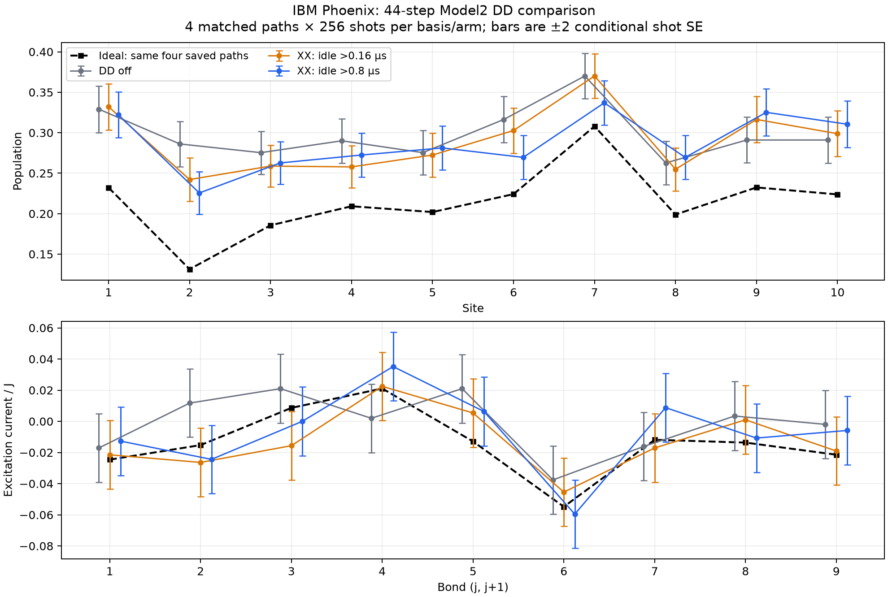

# Review of saved Model2 DD hardware results

Job `dbnn9idt7fqc73ajtifg` completed on `ibm_phoenix`. This archive contains 4 matched paths, 256 shots per basis/arm, 45 circuits and 27,648 shots including controls. Analysis uses saved counts only; no hardware, simulator or Runtime account calls were made.

**Both DD policies improved the aggregate observed errors. The >0.8 µs policy has the lowest maximum error and RMSE in this pilot; its advantage over >0.16 µs remains uncertain.**

| Policy | Population max error | Current/J max error | Combined RMSE |
| --- | ---: | ---: | ---: |
| DD off | 0.154750 | 0.033915 | 0.065361 |
| XX: idle >0.16 µs | 0.110805 | 0.024257 | 0.057212 |
| XX: idle >0.8 µs | 0.094203 | 0.020630 | 0.055635 |

Errors compare to the ideal ensemble of the same four saved trajectories. Combined RMSE averages 10 population residuals and 9 current/J residuals. It does not measure convergence to the physical stationary state.

The >0.16 µs policy has slightly lower current-only RMSE: 0.012442 versus 0.013198 for >0.8 µs (DD off: 0.019543). The >0.8 µs setting therefore does not win every metric. Each DD policy improves per-path combined RMSE on three of the four paths versus DD off; >0.8 µs beats >0.16 µs on two of four paths.

The >0.16 µs and >0.8 µs policies reduce maximum error by 28.4% and 39.1%, respectively. Their combined RMSE reductions are 12.5% and 14.9%.

At site 2 (physical qubit 47), the ideal population is 0.131383. Measured values are 0.286133 (DD off), 0.242188 (>0.16 µs), and 0.225586 (>0.8 µs). This site sets the maximum error in all three arms. The direct >0.8 minus >0.16 difference is −0.016602 with conditional shot SE 0.018699. Its nominal 95% interval includes zero. This single-site comparison is illustrative; it is not a confidence interval for the selected maximum-error metric.

The direct DD-versus-DD population differences are all below 1.96 conditional shot SE in magnitude. There are only four independent saved paths and one hardware job; these results support retaining >0.8 µs as the leading candidate, not declaring a proven optimum. Error reductions are not uniform: >0.8 µs is closer to the ideal population than DD off on 6/10 sites, and farther away on 4/10.

All 24 DD-versus-baseline hardware timing comparisons independently reproduce the saved checks: non-X anchors match, additional X pulse counts match the construction, and circuit end times are unchanged. This checks recorded compiler schedules; it does not directly measure every physical pulse or isolate the noise mechanism.

The >0.16 µs policy adds a mean of 881.0 X pulses per evolution circuit; >0.8 µs adds 492.0. The latter uses 44.2% fewer added X pulses. Added pulse counts are actual recorded counts, rather than the earlier estimates from baseline drive gaps.

Zero/one control maximum population errors range from 0.0107 to 0.0171. Half-mixture controls have maximum deviations 0.0220 (off), 0.0283 (>0.16 µs), and 0.0186 (>0.8 µs), with about 0.011 shot SE per site. These are short preparation/readout diagnostics and do not reproduce long-circuit noise. No SPAM correction, readout inversion, twirling, ZNE, or job exclusion was applied.

No arm meets a 0.02 same-path maximum-error threshold in this run. The four ideal paths also have substantial finite-trajectory mismatch from the stationary target, independently of device noise. This pilot ranks DD settings on those paths; it does not validate the full stationary-state experiment.

The plan digest, raw result hash and all 8 included manifest assets match. All saved observables, per-path values and conditional shot SEs reproduce from the raw counts. Nine QPY assets were deliberately omitted from the archive, so independent binary circuit validation is unavailable.

A next hardware comparison should retain all three arms, use more matched trajectories with balanced ordering, and choose the primary metric before collecting data. The current data favor >0.8 µs as the candidate to carry forward; increasing coverage is needed before dropping the other arm.

Detailed arithmetic and provenance: `review.json`; per-path errors: `per_path_errors.csv`; controls: `controls.csv`; server timing checks: `timing_checks.csv`; per-observable contrasts with nominal unadjusted shot intervals: `observable_contrasts.csv`.
