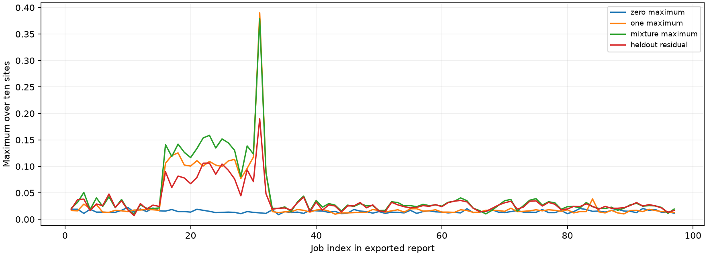

# Model2 exported raw analysis

Original manifest/counts/source are absent here; completion is reported by the exported analysis, not independently reconstructed from raw results.

The exported analysis lists **97 jobs**.

| Observable | Mean | Minimum | Maximum | Max vs same-path ideal | Max vs stationary |
| --- | ---: | ---: | ---: | ---: | ---: |
| excitation_flows | 0.00056797 | -0.00239658 | 0.00401688 | 0.00221324 | 0.00401688 |
| populations | 0.31281414 | 0.30650330 | 0.31839371 | 0.05176509 | 0.06839371 |

Largest all-one control discrepancy: **0.390137**, job 31 (`dbkv43onceqs73ammpj0`). Its held-out mixture residual is **0.189941**. These are per-job maxima over sites, not site-resolved calibration matrices; they cannot be used to apply an affine correction.

