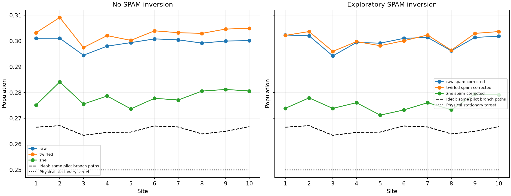
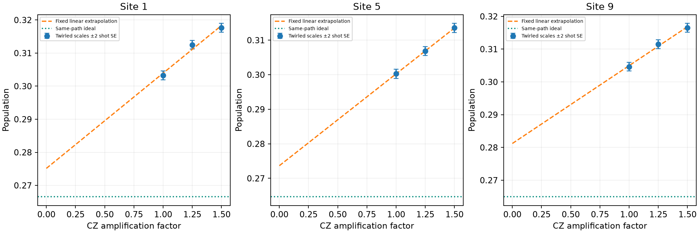

# Model2 mitigation: completed-job subset

**17/20 jobs; 13927/16384 original trajectories.**

Marginal SPAM model is conditional on stable local response and includes preparation error. CZ-only extrapolation does not remove intentional reservoir dissipation, finite-step bias, or guarantee removal of reset/idle noise. No clipping or reference fitting.

| Method | Ideal MAE | Ideal maximum | Physical maximum |
|---|---:|---:|---:|
| raw | 0.033901 | 0.035251 | 0.051083 |
| raw_spam_corrected | 0.034342 | 0.036478 | 0.052330 |
| twirled | 0.037632 | 0.042001 | 0.059141 |
| twirled_spam_corrected | 0.034969 | 0.038023 | 0.053681 |
| zne | 0.012876 | 0.017003 | 0.034143 |
| zne_spam_corrected | 0.009848 | 0.014424 | 0.029365 |

This is a fixed subset pilot, not a 0.02 steady-state certification. Actual CZ factors, linear-intercept weights, held-out mixture controls, uncertainty amplification, all raw scale populations and descriptive fit residuals are in analysis.json. A favorable intercept alone does not validate noise scaling; inspect the scale dependence and uncertainty before interpreting mitigation as improvement.

Paired empirical trajectory resampling within observed batches plus joint control-PUB resampling; shot noise already present in path means is not resampled again. Conditional on observed jobs and twirl variants; omits drift and calibration-model bias. Intervals descriptive, not simultaneous. Small-group bootstrap precision can be poor; fixed-path delta-method SEs are also reported. SPAM inversion uses independent job-local calibration draws, shared across factors inside each job.

## Preparation controls inside each evolution job

job_local: each job corrected before trajectory-weighted averaging; pooled calibration and mixture fields are diagnostics only

| Job | Readout | Largest corrected-mixture deviation from 0.5 | Site |
|---|---|---:|---:|
| dblb631kbkrc73cndj00 | raw | 0.018482 | 10 |
| dblb631kbkrc73cndj00 | twirled | 0.009716 | 6 |
| dbldhnd8mdtc73d5vk3g | raw | 0.037253 | 2 |
| dbldhnd8mdtc73d5vk3g | twirled | 0.041899 | 2 |
| dblel1d8mdtc73d61f90 | raw | 0.039427 | 2 |
| dblel1d8mdtc73d61f90 | twirled | 0.027081 | 6 |
| dblfpo674qds73dqe2f0 | raw | 0.030109 | 10 |
| dblfpo674qds73dqe2f0 | twirled | 0.030356 | 2 |
| dblgksd8mdtc73d64n6g | raw | 0.061775 | 2 |
| dblgksd8mdtc73d64n6g | twirled | 0.027245 | 8 |
| dbljmkd8mdtc73d69c30 | raw | 0.021526 | 9 |
| dbljmkd8mdtc73d69c30 | twirled | 0.038159 | 10 |
| dbll1qt8ft8s738t9ltg | raw | 0.017677 | 2 |
| dbll1qt8ft8s738t9ltg | twirled | 0.028938 | 2 |
| dblm9nl8ft8s738tbnq0 | raw | 0.018900 | 7 |
| dblm9nl8ft8s738tbnq0 | twirled | 0.055278 | 2 |
| dblsmdm74qds73dr3u2g | raw | 0.074490 | 2 |
| dblsmdm74qds73dr3u2g | twirled | 0.028084 | 2 |
| dbm34ne74qds73drg7jg | raw | 0.036377 | 2 |
| dbm34ne74qds73drg7jg | twirled | 0.025654 | 2 |
| dbm66mt8ft8s738u9lo0 | raw | 0.038813 | 2 |
| dbm66mt8ft8s738u9lo0 | twirled | 0.025263 | 2 |
| dbm8ik674qds73drqv6g | raw | 0.020305 | 8 |
| dbm8ik674qds73drqv6g | twirled | 0.028822 | 2 |
| dbmbgg674qds73ds0dpg | raw | 0.022873 | 1 |
| dbmbgg674qds73ds0dpg | twirled | 0.031327 | 10 |
| dbmd21674qds73ds36v0 | raw | 0.069523 | 2 |
| dbmd21674qds73ds36v0 | twirled | 0.095657 | 2 |
| dbmicnu74qds73dsbbf0 | raw | 0.039004 | 2 |
| dbmicnu74qds73dsbbf0 | twirled | 0.057997 | 2 |
| dbmjn358ft8s738uvu70 | raw | 0.018109 | 2 |
| dbmjn358ft8s738uvu70 | twirled | 0.034267 | 5 |
| dbmlq0m74qds73dsi45g | raw | 0.021191 | 2 |
| dbmlq0m74qds73dsi45g | twirled | 0.027163 | 8 |

Per-job calibration, held-out mixture intervals and evolved populations are saved in analysis.json. The mixture is held out of calibration. Same-job controls do not prove absence of within-job drift or state/context-dependent noise.
