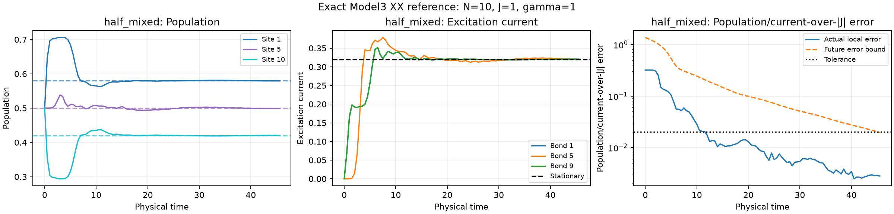

# Exact XX covariance reference

N=10, J=1, gamma=1, pL=0.9, pR=0.1.

Stop reason: **future_local_error_bound_met**. Last physical time: **45.5**. Tolerance: **0.02**.

| Initial state | Final local error | Future local error bound | Bound passed |
|---|---:|---:|---|
| half_mixed | 0.0027947305 | 0.019638432 | True |

Stationary populations: `[0.5799999999999985, 0.4999999999999999, 0.4999999999999998, 0.500000000000002, 0.5000000000000036, 0.5000000000000036, 0.5000000000000027, 0.5000000000000007, 0.5000000000000006, 0.42000000000000043]`.
Stationary excitation currents: `[0.3199999999999991, 0.3199999999999996, 0.3199999999999992, 0.31999999999999973, 0.3200000000000005, 0.3200000000000004, 0.32, 0.32000000000000034, 0.320000000000001]`.

Plots display the first/middle/last sites and bonds. The error metric, stopping decision and CSV use every site and bond. Dashed population/current lines show their stationary targets.

The covariance Frobenius bound controls these local observables at every later time for this exact generator (up to numerical precision). It is not a many-body state distance. Crossing times are resolved only on the requested observation grid; failure before the cap is reported explicitly.

This is continuous-time exact Lindblad evolution of one-body observables. Observation times are not Trotter timesteps. No finite-step dilation bias, trajectory sampling, measurement shots or device noise is included. The full many-body density matrix is not constructed.
