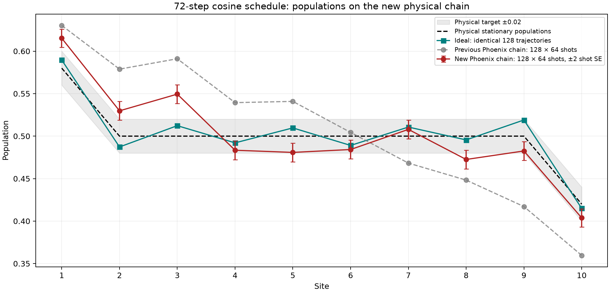
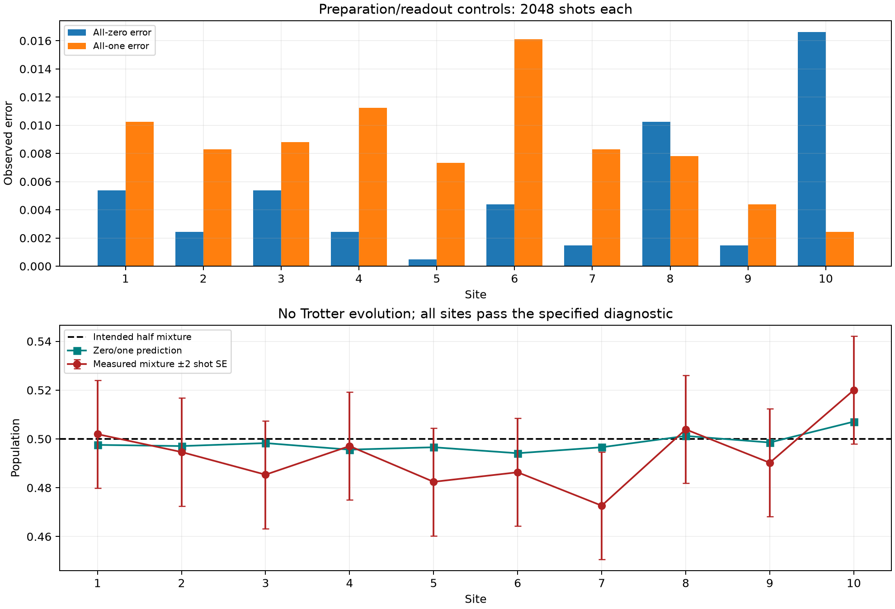

# Phoenix population analysis: calibration-selected chain

Controls: `ibm_phoenix_20261023T192723_098429Z` (3 circuits × 2048 shots). Full run: `ibm_phoenix_20261024T042722_287349Z` (128 trajectories × 64 shots). Both jobs are fully collected.

The preparation controls pass, and the full population profile improves substantially over the previous chain. The 0.02 steady-state population target is still unmet.

[Population PDF](populations.pdf) · [Population data](populations.csv) · [Control plot](controls.png)

| Comparison | Previous chain MAE | New chain MAE | Previous maximum | New maximum |
|---|---:|---:|---:|---:|
| Physical stationary populations | 0.053165 | 0.023502 | 0.091064 | 0.049438 |
| Ideal, same 128 trajectories | 0.055183 | 0.022100 | 0.101882 | 0.042522 |

The schedule, 128 saved branch sequences and ideal final covariances match the previous 128 × 64 experiment. Execution date, physical layout and device conditions differ, so the improvement cannot be uniquely attributed to layout.

| Site | Physical qubit | Hardware | Ideal same paths | Physical target | ±2 shot SE |
|---:|---:|---:|---:|---:|---:|
| 1 | 49 | 0.615234 | 0.589565 | 0.580000 | 0.010597 |
| 2 | 48 | 0.529785 | 0.487263 | 0.500000 | 0.010979 |
| 3 | 58 | 0.549438 | 0.512310 | 0.500000 | 0.010933 |
| 4 | 57 | 0.483398 | 0.492084 | 0.500000 | 0.011017 |
| 5 | 56 | 0.480835 | 0.509678 | 0.500000 | 0.011005 |
| 6 | 66 | 0.484253 | 0.489070 | 0.500000 | 0.011004 |
| 7 | 76 | 0.507935 | 0.510657 | 0.500000 | 0.010999 |
| 8 | 86 | 0.472534 | 0.495548 | 0.500000 | 0.011010 |
| 9 | 85 | 0.482544 | 0.518996 | 0.500000 | 0.011008 |
| 10 | 95 | 0.403809 | 0.414952 | 0.420000 | 0.010748 |

Sites within 0.02 of physical stationary values: **[4, 5, 6, 7, 9, 10]** (point estimates). The maximum same-path ideal population error against physical is **0.018996**.

The worst physical discrepancy is site 3: 0.549438 versus 0.500000. The worst matched-ideal discrepancy is site 2: 0.529785 versus 0.487263. Remaining discrepancies at several sites exceed nominal sampling uncertainty; more shots alone do not remove a systematic offset.

The plotted bars are ±2 shot standard errors conditional on these fixed 128 paths. Across-path and paired hardware-minus-ideal standard errors are saved separately in the CSV/JSON; they are not added to these bars. Normal approximations assume independent samples and exclude device drift. One full job cannot estimate between-job uncertainty.

## Preparation controls

All ten sites pass the existing diagnostic: baseline Wilson upper bounds below 0.03 and mixture residuals within the nominal family-adjusted cutoff 3.023.
Largest observed zero/one error: 1.6602%. Largest absolute mixture residual: 0.023926.
The largest mixture residual is at site 7 (physical qubit 76): 0.472656 measured versus 0.496582 predicted, about 2.16 nominal SE, below the screening cutoff. Passing these short controls does not certify 0.02 accuracy, bath resets, or performance after 72 steps. Controls and evolution were separate jobs executed at different times.

## Layout and circuit resources

Physical path, including the two endpoint baths: `[39, 49, 48, 58, 57, 56, 66, 76, 86, 85, 95, 105]`.
Selected calibration worst CZ error: 0.1286%; minimum T1/T2 over the path: 105.8/147.8 µs.
Native circuit depth: [1106, 1113]; CZ gates: [1440]; two-qubit depth: [288]; bath resets: [72]. Circuit depth remains substantial despite better calibration.

## Interpretation and next experiment

The new chain is a useful improvement and its preparation controls are consistent with expectations. Healthy preparation with residual full-circuit disagreement points toward effects accumulated during evolution, but these data do not isolate gate errors, idle relaxation, reset errors, or time-dependent calibration.
Next, use a small set of prefixes of the same saved cosine trajectories (for example 0, 12, 24, 48 and 72 steps), comparing each prefix to its own ideal prediction. An intermediate prefix is not expected to match the final steady state. This can identify where hardware disagreement grows before another large full-depth run. No hardware work was performed for this analysis.

## Integrity checks and scope

Reconstructed every final Z population and shot count from raw bitstrings, checked trajectory order, mappings, saved means, reference covariances, standard errors, job coverage and control assessment. Both bundles pass ZIP integrity checks; archived source and compiled ISA QPY hashes match their manifests. QPY files remain inside the bundles; no recompilation was performed. Git line-ending conversions in the checked-out JSON are accepted only when they reproduce the exact original source hash.
Only final populations were measured. These results do not establish hardware stationarity or current accuracy. There was no simulator evolution, account access, job submission, automatic correction, or modification of original run files.
