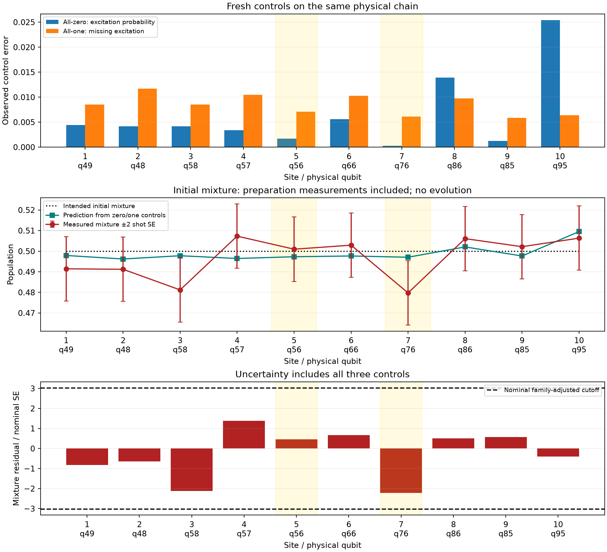

# Fresh preparation/readout evaluation

Run `ibm_phoenix_20261025T150619_925833Z`. Jobs: dbf1lrfsstms73fcv5j0. Three controls, **12288 total shots**, no Trotter evolution.

Physical path: `[39, 49, 48, 58, 57, 56, 66, 76, 86, 85, 95, 105]`. Focus physical qubits: `[56, 76]` (highlighted in gold). All sites enter the screening.

Diagnostic passed: **False**. Failed sites: `[10]`.

| Site | Physical qubit | Zero | One | Mixture | Zero/one prediction | Residual | Residual SE | Pass |
|---:|---:|---:|---:|---:|---:|---:|---:|---|
| 1 | 49 | 0.004395 | 0.991455 | 0.491455 | 0.497925 | -0.006470 | 0.007862 | True |
| 2 | 48 | 0.004150 | 0.988281 | 0.491211 | 0.496216 | -0.005005 | 0.007873 | True |
| 3 | 58 | 0.004150 | 0.991455 | 0.481201 | 0.497803 | -0.016602 | 0.007857 | True |
| 4 | 57 | 0.003418 | 0.989502 | 0.507324 | 0.496460 | 0.010864 | 0.007866 | True |
| 5 | 56 | 0.001709 | 0.992920 | 0.500977 | 0.497314 | 0.003662 | 0.007847 | True |
| 6 | 66 | 0.005615 | 0.989746 | 0.502930 | 0.497681 | 0.005249 | 0.007875 | True |
| 7 | 76 | 0.000244 | 0.993896 | 0.479736 | 0.497070 | -0.017334 | 0.007832 | True |
| 8 | 86 | 0.013916 | 0.990234 | 0.506104 | 0.502075 | 0.004028 | 0.007904 | True |
| 9 | 85 | 0.001221 | 0.994141 | 0.502197 | 0.497681 | 0.004517 | 0.007841 | True |
| 10 | 95 | 0.025391 | 0.993652 | 0.506348 | 0.509521 | -0.003174 | 0.007933 | False |

For intended occupation p, a stable local affine response predicts (1-p) × zero + p × one. At p=0.5 this is the average of the two baseline populations. The mixture residual tests that prediction, including sampling uncertainty from all three measurements.

Baseline errors use one-sided Wilson upper bounds with threshold 3.000%. Mixture tests use a nominal family-adjusted cutoff of 3.023, with family alpha 0.05. These screening choices are separate from the 0.02 evolved-state accuracy target.

Large zero/one errors point to a baseline preparation/readout concern. A mixture inconsistent with their prediction suggests that a stationary local affine response does not describe these preparations; preparation gates, initial measurement timing, crosstalk and drift remain possible contributors. This diagnostic does not separate those mechanisms or justify automatic inverse-response correction.

The zero and one controls use deterministic preparations followed by final Z readout. The mixture control retains the original unconditioned initial preparation measurements, whose records are ignored, then final Z readout. There are no system exchange gates, bath collisions or bath resets. No full evolution run is automatically submitted, regardless of the outcome.

Integrity: verified original QPY SHA-256; source hash and raw-count reconstruction checked. Individual control shots: `{'all_zero': 4096, 'all_one': 4096, 'initial_mixture': 4096}`.

Site 10 (physical 95): zero-control error upper bound exceeds threshold.
