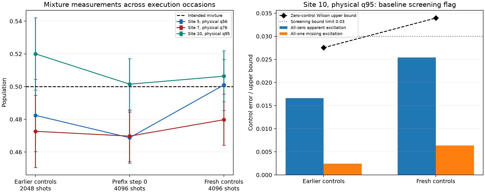

# Findings: fresh preparation/readout controls

Run `ibm_phoenix_20261025T150619_925833Z`; job `dbf1lrfsstms73fcv5j0`. All **3 circuits × 4096 shots = 12,288 shots** collected on the same physical chain.

**All ten mixture-consistency tests pass. The overall diagnostic fails only at site 10 (physical qubit 95), because its all-zero error upper bound exceeds the chosen 3% screen. Qubit 56 no longer shows the earlier mixture deficit; qubit 76 remains somewhat low but is not flagged by the current family-adjusted test.**

[Current control plots](preparation_controls.png) ([PDF](preparation_controls.pdf)); [cross-run comparison](followup_comparison.png) ([PDF](followup_comparison.pdf)); [full control table](preparation_controls.csv).

## Focus qubits

| Physical qubit | Site | Zero population | One population | Measured mixture | Zero/one prediction | Residual / nominal SE | Screen |
|---:|---:|---:|---:|---:|---:|---:|---|
| 56 | 5 | 0.001709 | 0.992920 | 0.500977 | 0.497314 | 0.47 | Pass |
| 76 | 7 | 0.000244 | 0.993896 | 0.479736 | 0.497070 | -2.21 | Pass |
| 95 | 10 | 0.025391 | 0.993652 | 0.506348 | 0.509521 | -0.40 | Baseline flag |

For the intended half mixture, the prediction is `(zero + one)/2`. The residual uncertainty includes finite shots in all three controls. The nominal family-adjusted cutoff is **3.023 SE**. The largest absolute mixture residual is site 7/q76: **−0.017334**, or **−2.21 nominal SE**. Site 3/q58 is also below its prediction by 0.016602 (−2.11 SE), but neither crosses this screening cutoff. Passing this test is not proof that the residual is zero or that every population is accurate to 0.02.

## Why qubit 95 fails the overall screen

Its all-zero control contains **104 apparent excitations out of 4096 shots**, giving **0.025391 (2.54%)**. The selected family-adjusted one-sided Wilson upper bound is **0.033945 (3.39%)**, above the **0.03** screening limit. Therefore the test cannot certify a baseline error below the chosen limit. It does **not** measure a 3.39% error or establish that the true error exceeds 3%.

The all-one error at q95 is much smaller: **26/4096 = 0.006348**. Its asymmetric zero/one response predicts mixture population **0.509521**; the measured **0.506348** agrees within **0.40 nominal SE**. Thus the flag is a baseline initialization/readout concern, not a mixture inconsistency at q95. The logical all-zero circuit contains final readout only; Runtime initialization is still enabled, so initial-state errors and readout misassignment are not separated by this data.

## Comparison with the earlier preparation offsets

| Physical qubit | Earlier 2048-shot control | Prefix step-0 measurement | Fresh 4096-shot control |
|---:|---:|---:|---:|
| 56 | 0.482422 | 0.468750 | 0.500977 |
| 76 | 0.472656 | 0.469727 | 0.479736 |
| 95 | 0.520020 | 0.501465 | 0.506348 |

Qubit 56 moved from **0.468750** in the prefix experiment to **0.500977** here. The earlier deficit therefore is not a stable offset reproduced in this fresh measurement. Qubit 76 moved from **0.469727** to **0.479736**, remaining low but consistent with a modest residual under the current uncertainty budget. Execution occasions, PUB structure (32 repeated prefix-zero circuits versus one control circuit), and surrounding circuit context differ. These measurements do not establish whether the changes arise from drift, timing, context or sampling; they do not justify permanently labeling q56 as faulty.

The old q95 zero-control population was 0.016602; it is 0.025391 now. The observed increase and asymmetric response merit attention, but are not by themselves a controlled demonstration of device deterioration. Do not pool these separate runs into one stationary calibration.

## What this establishes and what remains

Fresh simple preparation/readout is mostly consistent across the chain, with the specific q95 baseline screening concern above. This does not explain or remove the long-circuit hardware discrepancy: these controls have no system exchange gates, bath collisions or programmed bath resets. They cannot validate reset performance, currents or a hardware steady state. No automatic inverse affine correction was applied.

The next diagnostic should retain a q95 initialization/readout baseline and separate system-bond evolution from boundary-collision/reset sequences. That can test the mechanisms that accumulate during the longer prefixes while preserving the current schedule for comparison. Replacing q56 solely because of the earlier one-run deficit is not supported by this followup. Any hardware execution remains for the user.

## Verification

Independently reconstructed all raw control populations and recomputed the screening bounds and mixture residuals. All cached population values and assessment fields agree. The source hash matches after proven Git CRLF/LF conversion; the bundle passes CRC checks, its JSON/text agrees with the pulled files, and its original compiled QPY hash matches the manifest. All original run and pulled analysis files were preserved. No simulator evolution, noisy simulation, mitigation, hardware query or new job was performed.
