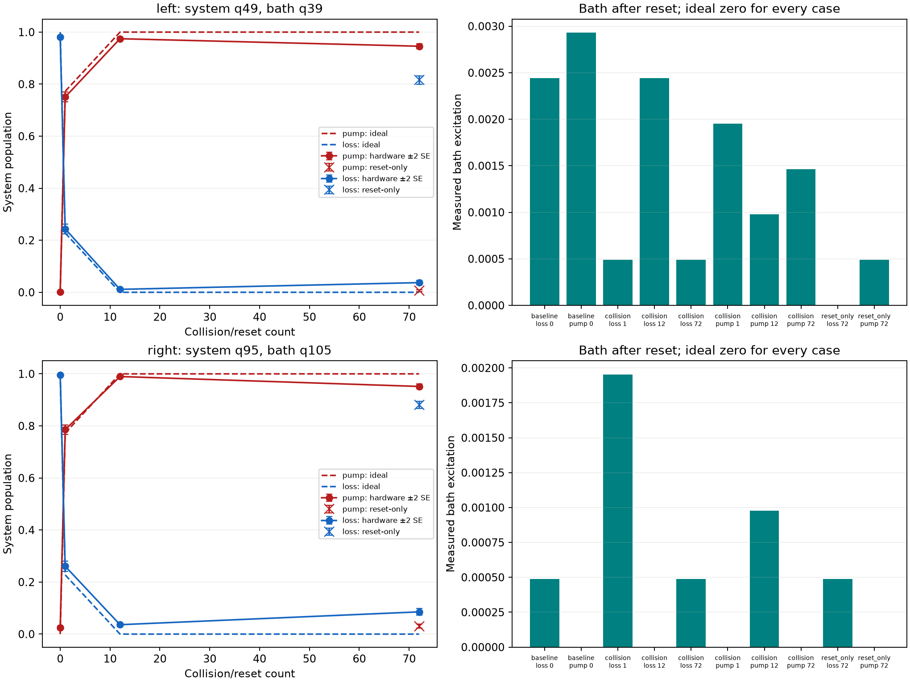

# Isolated boundary collision/reset evaluation

20 circuits × 2048 shots = 40960 shots; jobs dbf7la7sstms73fd957g.

| Case | System population | Ideal system | Bath population | Ideal bath |
|---|---:|---:|---:|---:|
| left_baseline_loss_0 | 0.980957 | 1.000000 | 0.002441 | 0 |
| left_baseline_pump_0 | 0.001465 | 0.000000 | 0.002930 | 0 |
| left_collision_loss_1 | 0.243652 | 0.227526 | 0.000488 | 0 |
| left_collision_loss_12 | 0.011230 | 0.000000 | 0.002441 | 0 |
| left_collision_loss_72 | 0.037109 | 0.000000 | 0.000488 | 0 |
| left_collision_pump_1 | 0.750488 | 0.772474 | 0.001953 | 0 |
| left_collision_pump_12 | 0.974609 | 1.000000 | 0.000977 | 0 |
| left_collision_pump_72 | 0.945801 | 1.000000 | 0.001465 | 0 |
| left_reset_only_loss_72 | 0.815430 | 1.000000 | 0.000000 | 0 |
| left_reset_only_pump_72 | 0.006348 | 0.000000 | 0.000488 | 0 |
| right_baseline_loss_0 | 0.996094 | 1.000000 | 0.000488 | 0 |
| right_baseline_pump_0 | 0.024414 | 0.000000 | 0.000000 | 0 |
| right_collision_loss_1 | 0.260742 | 0.227526 | 0.001953 | 0 |
| right_collision_loss_12 | 0.036133 | 0.000000 | 0.000000 | 0 |
| right_collision_loss_72 | 0.085449 | 0.000000 | 0.000488 | 0 |
| right_collision_pump_1 | 0.785645 | 0.772474 | 0.000000 | 0 |
| right_collision_pump_12 | 0.989746 | 1.000000 | 0.000977 | 0 |
| right_collision_pump_72 | 0.951660 | 1.000000 | 0.000000 | 0 |
| right_reset_only_loss_72 | 0.880859 | 1.000000 | 0.000488 | 0 |
| right_reset_only_pump_72 | 0.030762 | 0.000000 | 0.000000 | 0 |

Baselines prepare system 0 or 1 and bath 0, then measure both. Collision cases repeatedly apply one conditional pump or loss branch with the original schedule's compensated bath angles, resetting the bath after every collision. These repetitions are not stochastic physical-reservoir evolution or a replacement steady-state schedule.

Reset-only cases apply the same bath preparation (X for pump, none for loss) and reset count, without system–bath exchange. Synchronization barriers force the system to wait until the bath operations finish before readout. Collision and reset-only durations differ, so their difference does not isolate a pure CZ error rate.

Compare the measured bath excitation after resets with the corresponding baseline bath excitation; baseline readout errors can produce apparent excitation even after a perfect reset. System survival in reset-only cases tests effects associated with waiting, bath pulses and resets together. Neither comparison by itself separates reset errors, relaxation, crosstalk and readout. These are isolated-pair circuits with different measurement context and synchronization from the full-chain experiment.

Only the two active qubits are measured in each circuit. Error bars are nominal ±2 shot SE, assume independent stationary sampling, omit drift and are not simultaneous confidence guarantees. No inverse readout correction or mitigation is applied.

Original source/compiled circuit hashes and raw counts were verified. No hardware execution is performed by the offline analyzer.
