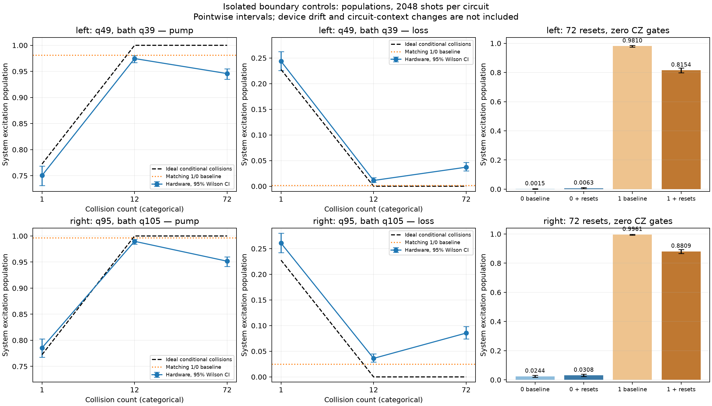

# Findings: isolated boundary collisions and resets

Run `ibm_phoenix_boundary_20261025T215447_981524Z`, IBM Phoenix job `dbf7la7sstms73fd957g`. All **20 circuits × 2048 shots = 40,960 shots** collected. The left pair is system **q49**, bath **q39**; the right pair is system **q95**, bath **q105**. These are separate two-qubit diagnostics on the endpoint pairs of the previous chain.

**There is a substantial system-population change during 72 bath resets even with no exchange gates. Repeated collision accuracy also deteriorates between 12 and 72 collisions. Final bath populations are small, so the measurements do not identify a large residual bath excitation after the last reset as the dominant problem. They do not separate system relaxation, reset-associated disturbance, gate errors and timing effects.**

[Figure PDF](boundary_findings.pdf), [original system and bath plots](boundary_controls.png), [all raw population estimates](boundary_controls.csv), [statistical contrasts](contrasts.csv), [machine-readable findings](findings.json).

## System changes without exchange gates

The loss-labelled reset-only control starts the system in 1 and repeatedly resets its bath, initially 0. The pump-labelled control starts the system in 0 and repeats bath X followed by reset. Both contain **zero CZ gates**, with barriers making the system wait through the bath sequence. Ideally their system populations remain 1 and 0 respectively.

| System qubit | Initial population | Fresh baseline | After 72 bath resets | Change, percentage points | Pointwise 95% interval for change, percentage points |
|---|---:|---:|---:|---:|---:|
| Left q49 | 1 | 0.980957 | 0.815430 | −16.553 | [−18.364, −14.792] |
| Right q95 | 1 | 0.996094 | 0.880859 | −11.523 | [−13.011, −10.139] |
| Left q49 | 0 | 0.001465 | 0.006348 | +0.488 | [+0.101, +0.947] |
| Right q95 | 0 | 0.024414 | 0.030762 | +0.635 | [−0.377, +1.658] |

The excited-system losses are much larger than sampling uncertainty: two-sided Fisher tests, adjusted over the eight contrasts described below, give p < 1.1 × 10⁻⁷⁶ (left) and p < 5.3 × 10⁻⁶⁴ (right). The left initially-zero change is much smaller and only marginal under that family adjustment (p = 0.042); the right change is inconclusive (p = 0.252).

Thus an explanation involving exchange-gate errors alone cannot account for all these observations: a sizeable population change appears without those gates. However, this is **not a measurement of reset infidelity per reset**. The system waits while the bath resets, so ordinary relaxation, bath-control disturbance, idle behavior and changes in readout context remain possible contributors. There is no duration-matched idle-only control in this run. The saved system T1 values, approximately 191 μs for q49 and 196 μs for q95, provide context but do not establish how much of the observed loss is ordinary relaxation. Circuit depth is not elapsed physical time, and the actual scheduled per-circuit duration is not established here.

## Collisions: early agreement, increasing long-sequence error

The conditional ideal pump population is

$$
n_{\mathrm{pump}}(m)=1-\prod_{k=0}^{m-1}\cos^2\theta_k,
\qquad
n_{\mathrm{loss}}(m)=\prod_{k=0}^{m-1}\cos^2\theta_k,
\qquad
\theta_k=\sqrt{2\gamma h_k}.
$$

The original cosine step sizes and compensated branch angles are retained. Every collision in a given test uses the same pump or loss branch. These are **conditional repetitions**, rather than random reservoir choices or full-chain evolution. Ideal pump/loss values are approximately 1/0 after 12 collisions: the remaining ideal retention is only 2.96 × 10⁻⁸. At 72 it is 2.17 × 10⁻²⁴.

| Pair | Conditional operation | Ideal after 1 | Hardware after 1 | Hardware after 12 | Hardware after 72 |
|---|---|---:|---:|---:|---:|
| Left | Pump from 0 | 0.772474 | 0.750488 | 0.974609 | 0.945801 |
| Left | Loss from 1 | 0.227526 | 0.243652 | 0.011230 | 0.037109 |
| Right | Pump from 0 | 0.772474 | 0.785645 | 0.989746 | 0.951660 |
| Right | Loss from 1 | 0.227526 | 0.260742 | 0.036133 | 0.085449 |

From 12 to 72 collisions, the pump population drops by **2.881 percentage points left** and **3.809 points right**. The loss population rises by **2.588 points left** and **4.932 points right**. All four changes remain statistically distinguishable under the specified eight-comparison adjustment (largest adjusted p = 8.5 × 10⁻⁶). The ideal change over this interval is negligible and goes toward the target. Hardware therefore moves farther from the intended conditional targets as this sequence gets longer.

The one-collision raw differences are much smaller. Their sizes do not suggest a gross error in branch direction or angle convention. A forward baseline-response comparison gives residuals of −0.00761/+0.01933 for left pump/loss and +0.01063/+0.01525 for right pump/loss, approximately −0.77/+2.03 and +1.16/+1.52 nominal shot SE. These are useful checks, not proof that the first collision is exact.

Each 12-collision circuit contains **24 CZ gates and 12 resets**; each 72-collision circuit contains **144 CZ gates and 72 resets**. The extra collisions both lengthen the sequence and introduce more gates. Comparing them with the reset-only controls does not isolate a pure CZ contribution because the durations and state histories differ. These isolated 144-CZ circuits also differ substantially from the earlier full-chain 1440-CZ circuits.

## Baseline offsets do not explain all the collision discrepancy

Q95 again has a relatively high zero-baseline population: **50/2048 = 0.024414**, versus the previous preparation run's **104/4096 = 0.025391**. The point estimates are close; the different execution occasion and two-qubit rather than ten-qubit measurement context mean they should not be pooled as one stationary calibration. Its one baseline is **0.996094**. On q49, the zero/one baselines are **0.001465/0.980957**.

A descriptive forward response model is

$$
n_{\mathrm{predicted}}=(1-n_{\mathrm{ideal}})b_0+n_{\mathrm{ideal}}b_1,
$$

where the two current baseline populations are $b_0,b_1$. This predicts raw measurement response under a stable affine preparation/readout model; it does **not** invert or mitigate the hardware data, and that model is not validated for longer circuits.

At 72 collisions, pump populations are **0.035156 below the one baseline on the left** and **0.044434 below it on the right**. Loss populations are **0.035645 above the zero baseline on the left** and **0.061035 above it on the right**. These residuals exceed nominal shot uncertainty by roughly 6–9 SE. Consequently, simply subtracting q95's zero offset or invoking finite shots would not account for these long-sequence discrepancies. See [forward comparisons](forward_baseline_comparison.csv).

## What the bath measurement establishes

All collision and reset-only circuits ideally end with the bath in 0. Their measured final bath populations range from **0 to 0.002441** (at most 5 apparent excitations in 2048 shots). Baseline bath populations range from 0 to 0.002930. There is no consistent large increase above the corresponding baselines.

This supports a low final measured bath excitation in these tests. It does **not** establish perfect resetting: zero observed excitations still has a pointwise 95% Wilson upper bound of about **0.001872**, readout can mask or introduce apparent excitations, and a final measurement does not resolve the bath state after each earlier reset or capture correlations with the system. Substantial system disturbance can coexist with a bath ending near 0.

## Implication and next evaluation

These diagnostics strengthen the case that accumulated device effects contribute to the previous population discrepancy, including effects present during bath-reset sequences without exchange gates. They do not show a failure of the mathematical cosine schedule or directly test a physical steady state, currents, or the full randomized dynamics. Shortening the original evolution solely because the 12-collision diagnostic looks better would change the physical question; its repeated conditional branches are different dynamics.

The most informative next control is **matched-duration system survival** on these same endpoint pairs: compare an initially excited system waiting with an inactive bath against bath-reset sequences of the same scheduled duration, retaining fresh zero/one baselines. Include several lengths, retain compiled circuits and timing metadata, and randomize or interleave the comparisons. This can help distinguish passive waiting losses from additional disturbance associated with bath operations. Actual hardware scheduling and reset latency must be included in the matching; simply replacing each reset by its nominal calibration duration may not suffice. No hardware evaluation was launched here.

## Statistics and verification

Intervals on individual populations are pointwise 95% Wilson intervals. Intervals for differences use the Newcombe independent-proportions method. The eight explicitly reported tests comprise the four reset-only-minus-baseline comparisons and four 72-minus-12 collision comparisons. Their two-sided Fisher exact p-values receive Holm adjustment together. The difference intervals remain pointwise, not simultaneous. This selected diagnostic family does not correct every possible exploratory comparison in the dataset. All sampling calculations assume independent stationary shots and omit drift, temporal correlation, calibration uncertainty and context changes. The forward-model SE also includes both baseline sampling variances but not model inadequacy.

Independently reconstructed all 20 populations from the manifest's raw outcome counts, checking 2048 shots per circuit, complete ordered coverage and physical bit mappings. Recomputed values agree with both cached JSON analyses. The source hash is reproducible with the original CRLF line endings; the compiled QPY SHA-256 matches exactly. The bundle passes CRC checks and its JSON agrees with the pulled originals. Inspected all 20 compiled circuits, verifying case order, measured physical qubits and saved operation counts. All original run files and previously pulled analysis files were preserved byte-for-byte. Only offline arithmetic, statistical comparisons, circuit inspection and plotting were performed; no simulator evolution, hardware query or new hardware job was used.
