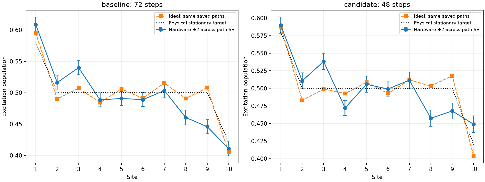

# Paired schedule population comparison

Jobs: dbfa8ensstms73fdede0, dbfacmnpc3tc739n2mk0, dbfah00m94ac738t64cg, dbfajivpc3tc739n32o0, dbfaqh0m94ac738t6gvg. Total shots: 22528.

| Schedule | Steps | CZ count | Hardware max error vs physical | Hardware max error vs own ideal | Ideal max error vs physical |
|---|---:|---|---:|---:|---:|
| baseline | 72 | [1440] | 0.054199 | 0.062185 | 0.015767 |
| candidate | 48 | [960] | 0.042603 | 0.050036 | 0.017810 |

Primary comparison: all-site population error to the physical stationary target (target 0.02). Own-ideal errors separate finite-path preparation bias from device discrepancy. Report both; do not infer improvement merely from circuit depth. Means use the same paths and shots. Controls are interleaved for context; they do not automatically stop the experiment or apply mitigation.

Preparation-control screen passed: **False**. Failed sites: [10].

Populations only. No hardware currents, readout correction or accuracy guarantee. Across-path errors include shots but omit drift; adjacent PUB order is requested, not verified hardware dispatch order.

Compiled QPY batches are retained locally. The small results bundle omits them; verification states which batches were available. Retain those local files for later circuit inspection. No permanent settling or noisy-hardware accuracy is certified by the input large-ensemble checks.
