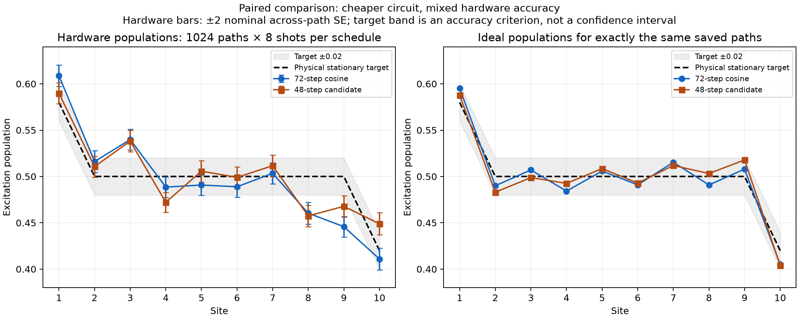

# Paired hardware result: 72-step versus 48-step schedules

Run `ibm_phoenix_comparison_20261026T005025_553744Z`. All **2051 circuits and 22,528 shots** collected across five jobs. Each schedule used **1024 trajectories × 8 shots**, with three additional 2048-shot preparation controls. Both schedules used the same physical chain, branch-choice prefixes and compilation settings; the requested PUB plan kept each pair adjacent within its batch and randomized schedule order. Actual hardware dispatch order is not verified.

**The 48-step circuit is one-third cheaper in CZ gates and resets. It has a smaller observed worst-site error to the physical target, but the overall hardware-accuracy outcome is mixed and neither schedule meets 0.02. Paired uncertainty estimates do not establish an aggregate accuracy improvement. The average discrepancy from the candidate's own ideal prediction is larger, despite its smaller worst discrepancy.**

[PDF](paired_population_comparison.pdf), [original per-schedule plots](populations.png), [all population values](populations.csv), [paired site comparisons](paired_site_comparisons.csv), [aggregate uncertainty estimates](aggregate_comparisons.csv), [full findings JSON](findings.json).

## Circuit cost and primary accuracy target

The physical Model3 target remains **(0.58, 0.5, 0.5, 0.5, 0.5, 0.5, 0.5, 0.5, 0.5, 0.42)**. Hardware measured populations only. No excitation-current measurement or full steady-state certification follows from this run.

| Quantity | Current 72-step | Candidate 48-step |
|---|---:|---:|
| Saved native CZ gates per trajectory | 1440 | 960 |
| Bath resets per trajectory | 72 | 48 |
| Saved native depth range | 1087–1135 | 744–758 |
| Maximum hardware population error to physical target | 0.054199 | 0.042603 |
| Mean absolute hardware population error to physical target | 0.022293 | 0.020862 |
| RMS hardware population error to physical target | 0.027601 | 0.025110 |
| Maximum hardware discrepancy from own ideal paths | 0.062185 | 0.050036 |
| Mean absolute hardware discrepancy from own ideal paths | 0.020436 | 0.023989 |
| RMS hardware discrepancy from own ideal paths | 0.026766 | 0.030698 |
| Ideal finite-path maximum error to physical target | 0.015767 | 0.017810 |

The observed maximum physical-target error falls by **0.011597**, or approximately **21.4%**. The observed mean absolute physical-target error falls by only **0.001432**, or **6.4%**. Both maxima remain more than twice the **0.02** acceptance threshold. Five candidate site means lie within 0.02 of their targets, compared with six baseline site means; these counts are descriptive point estimates, not confidence statements. The largest-error site changes between schedules, so a lower maximum does not imply uniform improvement.

The native CZ/reset reduction is exactly **33.33%** in the saved metadata. Compiled QPY files were deliberately retained locally rather than included in the small results bundle. They are absent from the pulled files, so their binaries and mappings could not be independently inspected here. The saved records consistently report the expected counts and physical layout. Actual hardware execution durations were not inferred from gate depth or job lifecycle timestamps.

## What changed in the actual populations

| Site | Physical qubit | Target | 72-step hardware | 48-step hardware | Observation |
|---|---:|---:|---:|---:|---|
| 1 | 49 | 0.58 | 0.608765 | 0.589844 | Closer to target |
| 2 | 48 | 0.50 | 0.516113 | 0.510620 | Closer |
| 3 | 58 | 0.50 | 0.539795 | 0.538208 | Similar positive offset |
| 4 | 57 | 0.50 | 0.488525 | 0.472046 | Farther from target |
| 5 | 56 | 0.50 | 0.490723 | 0.505737 | Closer |
| 6 | 66 | 0.50 | 0.488892 | 0.499023 | Closer |
| 7 | 76 | 0.50 | 0.503418 | 0.511597 | Farther |
| 8 | 86 | 0.50 | 0.460327 | 0.457397 | Similar negative offset; candidate worst site |
| 9 | 85 | 0.50 | 0.445801 | 0.467773 | Closer; baseline worst site |
| 10 | 95 | 0.42 | 0.410889 | 0.448853 | Crosses target and becomes farther away |

The persistent offsets at sites 3 and 8 show that reducing depth by one-third has not removed the population discrepancy. Conversely, improvements at sites 1 and 9 show that the outcome is not simply a uniform deterioration. This is a redistribution of errors with a modest improvement in some aggregate physical-target metrics.

## Paired uncertainty: the aggregate gain is inconclusive

Using the matched trajectories, 10,000 paired bootstrap resamples were drawn within the five observed batches. Both schedules and their per-path ideal predictions were resampled together. Differences below are **candidate minus baseline**, so negative values favor the candidate.

| Error metric | Observed difference | Descriptive 95% bootstrap interval |
|---|---:|---:|
| Maximum error to physical target | −0.011597 | [−0.024292, +0.004395] |
| Mean absolute error to physical target | −0.001432 | [−0.006058, +0.003549] |
| Maximum discrepancy from own ideal | −0.012149 | [−0.023522, +0.004434] |
| Mean absolute discrepancy from own ideal | +0.003553 | [−0.000354, +0.008463] |

All four intervals include zero. Therefore the data do not establish a reliable aggregate accuracy improvement or aggregate deterioration under this resampling model. The 21.4% maximum-error reduction is a point estimate, not a statistically established performance gain. The one-third circuit-cost saving is a separate, clear result.

The bootstrap unit is the paired trajectory, stratified by observed batch, with seed 20261026. It conditions on these five jobs rather than estimating general day-to-day device variation. It does not include device drift, temporal correlations or shared calibration uncertainty. Absolute-value and maximum statistics are nonlinear; these percentile intervals are descriptive and not simultaneous confidence guarantees.

## Changes relative to each schedule's own ideal

For each site, define the paired change in hardware discrepancy as

$$
\Delta_j=\bigl(n^{\mathrm{HW},48}_j-n^{\mathrm{ideal},48}_j\bigr)
          -\bigl(n^{\mathrm{HW},72}_j-n^{\mathrm{ideal},72}_j\bigr).
$$

This removes the change in the ideal population profile before comparing the hardware discrepancies. The two ideal profiles differ because both the schedule and finite-ensemble realization of the preparation change.

Two of ten nominal paired site tests survive Holm correction:

- **Site 4/q57:** Δ = **−0.024778**, nominal SE **0.007972**, adjusted p **0.0174**. Baseline hardware/ideal populations are **0.488525/0.484233**, versus candidate **0.472046/0.492531**. The candidate develops a negative discrepancy.
- **Site 10/q95:** Δ = **+0.039096**, nominal SE **0.008234**, adjusted p **2.35 × 10⁻⁵**. Baseline hardware/ideal populations are **0.410889/0.404925**, versus candidate **0.448853/0.403793**. The ideal endpoint barely changes, while the candidate hardware population rises substantially.

The tests use paired residual means over 1024 trajectories and two-sided t approximations with 1023 degrees of freedom, adjusted together over ten sites. They assume independent stationary trajectory observations and omit drift. They identify differences in population discrepancy, not a microscopic error mechanism or a quantum-channel fidelity. Other sitewise residual changes do not survive that correction. Pointwise movement toward the physical target can partly reflect cancellation between ideal preparation bias and hardware error, so both references must be retained.

## Preparation controls

All ten mixture-consistency screens pass at the nominal family-adjusted cutoff. The overall control screen fails only at site 10/q95:

- Zero control: **43/2048 = 0.020996** apparent excitation.
- One control: **0.996582** population.
- Half-mixture: **0.484375**, compared with the zero/one prediction **0.508789**; residual **−0.024414**, approximately **−2.18 nominal SE**, below the **3.023 SE** screening cutoff.
- The family-adjusted one-sided zero-error upper bound is **0.032916**, exceeding the selected **0.03** screen.

The bound does not measure a 3.29% error or prove the true error exceeds 3%. It means this control cannot certify the chosen bound. The q95 baseline concern persists, but a single stable readout offset cannot by itself explain why nearly identical ideal endpoint populations yield such different hardware populations in the paired schedules. Controls at different positions also do not prove a stationary readout model. No inverse correction or mitigation was applied.

## Decision from this bounded comparison

**Circuit-cost goal: achieved. Hardware population accuracy of 0.02: not achieved. General improvement in hardware agreement with the ideal circuit: not established.**

If retaining this implementation, the 48-step schedule is a lower-cost option with the mixed population results above. It should not be presented as a validated 0.02 hardware steady-state preparation. These data do not show that no better schedule can exist, but this particular comparison has answered the question it was designed to test.

Following the agreed stopping rule, stop the incremental diagnostic/schedule-tuning series here. Reaching a materially better hardware accuracy would require a deliberate new implementation or noise-handling strategy with its own justification, rather than automatically requesting another small hardware control. No additional hardware execution is proposed or launched by this analysis.

## Verification and preservation

Independently reconstructed all 2051 circuits' raw population counts, confirming 1024 paths per schedule, eight shots per evolution circuit, 2048 per control, five complete ordered batches and 22,528 total shots. Reproduced both cached analyses' population vectors, standard errors, error metrics, paired residuals and control assessment. Both source hashes match exactly. The sources match the packaged paired inputs, whose hash matches the manifest; shared branch prefixes and the saved physical layout agree with the planned experiment. Independently checked the physical stationary population formula from J, gamma and reservoir parameters.

The result bundle passes CRC checks and its JSON agrees with the pulled originals. QPY chunks are unavailable here by the runner's documented transfer design; verification records this limitation rather than claiming fresh compiled-binary inspection. Original hardware-run files and previously pulled analysis artifacts were preserved byte-for-byte. New findings, tables and plots are saved alongside them. Only offline count reconstruction, statistics and plotting were performed: no new trajectory evolution, simulator run, hardware query or hardware job.
