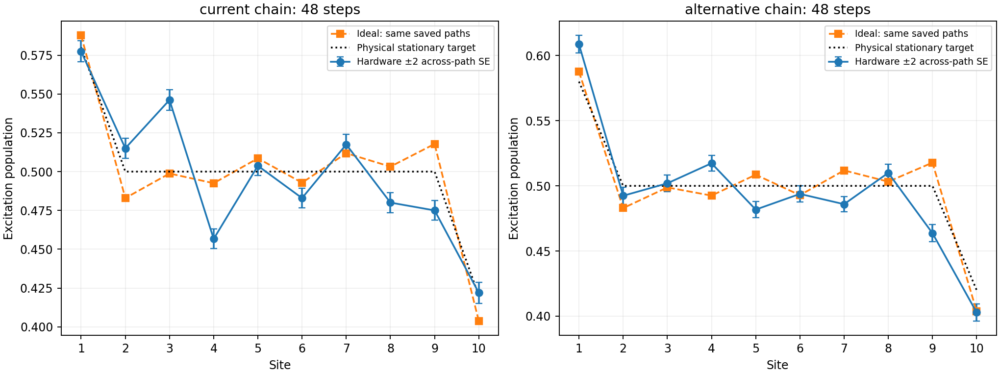

# Paired mapping population comparison

Jobs: dbfdv27gdj9s73bbegjg, dbfe26npc3tc739n9d00, dbfe6vfgdj9s73bbf2eg, dbfegnom94ac738tdfs0, dbfevtnpc3tc739nbh90. Total shots: 77824.

| Schedule | Steps | CZ count | Hardware max error vs physical | Hardware max error vs own ideal | Ideal max error vs physical |
|---|---:|---|---:|---:|---:|
| baseline | 48 | [960] | 0.046143 | 0.047356 | 0.017810 |
| candidate | 48 | [960] | 0.036316 | 0.054126 | 0.017810 |

Primary mapping comparison: hardware discrepancy from the common ideal saved paths. Also report population error to the physical stationary target; 0.02 is not certified by this workload. Own-ideal errors separate finite-path preparation bias from device discrepancy. Report both; do not infer improvement merely from circuit depth. Means use the same paths and shots. Controls are interleaved for context; they do not automatically stop the experiment or apply mitigation.

Preparation-control screen passed: **False**. Failed sites: {'baseline': [1, 10], 'candidate': []}.

Populations only. No hardware currents, readout correction or accuracy guarantee. Across-path errors include shots but omit drift; adjacent PUB order is requested, not verified hardware dispatch order.

Compiled QPY batches are retained locally. The small results bundle omits them; verification states which batches were available. Retain those local files for later circuit inspection. No permanent settling or noisy-hardware accuracy is certified by the input large-ensemble checks.

Mapping test: baseline is the current chain; candidate is the alternative chain. Both use the identical candidate schedule, preparation and branch paths. The primary mapping comparison is discrepancy from that common ideal; physical-target errors remain a secondary reported outcome. Per-chain controls are diagnostic context, not an automatic stopping rule or mitigation.

Physical paths: `{'baseline': [39, 49, 48, 58, 57, 56, 66, 76, 86, 85, 95, 105], 'candidate': [49, 39, 38, 48, 58, 57, 56, 66, 76, 86, 85, 84]}`.

Sampling precision here does not certify the original 0.02 error budget. Paired estimates condition on the saved branch paths and omit drift.
