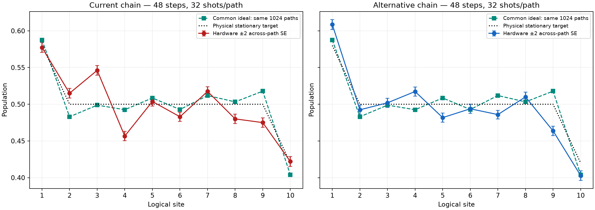
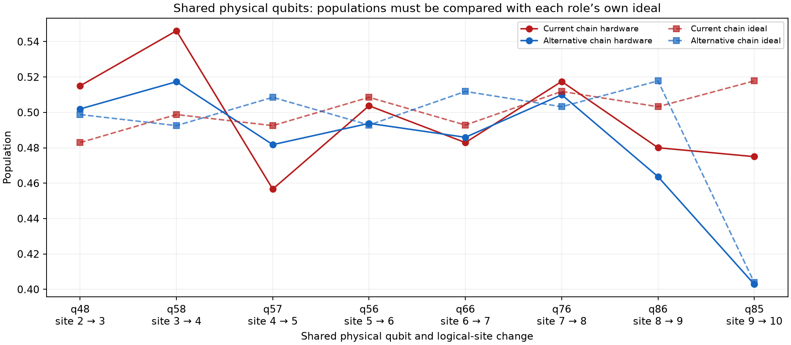

# Paired mapping result: execution succeeded; average accuracy improves

**The Qiskit/QPY problem is resolved and the new hardware run completed correctly. The alternative mapping improves average agreement with the common ideal population profile, with a descriptive paired bootstrap interval supporting that improvement within this run. It does not meet the maximum population-error target of 0.02. Its largest discrepancy from the ideal is slightly larger than the current chain's point estimate, although that worsening is not established by the bootstrap interval.**

Run `ibm_phoenix_mapping_comparison_20261026T050356_310922Z`, started October 26, 2026 at approximately 01:03 EDT. All five jobs, **2054 circuits and 77,824 shots**, were collected. Both mappings use **the identical 48-step schedule, 1024 branch trajectories and 32 shots per trajectory**. Each mapping also has three 2048-shot preparation controls.

[Numerical findings](findings.json), [all site values and paired tests](paired_mapping_sites.csv), [aggregate intervals](aggregate_comparisons.csv), [shared physical qubits](shared_physical_qubits.csv), [reproducible offline analysis](../../../../../analysis/offline_audit/analyze_mapping_result.py).

[Population figure PDF](paired_mapping_populations.pdf).

## Software, circuit inputs and collection

The execution manifest records **Qiskit 2.5.2**, **qiskit-ibm-runtime 0.49.0**, and NumPy 2.5.4. It records successful verification of all five QPY chunks from the previous 72/48-step run before the new backend connection. The previous manifest hash matches the pulled manifest after the proven CRLF/LF conversion. Thus the previous local QPY-format failure was overcome, rather than bypassed.

Both new source files are byte-for-byte identical, with SHA-256 `5c87e03cca8d4b799bf347392b4c1515fdbc1299a95c0ed629a3dd5e9e9a8d1f`. Their per-path ideal predictions are identical. Saved native resources are:

| Resource | Current mapping | Alternative mapping |
|---|---:|---:|
| Evolution trajectories | 1024 | 1024 |
| Shots per trajectory | 32 | 32 |
| Schedule steps | 48 | 48 |
| Native CZ gates per trajectory | 960 | 960 |
| Bath resets per trajectory | 48 | 48 |
| Native depth range | 736–746 | 748–759 |

The alternative's native depth is slightly greater. This comparison changes layout and its compilation/context effects while preserving the logical circuit; it is not a reduction in Trotter steps or CZ count.

All raw counts were reconstructed independently using integer bit masks and checked against the cached means and standard errors. Complete trajectory pairing, per-circuit shots, recorded physical mappings, bundle CRC and bundled JSON agree. The execution machine's final cached analysis records verification of all five new native QPY chunks. These binary files are omitted from the small transferred bundle, so this offline review cannot independently inspect them here. It can verify their recorded hashes and metadata, and distinguishes that from fresh binary inspection.

## Population accuracy

Both mappings have the same ideal finite-path maximum population error, **0.017810**, relative to the physical stationary target `(0.58, 0.5, …, 0.5, 0.42)`.

| Metric | Current mapping | Alternative mapping |
|---|---:|---:|
| Mean absolute discrepancy from common ideal | 0.023005 | **0.017388** |
| RMS discrepancy from common ideal | 0.027414 | **0.023493** |
| Maximum discrepancy from common ideal | **0.047356** | 0.054126 |
| Mean absolute error to physical stationary target | 0.019232 | **0.015747** |
| RMS error to physical stationary target | 0.024243 | **0.018611** |
| Maximum error to physical stationary target | 0.046143 | **0.036316** |

Average discrepancy from the ideal falls by **0.005617**, approximately **24.4%**. Worst-site physical-target error falls by **0.009827**, approximately **21.3%**. However, the original acceptance criterion is a maximum over sites: **0.036316 still exceeds 0.02**. An average error below 0.02 is not a pass on that criterion.

| Logical site | Current physical qubit | Alternative physical qubit | Common ideal | Current hardware | Alternative hardware |
|---:|---:|---:|---:|---:|---:|
| 1 | 49 | 39 | 0.587672 | 0.577393 | 0.608643 |
| 2 | 48 | 38 | 0.482942 | 0.515015 | 0.492401 |
| 3 | 58 | 48 | 0.498786 | 0.546143 | 0.501953 |
| 4 | 57 | 58 | 0.492531 | 0.456665 | 0.517334 |
| 5 | 56 | 57 | 0.508533 | 0.503754 | 0.481781 |
| 6 | 66 | 56 | 0.492856 | 0.482941 | 0.493805 |
| 7 | 76 | 66 | 0.511854 | 0.517487 | 0.485931 |
| 8 | 86 | 76 | 0.503211 | 0.480042 | 0.509979 |
| 9 | 85 | 86 | 0.517810 | 0.475006 | 0.463684 |
| 10 | 95 | 85 | 0.403793 | 0.421967 | 0.402832 |

The alternative improves several sites markedly, especially sites 2, 3, 6, 8 and 10, while worsening sites 1, 5, 7 and 9 relative to the ideal. Site 4 crosses the ideal and has a smaller absolute discrepancy. The limiting alternative site is **site 9 / physical q86**: population **0.463684**, physical target **0.5**, and common finite-path ideal **0.517810**.

## Paired uncertainty

Ten thousand paired trajectory bootstrap resamples were stratified by the five observed batches, with group sizes `[255,256,255,256,2]` and seed 20261026. Both hardware arms and their common per-path ideal were resampled together. Differences are **alternative minus current**; negative values favor the alternative.

| Metric difference | Observed | Descriptive 95% bootstrap interval |
|---|---:|---:|
| Mean absolute discrepancy from ideal | −0.005617 | [−0.007754, −0.002846] |
| RMS discrepancy from ideal | −0.003921 | [−0.006452, −0.001343] |
| Maximum discrepancy from ideal | +0.006769 | [−0.002356, +0.014557] |
| Mean absolute physical-target error | −0.003484 | [−0.006231, −0.001119] |
| Maximum physical-target error | −0.009827 | [−0.018829, −0.002349] |

The average-agreement gain is supported under this resampling model. The apparent worsening of the maximum ideal discrepancy is inconclusive. These are descriptive percentile intervals for nonlinear statistics, not simultaneous confidence guarantees; they condition on these five jobs and omit drift, circuit context and shared calibration uncertainty. They do not establish repeatability on another day.

All ten signed logical-site population changes survive Holm correction within the ten paired t tests; the largest adjusted p is **0.00536**. This shows that the two layouts produce materially different profiles under the paired independent-observation approximation. A significant signed change is not necessarily an accuracy improvement, as the population table demonstrates.

The increased shots reduce conditional measurement SEs to approximately **0.0027 per site per mapping**, compared with approximately 0.0055 at eight shots. The original finite-trajectory accuracy allocation remains uncertified for this 1024-path subset. Identical saved paths ensure that a change in ideal finite-ensemble bias is not driving the layout comparison. Neither more shots nor a shared ideal removes hardware bias.

## Preparation controls

All mixture-consistency screens pass on both chains. The alternative passes all of its baseline screens. The current chain fails two per-chain nominal family-adjusted baseline bounds:

| Current-chain physical qubit | Control | Observed error | Upper bound | Selected screen |
|---:|---|---:|---:|---:|
| 49 | All-one deficit | 45/2048 = 0.021973 | 0.034097 | 0.03 |
| 95 | All-zero apparent excitation | 39/2048 = 0.019043 | 0.030538 | 0.03 |

These failures mean the selected upper bound cannot be certified; they do not prove the true baseline error exceeds 3%. Passing the alternative's controls does not certify its evolved state. The per-chain screening adjustment does not constitute one simultaneous guarantee across both chains.

## Does this support the mapping hypothesis?

**Yes, mapping has a material effect in this controlled comparison, and the alternative improves average population agreement. It does not remove the hardware discrepancy or identify one uniquely bad qubit.**

The run's saved calibration favors the alternative on worst CZ error (**0.1413% versus 0.1819%**), weighted CZ score (**0.9906 versus 1.0403**) and worst system readout (**1.0498% versus 1.3306%**). These are calibration summaries, not predicted observable errors.

Eight physical system qubits are shared, but their logical roles move. Comparing their populations directly without adjusting the ideal would be misleading, especially q85, which becomes the right endpoint. The shared-qubit table therefore retains each role's own ideal.

- **q58 remains positively displaced:** residual +0.04736 at current site 3, versus +0.02480 at alternative site 4.
- **q86 remains negatively displaced:** residual −0.02317 at current site 8, versus −0.05413 at alternative site 9. It limits the alternative's accuracy.
- **q85 changes substantially with its role:** residual −0.04280 at current site 9, versus −0.00096 as the alternative's right endpoint. This argues against treating every observed offset as a fixed per-qubit additive error.

The data support layout dependence, with residual qubit/role/context effects still present. They do not distinguish coherent gate errors, waiting-related decay, crosstalk or reset effects. The alternative is preferable on the measured average-agreement metrics in this run; neither mapping is a validated 0.02 steady-state preparation. This bounded test does not automatically request another hardware diagnostic.

All original raw files and pulled analysis files were preserved. Only saved-data reconstruction, statistics and plotting were performed; no simulator evolution, hardware query or new job was launched.
