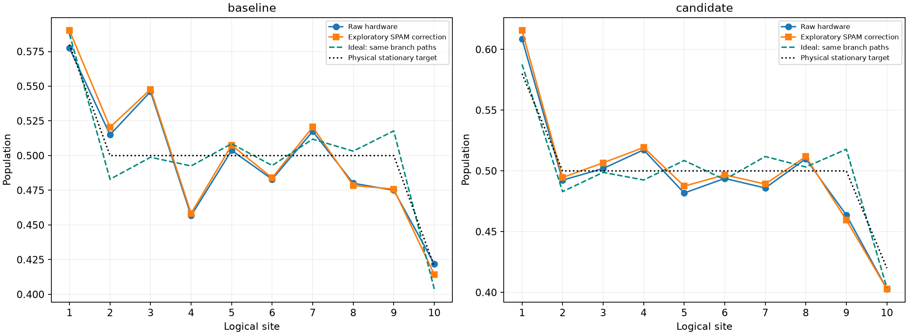

# Existing-data SPAM correction (exploratory)

Exploratory marginal SPAM inversion of saved counts, not a certified readout-only correction. No target fitting, clipping, simulator or hardware execution. Stable local response assumed; preparation errors, correlated/context-dependent readout and drift are not separated.

| Mapping | Raw ideal MAE | Corrected ideal MAE | Raw ideal maximum | Corrected ideal maximum |
|---|---:|---:|---:|---:|
| baseline | 0.023005 | 0.021896 | 0.047356 | 0.048986 |
| candidate | 0.017388 | 0.018939 | 0.054126 | 0.058146 |

Correction is (observed-zero)/(one-zero), with shared calibration uncertainty propagated. The mixture is held out of calibration. A passing mixture check cannot validate the response for all evolved states. These all-zero/all-one controls contain preparation errors; this is not a demonstrated unbiased readout-only correction. No estimates are clipped to [0,1]. Raw values and both references are retained.

Paired empirical path resampling plus independent joint control-count resampling. No second resampling of evolution shots. Descriptive intervals, not simultaneous; excludes temporal correlations and SPAM-model bias.
