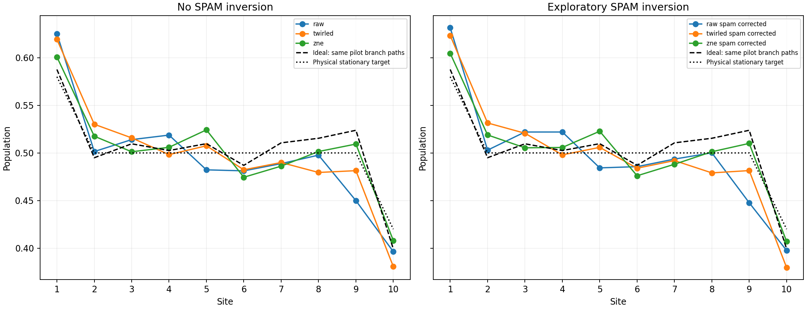
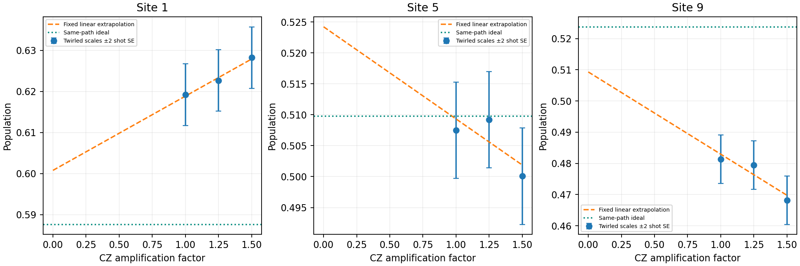

# First-order mitigation pilot

Marginal SPAM model is conditional on stable local response and includes preparation error. CZ-only extrapolation does not remove intentional reservoir dissipation, finite-step bias, or guarantee removal of reset/idle noise. No clipping or reference fitting.

| Method | Ideal MAE | Ideal maximum | Physical maximum |
|---|---:|---:|---:|
| raw | 0.021425 | 0.073905 | 0.050110 |
| raw_spam_corrected | 0.022047 | 0.076122 | 0.052327 |
| twirled | 0.020160 | 0.042411 | 0.039324 |
| twirled_spam_corrected | 0.021151 | 0.042321 | 0.043323 |
| zne | 0.013613 | 0.024462 | 0.025543 |
| zne_spam_corrected | 0.013053 | 0.023918 | 0.024581 |

This is a fixed subset pilot, not a 0.02 steady-state certification. Actual CZ factors, linear-intercept weights, held-out mixture controls, uncertainty amplification, all raw scale populations and descriptive fit residuals are in analysis.json. A favorable intercept alone does not validate noise scaling; inspect the scale dependence and uncertainty before interpreting mitigation as improvement.

Paired empirical trajectory resampling within observed batches plus joint control-PUB resampling; shot noise already present in path means is not resampled again. Conditional on observed jobs and twirl variants; omits drift and calibration-model bias. Intervals descriptive, not simultaneous. Small-group bootstrap precision can be poor; fixed-path delta-method SEs are also reported.
