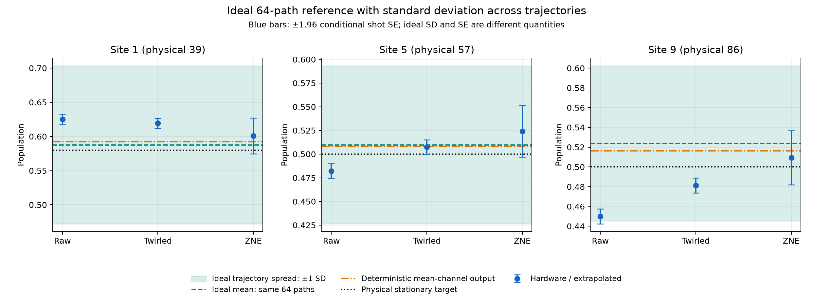

# Review of the pulled mitigation pilot

Both jobs completed: 847 circuits, 77,824 shots, 64 matched branch trajectories, and 256 shots per trajectory per arm/factor. The first-order 48-step schedule and 48 bath resets are retained. Raw counts reconstruct every saved population exactly; the transfer archive matches its local raw files and source hash checks pass. Native QPY files were not transferred, so this review cannot independently recheck compiled circuit contents. The execution-machine cached report records both QPY batches as verified.

The green band shows the ideal mean plus/minus one sample standard deviation across the saved branch paths (SD, ddof=1). It describes the spread of individual ideal trajectories, not uncertainty of the mean or a confidence interval. The [companion mean-uncertainty figure](selected_populations_mean_uncertainty.png) instead shows plus/minus 1.96 SE, with SE = SD/sqrt(R). Orange dash-dot lines show the deterministic infinite-trajectory mean-channel output. Blue error bars remain plus/minus 1.96 conditional shot/calibration SE for the fixed saved paths. These are different sources of variation and are not added together. Neither plot includes hardware drift or calibration-model bias. All ten ideal means, SDs, SEs and deterministic references are in [ideal_path_uncertainty.csv](ideal_path_uncertainty.csv). The separate populations.csv contains descriptive trajectory-bootstrap intervals for measured estimates.

| Method | Same-path ideal MAE | Same-path ideal maximum | Physical-target maximum |
|---|---:|---:|---:|
| raw | 0.021425 | 0.073905 | 0.050110 |
| raw_spam_corrected | 0.022047 | 0.076122 | 0.052327 |
| twirled | 0.020160 | 0.042411 | 0.039324 |
| twirled_spam_corrected | 0.021151 | 0.042321 | 0.043323 |
| zne | 0.013613 | 0.024462 | 0.025543 |
| zne_spam_corrected | 0.013053 | 0.023918 | 0.024581 |

## What the mitigation changed

Twirling reduces the largest same-path discrepancy substantially, mainly by moving site 9 toward its ideal. Its average error changes little, and several sites worsen. CZ-only linear ZNE improves the point estimates further, but the intervals for its incremental benefit over twirling include no improvement. Twirling here combines CZ Pauli frames and terminal measurement flips, so their individual contributions are not isolated.

| Comparison (negative favors method) | Metric | Difference | Descriptive paired 95% interval |
|---|---|---:|---|
| twirled minus raw | mae | -0.001266 | [-0.004439, +0.002076] |
| twirled minus raw | maximum | -0.031494 | [-0.040657, -0.017877] |
| zne minus raw | mae | -0.007812 | [-0.012930, +0.002301] |
| zne minus raw | maximum | -0.049444 | [-0.054930, -0.015044] |
| zne minus twirled | mae | -0.006547 | [-0.010802, +0.002510] |
| zne minus twirled | maximum | -0.017950 | [-0.023103, +0.011779] |

## Observable numbers

| Site | Physical qubit | Physical stationary | Ideal: same 64 paths | Raw | Twirled | ZNE |
|---:|---:|---:|---:|---:|---:|---:|
| 1 | 39 | 0.580000 | 0.587639 | 0.625244 | 0.619202 | 0.600789 |
| 2 | 38 | 0.500000 | 0.494962 | 0.501465 | 0.530090 | 0.517558 |
| 3 | 48 | 0.500000 | 0.509587 | 0.513977 | 0.515808 | 0.501231 |
| 4 | 58 | 0.500000 | 0.502522 | 0.518738 | 0.498230 | 0.505910 |
| 5 | 57 | 0.500000 | 0.509733 | 0.482239 | 0.507507 | 0.524211 |
| 6 | 56 | 0.500000 | 0.486958 | 0.481201 | 0.482300 | 0.474457 |
| 7 | 66 | 0.500000 | 0.510596 | 0.488770 | 0.489929 | 0.486135 |
| 8 | 76 | 0.500000 | 0.515396 | 0.497681 | 0.479492 | 0.501485 |
| 9 | 86 | 0.500000 | 0.523795 | 0.449890 | 0.481384 | 0.509318 |
| 10 | 85 | 0.420000 | 0.399202 | 0.396362 | 0.380676 | 0.408010 |

## Preparation-control failure

Site 3 is physical qubit 48. Its mixture is inconsistent with the zero/one affine prediction under both readout treatments:

| Treatment | Measured mixture | Predicted from zero/one | Corrected mixture | Bootstrap 95% interval |
|---|---:|---:|---:|---|
| raw | 0.415039 | 0.492920 | 0.418747 | [0.395799, 0.441101] |
| twirled | 0.437500 | 0.496094 | 0.438588 | [0.415644, 0.461538] |

The expected corrected mixture is 0.5. Both discrepancies also survive a Holm adjustment across 20 control checks using approximate normal tests (details in review.json). This flags a failed control assumption, not a uniquely identified bad-qubit mechanism: preparation, measurement context, and drift remain possible. Zero/one controls were in job 1; the mixture controls were in job 2. The jobs began roughly 97 minutes apart, so the data cannot separate these causes. SPAM-corrected results should remain exploratory. This failure also limits interpretation of the uncorrected evolution, whose preparation is the same mixture circuit.

## Precision, circuit cost, and conclusion

Linear CZ extrapolation uses weights (17/6, 1/3, -13/6). Its fixed-path shot SE is about 0.0135–0.0140 per site, versus about 0.0038–0.0039 without extrapolation: roughly 3.58 times larger. Three noise levels with small residuals do not establish linearity out to zero noise. Reset/idle effects are not uniformly scaled.

| Treatment | CZ factor | Circuits | CZ gates | Resets | Recorded native depth |
|---|---:|---:|---:|---:|---|
| raw | 1.0 | 64 | [960] | [48] | 750–759 |
| twirled | 1.0 | 256 | [960] | [48] | 785–815 |
| twirled | 1.25 | 256 | [1200] | [48] | 987–1075 |
| twirled | 1.5 | 256 | [1440] | [48] | 1137–1229 |

This is encouraging evidence for reducing the worst population discrepancy, with twirling showing the clearest gain. It is not a demonstrated 0.02 steady-state result: every method has a point-estimate physical maximum above 0.02, the ideal 64-path subset itself differs from the physical target by 0.023795, and extrapolation uncertainty is substantial. These are population-only measurements; excitation currents were not measured.

Before a large production run, retain the same first-order schedule and test whether the mixture failure persists with preparation controls repeated within each job. A paired confirmation of twirling and ZNE needs a separately chosen sampling budget; increasing only extrapolated shots will not address control failure or drift. No hardware jobs or backend queries were made for this review.
