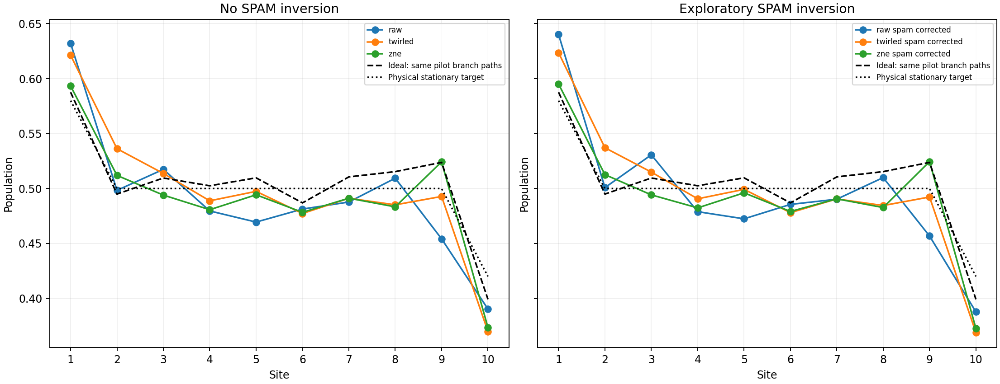
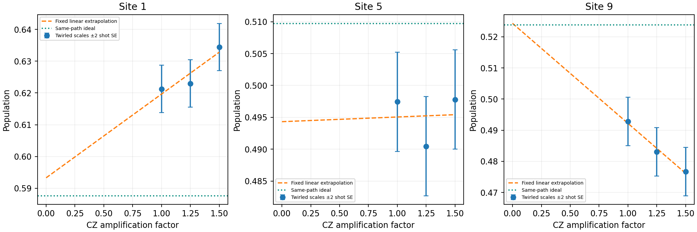

# First-order mitigation pilot

Marginal SPAM model is conditional on stable local response and includes preparation error. CZ-only extrapolation does not remove intentional reservoir dissipation, finite-step bias, or guarantee removal of reset/idle noise. No clipping or reference fitting.

| Method | Ideal MAE | Ideal maximum | Physical maximum |
|---|---:|---:|---:|
| raw | 0.023187 | 0.069572 | 0.052141 |
| raw_spam_corrected | 0.024602 | 0.067016 | 0.060230 |
| twirled | 0.022467 | 0.041293 | 0.050066 |
| twirled_spam_corrected | 0.022731 | 0.042140 | 0.050983 |
| zne | 0.016167 | 0.032039 | 0.046536 |
| zne_spam_corrected | 0.016209 | 0.032691 | 0.047418 |

This is a fixed subset pilot, not a 0.02 steady-state certification. Actual CZ factors, linear-intercept weights, held-out mixture controls, uncertainty amplification, all raw scale populations and descriptive fit residuals are in analysis.json. A favorable intercept alone does not validate noise scaling; inspect the scale dependence and uncertainty before interpreting mitigation as improvement.

Paired empirical trajectory resampling within observed batches plus joint control-PUB resampling; shot noise already present in path means is not resampled again. Conditional on observed jobs and twirl variants; omits drift and calibration-model bias. Intervals descriptive, not simultaneous. Small-group bootstrap precision can be poor; fixed-path delta-method SEs are also reported. SPAM inversion uses independent job-local calibration draws, shared across factors inside each job.

## Preparation controls inside each evolution job

job_local: each job corrected before trajectory-weighted averaging; pooled calibration and mixture fields are diagnostics only

| Job | Readout | Largest corrected-mixture deviation from 0.5 | Site |
|---|---|---:|---:|
| dbg9utljm0ks73eg6tq0 | raw | 0.043796 | 3 |
| dbg9utljm0ks73eg6tq0 | twirled | 0.127225 | 3 |
| dbgu1m1q260s73bu2abg | raw | 0.034287 | 7 |
| dbgu1m1q260s73bu2abg | twirled | 0.023833 | 1 |

Per-job calibration, held-out mixture intervals and evolved populations are saved in analysis.json. The mixture is held out of calibration. Same-job controls do not prove absence of within-job drift or state/context-dependent noise.
