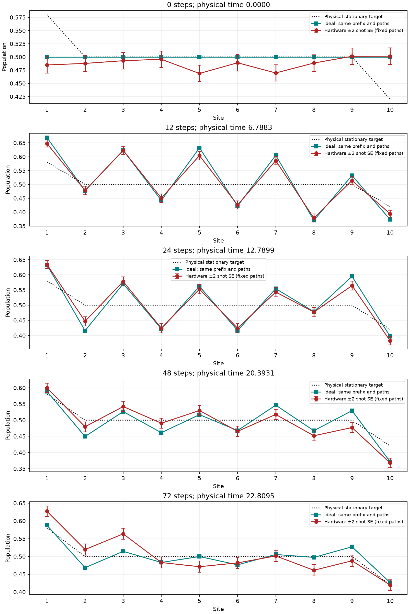
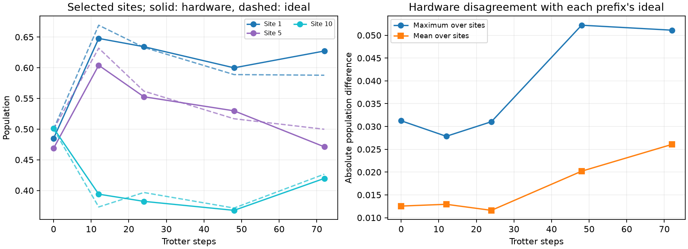

# Model3 population prefixes

32 saved trajectories × 128 shots × 5 prefixes: 160 circuits and 20480 shots.

Physical path (baths included): `[39, 49, 48, 58, 57, 56, 66, 76, 86, 85, 95, 105]`. Jobs: dbedllvsstms73fbsblg.

| Steps | Physical time | MAE vs matched ideal | Max vs matched ideal | Max vs stationary target | CZ counts | Resets |
|---:|---:|---:|---:|---:|---|---|
| 0 | 0.000000 | 0.012549 | 0.031250 | 0.095137 | [0] | [0] |
| 12 | 6.788334 | 0.012936 | 0.027845 | 0.122803 | [240] | [12] |
| 24 | 12.789931 | 0.011609 | 0.031042 | 0.078125 | [480] | [24] |
| 48 | 20.393112 | 0.020193 | 0.052204 | 0.052324 | [960] | [48] |
| 72 | 22.809543 | 0.026061 | 0.051114 | 0.063477 | [1440] | [72] |

Compare hardware against the matching prefix ideal. Early prefixes are transient and need not match the stationary target. The selected subset is not independently certified to meet the original 0.02 sampling budget.

The 0-step circuits repeat the initial-mixture preparation, including ignored preparation measurements, with no evolution. They screen the preparation at this execution occasion but do not replace all-zero/all-one or bath-reset controls.

Error bars are ±2 shot SE conditional on the selected fixed paths. Across-path and paired hardware-minus-ideal covariance matrices are saved separately in analysis.json. Do not add these uncertainty estimates. They assume independent sampling and omit device drift; they are not simultaneous accuracy guarantees.

All prefix/path pairs were shuffled with a saved seed. Submission order is not a calibrated execution timeline. Gate, idle and reset errors can accumulate together; this diagnostic alone does not isolate a noise mechanism.

Integrity: verified original QPY SHA-256. Source and ideal hashes checked; ideal prefix references independently recomputed; shot counts, pair coverage, mappings and count bit ordering verified. No original run files were changed by this analyzer.
