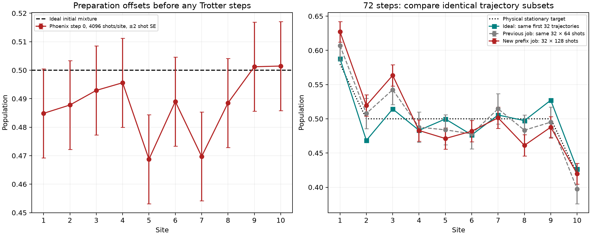

# Findings from the new Phoenix prefix run

Run `ibm_phoenix_prefix_20261024T162033_596311Z`; job `dbedllvsstms73fbsblg`. All **160 circuits and 20,480 shots** collected. This analysis reads saved data only; it submits no jobs and makes no account connection.

**The run is complete and the saved data are internally consistent. It shows preparation offsets before evolution and larger average hardware disagreement in the longer prefixes. The final hardware populations do not meet the 0.02 target.**

[Actual populations at every prefix](populations_by_prefix.png) ([PDF](populations_by_prefix.pdf)); [three-site progression and error metrics](prefix_progression.png); [initial preparation and previous subset comparison](preparation_and_previous_subset.png).

| Steps | Physical time | MAE vs same-prefix ideal | Max vs same-prefix ideal | Max vs physical stationary target |
|---:|---:|---:|---:|---:|
| 0 | 0.0000 | 0.01255 | 0.03125 | 0.09514 |
| 12 | 6.7883 | 0.01294 | 0.02784 | 0.12280 |
| 24 | 12.7899 | 0.01161 | 0.03104 | 0.07813 |
| 48 | 20.3931 | 0.02019 | 0.05220 | 0.05232 |
| 72 | 22.8095 | 0.02606 | 0.05111 | 0.06348 |

## Preparation already has observable offsets

The 0-step measurements contain initial-mixture preparation and final Z readout, with no exchange gates or bath resets. Their ideal populations are 0.5 at every site. Each site has 4096 measurements from 32 circuits.

| Site | Physical qubit | Measured initial population | Difference from 0.5 |
|---:|---:|---:|---:|
| 5 | 56 | 0.468750 | −0.031250 |
| 7 | 76 | 0.469727 | −0.030273 |

Both deficits exceed typical pooled shot SE (about 0.0078). Under independent stationary Bernoulli sampling, two-sided binomial tests remain below 0.05 after a Bonferroni adjustment over the ten initial-population checks: adjusted p-values 0.000673 and 0.001132. These are conditional sampling diagnostics, not a model for drift or correlated device errors.

The older 2048-shot mixture control on the same path already had populations 0.482422 at site 5 and 0.472656 at site 7; it passed the specified, more conservative zero/one-response screening. These different execution occasions should not be combined as one stationary calibration. The new zero-step measurements show that the current preparation/readout baseline should be investigated. They do not distinguish preparation from measurement errors, and they do not measure reset performance.

## Disagreement grows in the longer prefixes

The 12- and 24-step profiles follow their matching ideal transients fairly well on average (MAE about 0.012), although individual sites already differ by roughly 0.03. MAE rises to 0.0202 at 48 steps and 0.0261 at 72 steps. This is evidence of additional disagreement associated with longer evolution, not a monotonic curve at every site or proof of a specific gate/reset mechanism.

At 72 steps, the largest matched-ideal discrepancy is site 2: **0.519531 measured versus 0.468417 ideal**, difference **0.051114**. The largest physical-target error is site 3: **0.563477 versus 0.500000**, difference **0.063477**. Sites 1–3 are all above their matched ideal by about 0.039–0.051, while site 9 is below by about 0.039. A single uniform population offset cannot describe this spatial pattern.

Nominal paired hardware-minus-ideal SEs at 72 steps range from 0.00844 to 0.01130. A descriptive paired t analysis over the 32 trajectory records flags sites 1, 2, 3 and 9 at this prefix even after a nominal Bonferroni adjustment over all 50 site/prefix comparisons. This supports discrepancies beyond independent sampling noise under the stated assumptions; one job cannot quantify between-job drift or isolate a causal noise channel.

Every positive-depth prefix adds system interactions and bath collisions together. Thus the experiment cannot separately assign the extra discrepancy to CZ errors, idle relaxation, bath resets or calibration changes. The native CZ counts are 0, 240, 480, 960 and 1440; reset counts are 0, 12, 24, 48 and 72.

## The 32-path ideal is not the same ensemble as the previous 128-path mean

At 72 steps, the ideal first-32-path populations have maximum physical-stationary error **0.031583** (site 2), whereas the deterministic mean channel has error **0.015925**. The earlier ideal 128-path mean had error **0.018996**. This smaller diagnostic ensemble was not expected to certify the original sampling budget. Hardware agreement must be assessed against its own matching 32-path ideal.

Even the ideal 32-path population estimate misses a strict 0.02 threshold, so the final hardware result cannot be treated as a successful accuracy validation. Six of ten hardware point estimates are within 0.02 of physical stationary populations, but the all-site maximum fails. Only Z populations were measured; hardware currents and stationarity are not established.

## Compare the same 32 paths across execution occasions

| 72-step matched subset | Shots/path | MAE vs matching ideal | Max vs matching ideal | Max vs physical target |
|---|---:|---:|---:|---:|
| Previous full job, first 32 paths | 64 | 0.019307 | 0.039395 | 0.042480 |
| New prefix job, same 32 paths | 128 | 0.026061 | 0.051114 | 0.063477 |

The new point estimates are less accurate on this matched subset despite twice the shots/path. Differences between jobs are modest relative to their sampling uncertainties and uncontrolled device drift; this is not evidence that extra shots worsen fidelity. It is also not a controlled test of adding the other prefixes to the job.

## Suggested next step

Check fresh all-zero, all-one and initial-mixture controls on this same physical chain, with particular attention to physical qubits 56 and 76. Use at least 4096 shots per control if pursuing these roughly three-percentage-point offsets. If the preparation baseline is consistent, use focused endpoint collision/reset controls to distinguish bath behavior from the system-bond evolution. Keep the schedule unchanged while identifying the device discrepancy; increasing the trajectory count alone cannot diagnose these offsets. Any such hardware execution remains for the user to perform.

## Verification

The offline analyzer independently recomputed every prefix ideal and reconstructed the measured means, covariances and shot totals from raw final-register bitstrings. All saved hardware population/reference/covariance arrays agree. Source and ideal hashes match after proven Git CRLF/LF conversion. The ZIP passes CRC checks, its JSON contents agree with the pulled originals, and the archived ISA QPY SHA-256 matches the manifest. All original files remain unchanged. Source, path, schedule and trajectory indices match the previous full run.

Additional diagnostics: [prefix metrics](prefix_metrics.csv), [initial preparation tests](initial_preparation.csv), [paired residual tests](residual_diagnostics.csv), [numerical findings and integrity hashes](findings.json). No noisy simulation, new trajectory sampling, mitigation or hardware query was used.

## Pulled classical reference

The Experiment1 N=10, J=gamma=1 half-mixture CSV and summary also agree: initial populations 0.5, initial currents zero, final time 45.5, actual maximum population/current error 0.00279473 and conservative future error bound 0.01963843. These are exact classical reference results at a later physical time than the hardware prefix endpoint (22.80954), so the two endpoints are not a matched-time hardware comparison.
