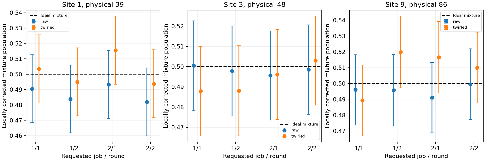

# Repeated preparation controls

Controls only, without evolution. Mixture residual is mixture-(zero+one)/2 within the same round/job. Holm correction covers all sites, readout treatments, rounds and job-pooled checks; normal approximations, independent shots and stable local response are assumptions. Passing does not certify evolved-state accuracy. Within-job requested order is recorded, but actual dispatch order/timing is not guaranteed. No automatic follow-up hardware execution or mapping selection.

| Job | Arm | Site | Physical | Zero | One | Mixture | Predicted | Corrected | Flagged |
|---:|---|---:|---:|---:|---:|---:|---:|---:|---|
| 1 | raw | 1 | 39 | 0.001953 | 0.988037 | 0.482422 | 0.494995 | 0.487249 | False |
| 1 | raw | 2 | 38 | 0.000732 | 0.995850 | 0.501465 | 0.498291 | 0.503189 | False |
| 1 | raw | 3 | 48 | 0.003906 | 0.989014 | 0.495605 | 0.496460 | 0.499133 | False |
| 1 | raw | 4 | 58 | 0.003174 | 0.987061 | 0.488525 | 0.495117 | 0.493300 | False |
| 1 | raw | 5 | 57 | 0.001465 | 0.991455 | 0.489258 | 0.496460 | 0.492725 | False |
| 1 | raw | 6 | 56 | 0.002441 | 0.992188 | 0.477539 | 0.497314 | 0.480020 | False |
| 1 | raw | 7 | 66 | 0.005859 | 0.991455 | 0.499512 | 0.498657 | 0.500867 | False |
| 1 | raw | 8 | 76 | 0.001465 | 0.990723 | 0.481689 | 0.496094 | 0.485439 | False |
| 1 | raw | 9 | 86 | 0.008789 | 0.986572 | 0.493652 | 0.497681 | 0.495880 | False |
| 1 | raw | 10 | 85 | 0.000488 | 0.995361 | 0.483887 | 0.497925 | 0.485890 | False |
| 1 | twirled | 1 | 39 | 0.005615 | 0.992432 | 0.498291 | 0.499023 | 0.499258 | False |
| 1 | twirled | 2 | 38 | 0.003174 | 0.997314 | 0.503174 | 0.500244 | 0.502947 | False |
| 1 | twirled | 3 | 48 | 0.010498 | 0.993164 | 0.489990 | 0.501831 | 0.487950 | False |
| 1 | twirled | 4 | 58 | 0.007568 | 0.992676 | 0.487061 | 0.500122 | 0.486741 | False |
| 1 | twirled | 5 | 57 | 0.004395 | 0.994141 | 0.499268 | 0.499268 | 0.500000 | False |
| 1 | twirled | 6 | 56 | 0.004395 | 0.993896 | 0.484619 | 0.499146 | 0.485320 | False |
| 1 | twirled | 7 | 66 | 0.005615 | 0.994385 | 0.513184 | 0.500000 | 0.513333 | False |
| 1 | twirled | 8 | 76 | 0.003906 | 0.995117 | 0.489502 | 0.499512 | 0.489901 | False |
| 1 | twirled | 9 | 86 | 0.010254 | 0.983398 | 0.501221 | 0.496826 | 0.504516 | False |
| 1 | twirled | 10 | 85 | 0.002930 | 0.997314 | 0.497314 | 0.500122 | 0.497177 | False |
| 2 | raw | 1 | 39 | 0.001465 | 0.987305 | 0.482178 | 0.494385 | 0.487618 | False |
| 2 | raw | 2 | 38 | 0.000000 | 0.995605 | 0.505615 | 0.497803 | 0.507847 | False |
| 2 | raw | 3 | 48 | 0.004883 | 0.993164 | 0.496094 | 0.499023 | 0.497036 | False |
| 2 | raw | 4 | 58 | 0.004150 | 0.993896 | 0.477295 | 0.499023 | 0.478046 | False |
| 2 | raw | 5 | 57 | 0.002686 | 0.991699 | 0.496338 | 0.497192 | 0.499136 | False |
| 2 | raw | 6 | 56 | 0.002686 | 0.993408 | 0.489990 | 0.498047 | 0.491868 | False |
| 2 | raw | 7 | 66 | 0.006592 | 0.991943 | 0.508301 | 0.499268 | 0.509167 | False |
| 2 | raw | 8 | 76 | 0.000732 | 0.986816 | 0.471924 | 0.493774 | 0.477841 | False |
| 2 | raw | 9 | 86 | 0.008789 | 0.988770 | 0.494141 | 0.498779 | 0.495267 | False |
| 2 | raw | 10 | 85 | 0.000732 | 0.992920 | 0.480713 | 0.496826 | 0.483760 | False |
| 2 | twirled | 1 | 39 | 0.005127 | 0.990479 | 0.502441 | 0.497803 | 0.504708 | False |
| 2 | twirled | 2 | 38 | 0.002197 | 0.996094 | 0.483887 | 0.499146 | 0.484648 | False |
| 2 | twirled | 3 | 48 | 0.006836 | 0.993652 | 0.499756 | 0.500244 | 0.499505 | False |
| 2 | twirled | 4 | 58 | 0.007324 | 0.991699 | 0.496582 | 0.499512 | 0.497024 | False |
| 2 | twirled | 5 | 57 | 0.005127 | 0.995605 | 0.504150 | 0.500366 | 0.503821 | False |
| 2 | twirled | 6 | 56 | 0.005859 | 0.994629 | 0.507812 | 0.500244 | 0.507654 | False |
| 2 | twirled | 7 | 66 | 0.006592 | 0.991699 | 0.499756 | 0.499146 | 0.500620 | False |
| 2 | twirled | 8 | 76 | 0.010254 | 0.988037 | 0.442627 | 0.499146 | 0.442197 | True |
| 2 | twirled | 9 | 86 | 0.011963 | 0.986084 | 0.511963 | 0.499023 | 0.513283 | False |
| 2 | twirled | 10 | 85 | 0.002686 | 0.996826 | 0.489502 | 0.499756 | 0.489686 | False |

All round-level data, multiplicity-adjusted approximate tests, contrasts, and uncertainties are in controls.csv and analysis.json. A flag identifies inconsistency with the local response model; it does not uniquely identify preparation, readout, latency or drift as its cause. A failed contrast is recorded without inversion or clipping. No large evolution run is automatically started.
