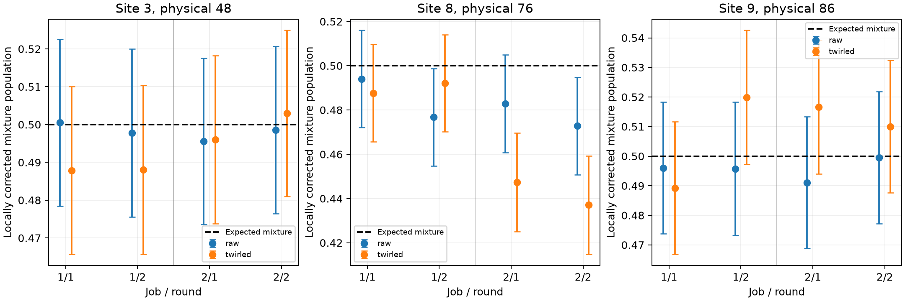

# Review of repeated preparation controls

Both jobs completed, with 60 circuits and 49,152 shots. Reconstructing all final counts and terminal masks reproduces every saved population exactly and derived statistics to rounding precision. The source, reference manifest, calibration snapshots and transfer archive pass integrity checks. Native QPY was not transferred, so native contents cannot be independently rechecked here; the execution-machine report records both native batches as verified.

Error bars are 1.96 times conditional shot/calibration SE, not simultaneous bounds and not a drift model.

## Qubit 48: the previous large deficit did not recur

The previous mitigation pilot measured 0.4150 raw / 0.4375 terminal-twirled at site 3 (physical 48). This run gives the following job-pooled mixtures, each calibrated using its own job:

| Job | Readout | Observed mixture | Zero/one prediction | Corrected mixture | Conditional 95% interval |
|---:|---|---:|---:|---:|---|
| 1 | raw | 0.495605 | 0.496460 | 0.499133 | [0.483472, 0.514794] |
| 1 | twirled | 0.489990 | 0.501831 | 0.487950 | [0.472227, 0.503674] |
| 2 | raw | 0.496094 | 0.499023 | 0.497036 | [0.481448, 0.512623] |
| 2 | twirled | 0.499756 | 0.500244 | 0.499505 | [0.483887, 0.515124] |

No qubit-48 round or pooled check is flagged. The data do not support a persistent, large deficit on that qubit. They also do not establish whether the earlier failure was drift, context, or another transient effect.

## Qubit 76: a different within-job failure

| Job / round | Readout | Observed mixture | Zero/one prediction | Corrected mixture | Holm-adjusted p |
|---|---|---:|---:|---:|---:|
| 1 / 1 | twirled | 0.487305 | 0.499512 | 0.487673 | 1 |
| 1 / 2 | twirled | 0.491699 | 0.499512 | 0.492126 | 1 |
| 1 / pooled | twirled | 0.489502 | 0.499512 | 0.489901 | 1 |
| 2 / 1 | twirled | 0.445801 | 0.497314 | 0.447329 | 0.00042 |
| 2 / 2 | twirled | 0.439453 | 0.500977 | 0.437063 | 3.48e-06 |
| 2 / pooled | twirled | 0.442627 | 0.499146 | 0.442197 | 7.28e-11 |

Job 2's corrected twirled mixture is 0.442197, interval [0.426461, 0.457934], rather than 0.5. Its two rounds and pooled result are the only three flagged rows among 120 adjusted checks. These are repeated views of the same failure, not three independent hardware events. All 20 distinct site/readout combinations are otherwise unflagged at the predeclared multiplicity-adjusted threshold; absence of a flag is not an equivalence or 0.02-accuracy certificate.

All eight job-2 twirled mixture variants at qubit 76 lie between 0.4102 and 0.4590 after decoding. The deficit occurs with and without a terminal X, and in both rounds. It is not explained by one anomalous variant or solely by transferring zero/one calibration from a different job. Dependence on other flipped sites or actual dispatch timing remains possible. Job-2 raw mixture is 0.4719 (corrected 0.4778), a smaller deficit whose within-job test does not survive the full family adjustment.

The twirled residual changes from -0.010010 in job 1 to -0.056519 in job 2. Between-job change tests and all individual variant values are saved in review.json and mixture_variants.csv. Changing output across jobs is evidence of context/time sensitivity, not proof of one specific drift mechanism.

## Calibration and implications

Qubit 76's saved T1 is 52.3 microseconds in both new snapshots, down from 203.4 microseconds in the mitigation pilot. This is a relevant coherence vulnerability and is below the earlier evolution-chain T1 screen of 80 microseconds. The controls runner deliberately retained the reference mapping rather than filtering it out. Both new snapshots contain identical qubit-76 calibration, so this recorded T1 change does not explain why job 2 differs from job 1. It is not a measured duration model or proof that T1 decay caused the deficit.

The experiment resolves the cross-job calibration ambiguity for the new failure: a mixture inconsistency remains even when its zero/one controls come from the same round/job. It occurs with no CZ gates and no reservoir resets, so deep evolution and bath-reset errors cannot be its only possible origin. Initialization, intermediate preparation measurement and timing, measurement context, and temporal hardware effects remain relevant. Preparation-register counts were not saved in this protocol, so the preparation outcome and subsequent final readout cannot be compared shot by shot.

The practical conclusion is to keep the cosine schedule fixed and avoid treating the chain or terminal-twirled readout as universally validated. Replacing qubit 48 alone is not supported by this run. Any production mitigation evaluation should keep same-job preparation controls alongside evolution and assess the current chain calibration; passing these short controls would still not establish deep-circuit accuracy. No new hardware run was launched for this review.
