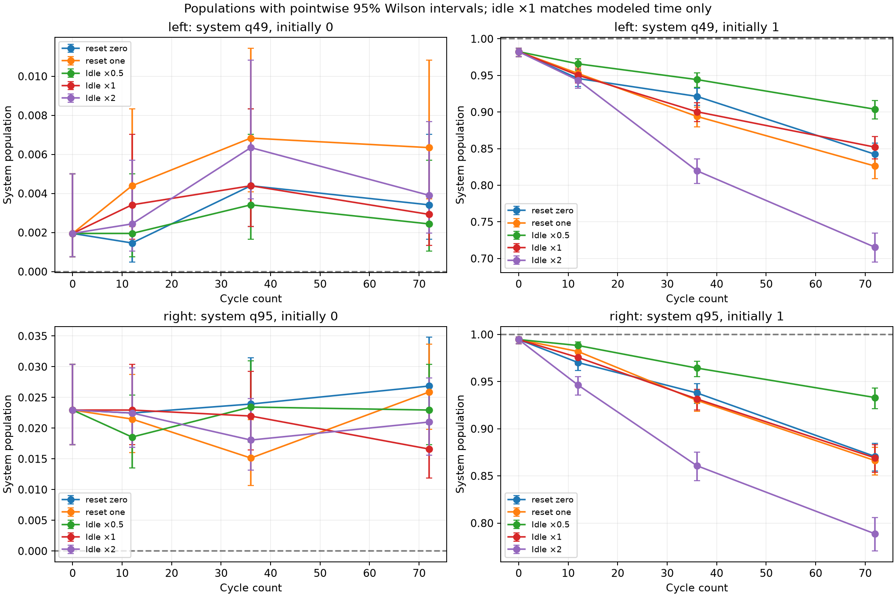

# System survival: idle durations versus bath resets

Jobs: dbf8c4fgdj9s73fn1t40. 64 circuits; 131072 shots.

Equal means equal summed target-model time before final measurement, not verified equal hardware elapsed time. Reset block-transition latency is unknown. Idle scales bracket the target model; no finite bracket is guaranteed to contain actual reset latency.

| Case | Modeled wait, μs | System population | Bath population |
|---|---:|---:|---:|
| left_s0_baseline_0_scale1 | 0.0000 | 0.001953 | 0.001465 |
| left_s0_idle_12_scale0.5 | 2.6400 | 0.001953 | 0.002930 |
| left_s0_idle_12_scale1 | 5.2800 | 0.003418 | 0.000488 |
| left_s0_idle_12_scale2 | 10.5600 | 0.002441 | 0.000977 |
| left_s0_idle_36_scale0.5 | 7.9200 | 0.003418 | 0.001465 |
| left_s0_idle_36_scale1 | 15.8400 | 0.004395 | 0.002441 |
| left_s0_idle_36_scale2 | 31.6800 | 0.006348 | 0.000488 |
| left_s0_idle_72_scale0.5 | 15.8400 | 0.002441 | 0.000977 |
| left_s0_idle_72_scale1 | 31.6800 | 0.002930 | 0.001465 |
| left_s0_idle_72_scale2 | 63.3600 | 0.003906 | 0.001465 |
| left_s0_reset_one_12_scale1 | 5.2800 | 0.004395 | 0.000488 |
| left_s0_reset_one_36_scale1 | 15.8400 | 0.006836 | 0.000977 |
| left_s0_reset_one_72_scale1 | 31.6800 | 0.006348 | 0.001465 |
| left_s0_reset_zero_12_scale1 | 5.2800 | 0.001465 | 0.000488 |
| left_s0_reset_zero_36_scale1 | 15.8400 | 0.004395 | 0.000977 |
| left_s0_reset_zero_72_scale1 | 31.6800 | 0.003418 | 0.000977 |
| left_s1_baseline_0_scale1 | 0.0000 | 0.982422 | 0.000977 |
| left_s1_idle_12_scale0.5 | 2.6400 | 0.965820 | 0.000488 |
| left_s1_idle_12_scale1 | 5.2800 | 0.950195 | 0.001953 |
| left_s1_idle_12_scale2 | 10.5600 | 0.943359 | 0.001953 |
| left_s1_idle_36_scale0.5 | 7.9200 | 0.944336 | 0.000977 |
| left_s1_idle_36_scale1 | 15.8400 | 0.900391 | 0.000488 |
| left_s1_idle_36_scale2 | 31.6800 | 0.819824 | 0.000977 |
| left_s1_idle_72_scale0.5 | 15.8400 | 0.903809 | 0.000488 |
| left_s1_idle_72_scale1 | 31.6800 | 0.852051 | 0.001465 |
| left_s1_idle_72_scale2 | 63.3600 | 0.715332 | 0.003906 |
| left_s1_reset_one_12_scale1 | 5.2800 | 0.952637 | 0.002930 |
| left_s1_reset_one_36_scale1 | 15.8400 | 0.894043 | 0.000977 |
| left_s1_reset_one_72_scale1 | 31.6800 | 0.826172 | 0.003418 |
| left_s1_reset_zero_12_scale1 | 5.2800 | 0.945801 | 0.001953 |
| left_s1_reset_zero_36_scale1 | 15.8400 | 0.921387 | 0.000977 |
| left_s1_reset_zero_72_scale1 | 31.6800 | 0.842285 | 0.001953 |
| right_s0_baseline_0_scale1 | 0.0000 | 0.022949 | 0.000000 |
| right_s0_idle_12_scale0.5 | 2.6400 | 0.018555 | 0.000000 |
| right_s0_idle_12_scale1 | 5.2800 | 0.022949 | 0.000000 |
| right_s0_idle_12_scale2 | 10.5600 | 0.022461 | 0.000977 |
| right_s0_idle_36_scale0.5 | 7.9200 | 0.023438 | 0.000488 |
| right_s0_idle_36_scale1 | 15.8400 | 0.021973 | 0.000488 |
| right_s0_idle_36_scale2 | 31.6800 | 0.018066 | 0.000000 |
| right_s0_idle_72_scale0.5 | 15.8400 | 0.022949 | 0.000000 |
| right_s0_idle_72_scale1 | 31.6800 | 0.016602 | 0.000488 |
| right_s0_idle_72_scale2 | 63.3600 | 0.020996 | 0.000000 |
| right_s0_reset_one_12_scale1 | 5.2800 | 0.021484 | 0.000977 |
| right_s0_reset_one_36_scale1 | 15.8400 | 0.015137 | 0.000000 |
| right_s0_reset_one_72_scale1 | 31.6800 | 0.025879 | 0.000488 |
| right_s0_reset_zero_12_scale1 | 5.2800 | 0.022461 | 0.000000 |
| right_s0_reset_zero_36_scale1 | 15.8400 | 0.023926 | 0.000488 |
| right_s0_reset_zero_72_scale1 | 31.6800 | 0.026855 | 0.000977 |
| right_s1_baseline_0_scale1 | 0.0000 | 0.994629 | 0.000977 |
| right_s1_idle_12_scale0.5 | 2.6400 | 0.988281 | 0.000977 |
| right_s1_idle_12_scale1 | 5.2800 | 0.975586 | 0.000977 |
| right_s1_idle_12_scale2 | 10.5600 | 0.946289 | 0.001465 |
| right_s1_idle_36_scale0.5 | 7.9200 | 0.964355 | 0.000977 |
| right_s1_idle_36_scale1 | 15.8400 | 0.931641 | 0.000977 |
| right_s1_idle_36_scale2 | 31.6800 | 0.860840 | 0.000488 |
| right_s1_idle_72_scale0.5 | 15.8400 | 0.933105 | 0.000000 |
| right_s1_idle_72_scale1 | 31.6800 | 0.869141 | 0.000488 |
| right_s1_idle_72_scale2 | 63.3600 | 0.788574 | 0.000000 |
| right_s1_reset_one_12_scale1 | 5.2800 | 0.981934 | 0.001465 |
| right_s1_reset_one_36_scale1 | 15.8400 | 0.930176 | 0.001465 |
| right_s1_reset_one_72_scale1 | 31.6800 | 0.866211 | 0.000977 |
| right_s1_reset_zero_12_scale1 | 5.2800 | 0.970215 | 0.000488 |
| right_s1_reset_zero_36_scale1 | 15.8400 | 0.937988 | 0.000000 |
| right_s1_reset_zero_72_scale1 | 31.6800 | 0.870605 | 0.000488 |

Both initial system states are tested against both bath preparations. reset_zero resets a bath prepared in 0; reset_one applies X before each bath reset. No exchange gates or full-chain evolution are present. All arms have the same initial preparation slot and terminal two-qubit measurement. Reset-zero has a padded empty X slot, so both reset arms have the same target-model cycle duration. Explicit barriers prevent readout before the sequence finishes.

Compare reset arms with the whole idle-duration sweep. A reset-minus-idle difference at scale 1 does not alone establish reset crosstalk: unknown elapsed-time differences can contribute. Curves are connected across separate circuits, not a single continuously monitored trajectory. Final bath measurement does not reveal every earlier bath reset.

No inverse readout correction is applied. Population intervals are pointwise 95% Wilson; difference intervals use the Newcombe independent-proportions method. They assume independent stationary shots, omit device drift and are not simultaneous confidence bounds. Saved comparisons share idle controls and are therefore correlated. PUB order is randomized; actual QPU dispatch order is not verified.

Source and compiled-circuit hashes, native circuit contents, mappings, complete batch coverage and shot counts were checked. Offline analysis performs no hardware queries or new jobs.

Timing reference: [IBM dynamic scheduling documentation](https://docs.quantum.ibm.com/api/qiskit-ibm-runtime/transpiler-passes-scheduling-alap-schedule-analysis).
