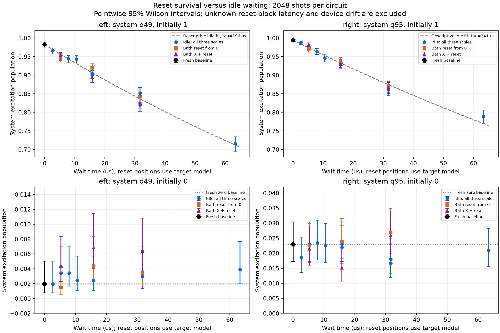

# Findings: waiting versus boundary-bath reset sequences

Run `ibm_phoenix_reset_survival_20261025T224328_184810Z`; IBM Phoenix job `dbf8c4fgdj9s73fn1t40`. All **64 circuits × 2048 shots = 131,072 shots** collected in one batch. The isolated system/bath pairs remain **49/39 on the left** and **95/105 on the right**. Every circuit has zero CZ gates.

**Waiting alone produces excitation losses comparable to the bath-reset sequences. The right-side reset and equal-model-time idle results closely agree. Some left-side differences are larger, but none of the 24 reset-versus-idle tests survives correction for multiple comparisons. The previous reset-only losses therefore do not establish a large additional reset-specific disturbance. These data support waiting-related decay as a substantial contributor in the isolated controls, while leaving smaller reset effects unresolved.**

[PDF](survival_findings.pdf), [original cycle-count plots](reset_survival.png), [all population estimates](populations.csv), [24 statistical comparisons](reset_idle_tests.csv), [machine-readable findings](findings.json).

## Main comparison at 72 cycles

The equal-scale idle and reset circuits have **31.68 μs of modeled wait**, excluding their common 0.04 μs preparation slot and terminal measurement. This is a hardware timing model, not the physical simulation time of the cosine Trotter schedule. These diagnostic cycles contain no Hamiltonian or reservoir-exchange evolution.

For an initially excited system, the ideal population is 1 in every arm:

| System | Fresh one baseline | Idle ×1 | Bath resets from 0 | Bath X + reset |
|---|---:|---:|---:|---:|
| Left q49 | 0.982422 | 0.852051 | 0.842285 | 0.826172 |
| Right q95 | 0.994629 | 0.869141 | 0.870605 | 0.866211 |

On the left, idle alone loses **13.04 percentage points** from baseline, compared with **14.01 points** for empty-bath resets and **15.63 points** for X-plus-reset. On the right, the corresponding losses are **12.55, 12.40 and 12.84 points**. Thus substantial excitation loss occurs with the bath inactive throughout the programmed wait.

The initially-one populations also decrease as idle duration increases. At the longest idle duration, **63.36 μs**, populations are **0.715332 left** and **0.788574 right**. This duration dependence is consistent with relaxation during waiting. These controls do not prove a unique noise mechanism or determine how much of the previous full-chain discrepancy it explains.

## Differences and statistical precision

At 72 cycles, reset minus equal-model-time idle gives:

| System | Reset arm | Population difference, percentage points | Pointwise 95% interval, percentage points | Holm-adjusted p, 24 tests |
|---|---|---:|---:|---:|
| Left q49 | Reset from 0 | −0.977 | [−3.182, +1.229] | 1.000 |
| Left q49 | Bath X + reset | −2.588 | [−4.838, −0.337] | 0.620 |
| Right q95 | Reset from 0 | +0.146 | [−1.917, +2.210] | 1.000 |
| Right q95 | Bath X + reset | −0.293 | [−2.371, +1.785] | 1.000 |

The left X-plus-reset result has a nominal difference, with unadjusted Fisher p = 0.027. It is not a robust detection across the full planned comparison family. The smallest adjusted p among all 24 comparisons is **0.508**, for a different left-side comparison at 36 cycles where the reset population is *higher* than idle by 2.10 points. There is no consistent detected additional reset penalty across the lengths and preparations.

The primary family includes two endpoints × two initial system states × three lengths × two reset preparations. Two-sided Fisher exact tests are adjusted together using Holm's method. The intervals in the table are pointwise Newcombe intervals; they are not simultaneous intervals and should not be interpreted as corrected significance tests.

**Failure to detect a difference does not establish equivalence, harmless resets, or population accuracy within 0.02.** For example, the left X-plus-reset pointwise interval still allows several percentage points of extra loss. Timing differences, device variation and preparation/readout context are outside these shot-only intervals. Several comparisons share the same idle control and are correlated; Holm adjustment remains applicable without assuming independence between the comparisons.

## Timing and variation limit causal attribution

The saved backend target uses `dt = 4 ns`, bath X duration **40 ns** and reset duration **400 ns**. Both reset preparations reserve the same **440 ns model-time cycle**; the reset-from-zero arm pads the X slot with idle. The idle scales 0.5, 1 and 2 test a wider range of waiting times. Source and circuit inspection confirm the intended explicit delays, synchronization barriers, qubit mapping and zero exchange-gate count.

Actual reset elapsed time is not independently measured. The reset instructions split dynamic scheduling blocks, whose transition latency is unknown. Consequently, equal target-model duration does not guarantee equal hardware elapsed time. A reset-minus-idle difference could include additional waiting as well as disturbance from bath operations. This limitation was specified before execution; these results do not resolve it.

There is also a useful internal consistency check. Two initially-one left idle circuits have the same **31.68 μs** total modeled wait:

| Left idle circuit | Population |
|---|---:|
| 36 cycles, scale 2 | 0.819824 |
| 72 cycles, scale 1 | 0.852051 |

Their difference is **3.223 percentage points**, with unadjusted Fisher p = **0.00607**. Among four exploratory duplicate-duration idle comparisons, its separately Holm-adjusted p is **0.0243**. The other three comparisons do not show comparable evidence. This exploratory family is separate from the primary reset-versus-idle family; its correction does not cover all possible post hoc tests.

This left-side discrepancy cautions against treating nominal total wait as a complete, stationary predictor. The circuits differ in delay segmentation and barrier count, and their execution times/order are not independently verified. The observations cannot distinguish drift, circuit-context effects, timing differences or sampling fluctuation. Do not pool the duplicate-duration measurements as though their equality had been established.

For visualization only, a descriptive binomial fit to the nine initially-one idle measurements uses

$$
n(t)=b_0+(b_1-b_0)\exp(-t/\tau),
$$

where $b_0,b_1$ are the current zero/one baseline populations. Fixing those baselines gives **τ ≈ 196 μs left** and **241 μs right**. The saved calibration lists T1 ≈ **191 μs** and **196 μs**, respectively. These fitted decay scales illustrate the idle trend; they are not independently calibrated physical T1 values or a validated noise model. The fit omits baseline uncertainty, context effects and drift, and its long-time floor is assumed rather than measured. No fit-based correction was applied to any population.

## Initially-zero systems and final bath populations

Fresh zero baselines are **0.001953 on q49** and **0.022949 on q95**. At 72 cycles:

| System initially 0 | Idle ×1 | Bath resets from 0 | Bath X + reset |
|---|---:|---:|---:|
| Left q49 | 0.002930 | 0.003418 | 0.006348 |
| Right q95 | 0.016602 | 0.026855 | 0.025879 |

Q95's apparent-excitation offset therefore persists in a fresh baseline: **47/2048 shots**, close to the preceding isolated-control value of **50/2048**. Separate runs and contexts should not be pooled into a stationary readout calibration. The initially-zero reset-versus-idle differences also fail the 24-test correction. The data provide no robust evidence of a large accumulated excitation gain from bath resets, but do not certify zero added excitation.

Final measured bath populations after reset sequences remain at most **0.003418 on q39** and **0.001465 on q105**. This is low final measured excitation, not a per-reset fidelity estimate. Final readout does not reveal every earlier bath state or separate readout misassignment from actual excitation.

## Implication for the Model3 hardware discrepancy

The preceding reset-only experiment showed large losses but lacked idle controls. The new data show that waiting alone can produce losses of comparable size. It is therefore premature to attribute those earlier losses primarily to bath-reset disturbance. Nor does this experiment establish that reset errors are absent.

For the full Model3 circuit, total hardware duration and ordinary excitation decay deserve attention alongside exchange-gate errors. More shots can improve statistical precision but do not remove this measured mean-population loss. These isolated controls do not validate the 72-step hardware state, currents, or a steady state, and cannot determine the error contributions of the full 1440-CZ chain circuit.

The next distinct diagnostic should examine **XX exchange-gate accumulation**, retaining duration controls and the current cosine schedule for comparison. A gate-only control should use a nontrivial initial state, such as a single excitation or a Néel pattern, and be compared with its own ideal evolution. The half-mixed state is invariant under ideal unitary evolution, so it would not expose many coherent Hamiltonian errors. Any shortened or redesigned reservoir evolution would first need its own classical accuracy check. No new hardware evaluation was performed here.

## Verification and retained artifacts

Reconstructed all 64 population estimates and all 24 reset-minus-idle comparisons from the saved raw counts. The two cached JSON analyses agree, allowing only machine-precision roundoff in a few SE/interval endpoints. Verified complete ordered batch coverage, 2048 shots per circuit, original source integrity under proven CRLF/LF conversion, exact native-QPY SHA-256, exact circuit contents, saved operation counts and physical measurement mapping. The bundle passes CRC checks; bundled JSON and text tables agree with the pulled originals, allowing text line-ending conversion.

All original hardware-run files and previously pulled analysis files were preserved byte-for-byte. New findings, statistical CSVs and population figures are saved alongside them. No hardware query, new job, simulator evolution or mitigation was performed. The fitted curves are statistical summaries of the existing measurements.
