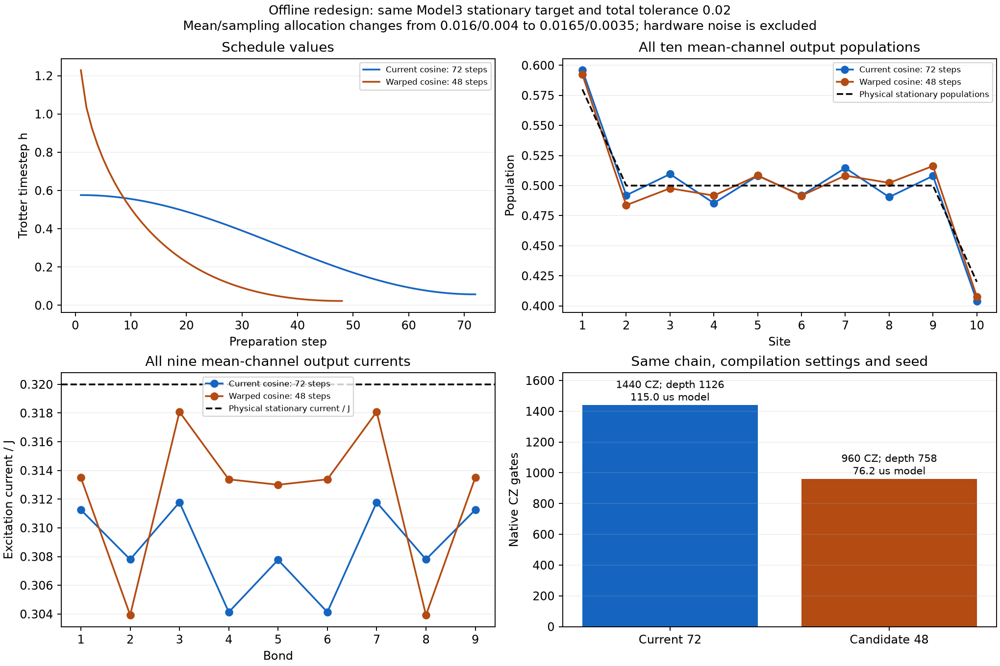

# Offline redesign decision: 48-step warped cosine

**A cheaper candidate was found without changing Model3, its initial state, or the total 0.02 tolerance.** The 48-step schedule uses 960 CZ gates and 48 bath resets, one-third fewer than the current 72-step schedule. It requires a slightly different mean/sampling allocation and has passed three independent classical replay checks. No hardware job, live calibration query, noisy simulation or readout mitigation was performed.



[PDF](comparison.pdf), [schedule CSV](candidate_schedule.csv), [search table](search_summary.csv), [48-step validation](reallocated_budget/verification.json), [baseline/64-step validation](verification.json).

## Fixed question and decision

Keep N=10, J=gamma=1, p_L=0.9, p_R=0.1, exchange prefactor 0.5, half-mixed preparation, Hamiltonian-first ordering, even-odd Hamiltonian splitting and rate-weighted sampling of one boundary branch per step. The physical stationary target remains n=(0.58,0.5,...,0.5,0.42), with excitation current I/J=0.32 on every bond. All ten populations and all nine currents enter the acceptance metric, even though hardware followup would measure populations first.

$$d(C,C_*)=\max\left\{\max_j|\Delta n_j|,\;\max_j|\Delta I_j|/J\right\}.$$

The predeclared circuit-cost goal was at least 20% fewer CZ gates. With the original 0.016 mean allowance, the best passing tested schedule had 64 steps: only an 11.1% CZ reduction. The 48-step candidate narrowly failed that allowance. A separately declared reallocation to **0.0165 mean + 0.0035 sampling = 0.02 total** makes it feasible without loosening the total tolerance. It was then checked with a larger classical ensemble. This allocation change is part of the result, rather than a claim that the 48-step schedule passed the original 0.016 limit.

## Schedule and acceptance

$$h_k=h_{\min}+\frac{h_{\max}-h_{\min}}{2}\left[1+\cos\left(\pi\left(\frac{k}{M-1}\right)^q\right)\right],\quad k=0,\ldots,M-1.$$

M=48, h_max=1.228835337648, h_min=0.022820762802, q=0.346973499184. The simulated preparation time is 13.352527567, compared with 22.809542863 for the baseline. The exponent below 1 front-loads the decrease: a few large initial steps are followed by earlier refinement. This is a fixed, reference-assisted optimized schedule, not a new online feedback controller.

| Quantity | Current cosine | 48-step candidate |
|---|---:|---:|
| Mean error at output | 0.015925388 | 0.016278691 |
| Worst mean error over the forward window | 0.015925388 | 0.016358048 |
| Mean allowance | 0.016 | 0.0165 |
| Sampling allowance | 0.004 | 0.0035 |
| Stationary bias of final-step mean channel | 0.009090856 | 0.003638623 |

The candidate was directly checked at every node for 439 constant-final-step continuation steps, from time 13.352528 to 23.370842. This covers at least 10/J of future physical time. Those continuation steps are classical validation work and do not enter the preparation circuit. This matches the existing finite-window protocol; it is not a permanent-settling proof. Large early steps prepare a target state efficiently but do not imply accurate intermediate Lindblad dynamics.

## Independent sampled checks

After schedule selection and the new budget split, the candidate was replayed with **R=16,384** at seeds 29, 30 and 31. Each check requires the observed sampled output distance below 0.02, sampling distance below 0.0035 and maximum descriptive two-SE below 0.0035.

| Seed | Sampled output error | Sampling distance | Maximum two-SE | Status |
|---|---:|---:|---:|---|
| 29 | 0.017537032 | 0.001497075 | 0.002193389 | passed |
| 30 | 0.016827624 | 0.001543940 | 0.002193815 | passed |
| 31 | 0.017673649 | 0.001825654 | 0.002202218 | passed |

The baseline and 64-step schedule also passed independent R=8192 checks at these three seeds. Trajectory means analytically average the mixed initial state; these checks exclude preparation-bit sampling, final measurement shots and hardware noise. Two-SE values and three seeds are descriptive checks, not simultaneous confidence guarantees. The larger classical R does not increase per-circuit gate depth and is not a requirement to execute 16,384 hardware circuits.

## Native circuit cost and hardware timing

| Quantity | Current 72-step, path 0 | Candidate 48-step, path 0 | Reduction |
|---|---:|---:|---:|
| CZ gates | 1440 | 960 | 33.33% |
| Bath resets | 72 | 48 | 33.33% |
| Two-qubit depth | 288 | 192 | 33.33% |
| Full native depth | 1126 | 758 | 32.68% |
| Summed modeled block duration, including measurement | 115.040 us | 76.228 us | 33.74% |

Compilation is entirely offline, on the same saved chain [39,49,48,58,57,56,66,76,86,85,95,105], optimization level 3 and transpiler seed 11. The native target was reconstructed from the saved 2026-10-25 calibration, using dt=4 ns, saved X/SX/CZ/measurement/reset durations and virtual RZ. It is not a live IBM target or a bit-for-bit reproduction of all backend metadata. Absolute compiled depths may differ slightly on a fresh target.

The representative path-0 comparison uses identical branch choices for the first 48 steps. The baseline was also compiled for paths 1–3: depth 1126–1128 and summed modeled durations 113.708–128.340 us. The 48-step timing figure is one representative circuit, not a measured duration distribution. Final readouts can start at different modeled times on different sites; the summary includes the last final readout. Unknown dynamic reset-block latency is excluded. Actual hardware elapsed time, error reduction and 0.02 accuracy are not predicted by these percentages.

The survival measurements motivate reducing duration, while the CZ/reset reductions make this a material implementation change. They do not provide a calibrated noise model from which to forecast the new observable values. No such forecast is claimed.

## Finite-ensemble issue in the existing hardware protocol

The first 128 seed-29 candidate paths have ideal population distance **0.030124**, already above 0.02. This is finite-path sampling, before any hardware noise, and prevents using that subset as evidence of 0.02 steady-state accuracy. The compact 128-path input is therefore an inspection artifact, not an independently accepted hardware ensemble.

A separate fixed ensemble-size check, with no schedule or seed reselection, gives:

| Paths | Baseline population-error range, seeds 29–31 | Candidate population-error range, seeds 29–31 |
|---|---:|---:|
| 128 | 0.016796–0.022320 | 0.016155–0.030124 |
| 512 | 0.016546–0.019603 | 0.018037–0.019937 |
| 1024 | 0.015767–0.018107 | 0.015903–0.017810 |
| 4096 | 0.015996–0.017360 | 0.017277–0.017996 |

For a single **population** comparison at the existing 8192-shot budget per schedule, **1024 trajectories × 8 shots** is a reasonable concrete allocation for both schedules: all three tested ideal population means are below 0.02. This does not mean the 1024-path ensembles satisfy the tighter 0.0035 covariance-sampling allocation, nor does it establish a confidence bound or a current measurement claim. One 1024-path candidate current estimate still exceeds 0.02; the hardware followup is explicitly about populations. Measurement-shot uncertainty and device errors remain. Use the same fixed seed, chain, total shots and interleaved schedule order, and compare each hardware population vector with both its own finite-ensemble ideal and the physical stationary target.

## Bounded search and stopping decision

The search tested cosine, warped cosine and two-stage families at 40, 48, 56 and 64 steps, with positive steps between 0.001 and 4. It used 50 differential-evolution iterations per trial, followed by four local starts capped at 350 evaluations each. The complete run used 13883 proxy evaluations. Every retained trial was independently checked by direct continuation at every validation node. The best 40-step result failed even the revised 0.0165 allowance. The search is heuristic and does not prove that 48 is minimal.

**Retain the 48-step candidate for one coordinated comparison against the current 72-step baseline. Stop the diagnostic expansion here.** This is a concrete circuit-cost improvement with unchanged total classical tolerance; hardware improvement remains an experimental question. If that paired comparison does not show useful improvement, report that outcome rather than automatically launching another small control campaign.

## Reproduction and storage

Run from the repository root (Bash):

```bash
OPENBLAS_NUM_THREADS=1 OMP_NUM_THREADS=1 .venv/bin/python Model3/analysis/hardware_cost_redesign/search.py
OPENBLAS_NUM_THREADS=1 OMP_NUM_THREADS=1 .venv/bin/python Model3/analysis/hardware_cost_redesign/polish.py
OPENBLAS_NUM_THREADS=1 OMP_NUM_THREADS=1 .venv/bin/python Model3/analysis/hardware_cost_redesign/verify.py
OPENBLAS_NUM_THREADS=1 OMP_NUM_THREADS=1 .venv/bin/python Model3/analysis/hardware_cost_redesign/verify.py --candidate-steps 48 --mean-tolerance .0165 --sampling-tolerance .0035 --trajectories 16384 --labels candidate --compile-count 1 --output Model3/analysis/hardware_cost_redesign/reallocated_budget/verification.json
OPENBLAS_NUM_THREADS=1 OMP_NUM_THREADS=1 .venv/bin/python Model3/analysis/hardware_cost_redesign/ensemble.py
MPLCONFIGDIR=/tmp/model3_redesign_mpl .venv/bin/python Model3/analysis/hardware_cost_redesign/report.py
```

The full R=8192/16384 covariance dumps were computed in memory and not retained as bulky JSON files. Their canonical hashes, seeds, assessments and output observables are retained. Compact 128-path inputs preserve exact trajectory choices and per-path ideal covariances for circuit inspection; their provenance explicitly limits sampling validation to the original full replay. Neither hardware runner nor IBM account creation is invoked by these scripts.

[Additional numerical checks](checks.json) compare the averaged channel with an explicit weighted sum over all four sampled alternatives at every candidate preparation/validation node, check covariance eigenvalues and symmetry, validate the three compact inputs and record the installed numerical package versions. These checks concern the implemented covariance channel; no new density-matrix or hardware noise simulation is implied.
