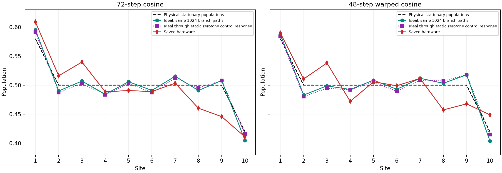
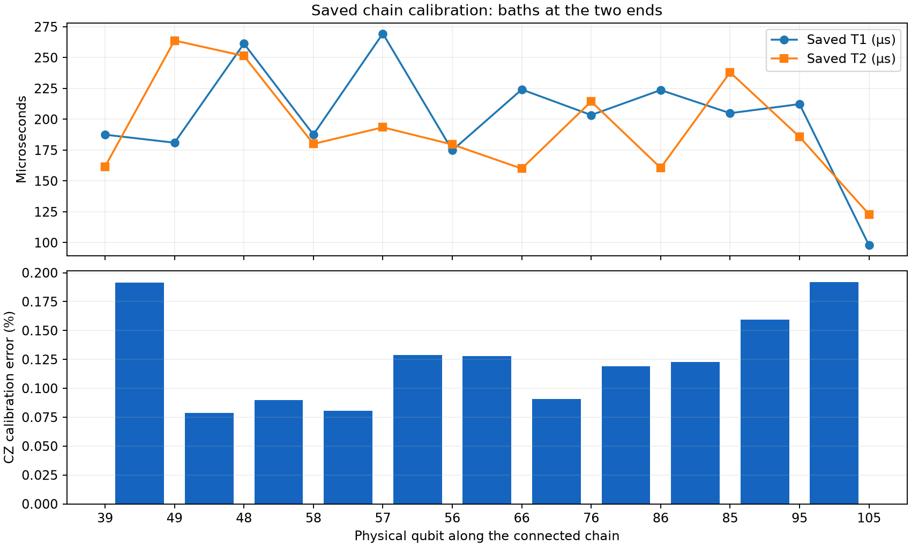

# Model3: consolidated offline audit

**The checks found no model, logical-circuit, trajectory-generation or count-decoding defect that explains the hardware discrepancy. They did confirm inadequate statistical headroom for a hardware accuracy claim of 0.02, a recurring q95 baseline-control concern, and incomplete reproducibility of the latest compiled circuits. The saved calibration permits a better CZ-ranked chain, but does not establish bad mapping as the principal cause. Existing idle controls already demonstrate substantial population loss without exchange gates.**

This audit concerns the latest paired 72/48-step run, `ibm_phoenix_comparison_20261026T005025_553744Z`, and relevant existing controls. All work was local: file checks, numerical replay, exact noiseless Aer simulation, offline compilation, saved-calibration search and statistical analysis. **No IBM connection, calibration query or hardware job was made.** Original hardware files and existing analyses were preserved.

Evidence: [machine-readable audit](audit.json), [per-site population checks](population_checks.csv), [chain qubits](chain_qubits.csv), [chain edges](chain_edges.csv), [audit script](audit.py), [supplementary checks](finish.py). The earlier [paired hardware findings](../../Experiment5/analysis/hardware/ibm_phoenix_comparison_20261026T005025_553744Z/schedule_comparison/Findings.md) retain the full hardware comparison and paired uncertainty analysis.

## 1. What was checked, and whether an issue is present

| Possible issue | Offline check | Finding |
|---|---|---|
| Wrong Hamiltonian normalization or boundary rates | Independent full-spin Lindblad stationary solve; gate/covariance tests | **No defect found.** The writeup benchmark and longer-chain run use different rates. |
| Incorrect stationary target | Full-spin three-site calculation and independent ten-site covariance stationary solve | **No defect found:** current target is `(0.58, 0.5, …, 0.5, 0.42)`. |
| Incorrect pumping/loss branch, bath initialization, angle or probability compensation | Full-spin channel tests for all branches, orders and policies; actual-input density simulations | **No defect found.** |
| Ignored preparation measurements accidentally preparing the wrong ideal state | Exact nonselective-measurement tests and actual-input density simulation | **No ideal defect found.** H then ignored Z measurement prepares the half mixture. Hardware preparation disturbance remains a separate question. |
| Wrong even/odd order or coarse-step implementation | Replay every saved path; exact density checks for both schedules | **No defect found.** Coarse-step maps reproduce the saved predictions. |
| Stale ideal predictions or wrong trajectory files | Reconstruct all 1024 final covariances per schedule from supplied timesteps/choices | **Exact agreement** in the current environment. |
| Incorrect random seed, duplicated paths or branch probabilities | Regenerate every choice from its saved per-path seed; validate complete unique path indices and paired prefixes | **No defect found.** Both choice arrays reproduce exactly. |
| Lost counts, wrong shots, duplicate PUBs, incomplete jobs or damaged transfer | Raw counts, ordered plan, hashes and bundle CRC/JSON checks | **No defect found:** 2051 circuits, 22,528 shots, five complete batches. |
| Reversed bitstrings, preparation-register contamination or swapped site labels | Separate integer-mask decoder; outcome-register tests; saved layout checks | **No defect found.** Counts and all recorded mappings agree. |
| A simple site-label permutation explains the population error | Exhaust all 90 distinct assignments of the two endpoint targets | **Excluded as a complete explanation.** Best relabeling is the present endpoint assignment and still fails 0.02. |
| Extra routing/SWAP cost | Saved metrics and four saved-target recompilations | **No indication:** 1440/960 CZ and 288/192 two-qubit depth reproduce. Actual latest QPY is unavailable here. |
| Circuit ends before the ideal half-mixture is sufficiently prepared | Recompute all-site/all-bond error and extend constant-final-step mean evolution to a contractive tail bound | **Passes the respective ideal mean budgets**, including all later integer-step nodes under that continuation. |
| Schedule works equally well for other initial states | Replay the same schedules from all-zero/all-one states | **It does not:** these are preparation-specific schedules. This is a scope limitation, not a wrong stationary state. |
| Actual hardware subset retains the original sampling allocation | Evaluate the 1024 saved paths and ideal measurement variance | **Issue present:** the original large-ensemble allocation is not certified for this smaller measured ensemble. Inputs already disclose this. |
| Shot noise alone explains hardware versus same-path ideal | Fixed-path ideal shot variance and a conservative concentration bound | **Strongly inconsistent with this explanation alone.** |
| Simple preparation/readout offsets explain the full discrepancy | Forward zero/one-control response applied to the ideal populations | **Insufficient:** large residuals remain. No inverse correction was applied. |
| Bad physical-qubit chain | Validate current chain and rerank all eligible paths in the saved full-device calibration | **Plausible contributor, unproven cause.** Current chain passes its filters; a better CZ-ranked path exists with other tradeoffs. |
| Stale calibration or a clearly short-T1 system qubit | Inspect individual saved T1/T2/readout values and their measurement dates | **No repeat of the earlier q7 problem on this chain.** Some initialization-error entries are old and should not be treated as fresh. |
| Drift across the paired jobs | Test mean hardware-minus-ideal residuals across the four large batches | **No corrected detection:** minimum Holm-adjusted p ≈ 0.938 across 20 exploratory tests. Drift is not ruled out. |
| Ordinary waiting/relaxation | Revalidate saved idle/reset counts and native control QPY | **Present in existing controls:** waiting alone causes substantial excitation loss. Its full-circuit contribution is unidentified. |
| Extra reset-specific disturbance | Recompute 24 reset-versus-idle tests | **Not established:** minimum Holm-adjusted p ≈ 0.508. This does not establish harmless resets or equivalence. |
| Coherent gate errors, crosstalk, leakage, state-dependent reset error, dephasing or unknown dynamic latency | Inspect what calibration and controls actually measure | **Unresolved offline from these records.** None has been separately identified or excluded. |
| Complete hardware steady-state or current certification from population data | Inspect actual measurement settings | **Unavailable:** this run measures Z populations only. |
| Exact reproduction of submitted native circuits | Look for QPY and reproduce compilation from saved chain properties | **Evidence gap present:** QPY was intentionally omitted; native one-qubit metrics do not reproduce exactly. |

## 2. Model and ideal-circuit checks

The conventions agree with the existing [circuit derivation](../../circuit_derivation.md), which relates Model3 to Section 4.9 of the modified [writeup](../../../writeup.pdf):

$$
H=\frac{J}{2}\sum_{\ell=1}^{n-1}(X_\ell X_{\ell+1}+Y_\ell Y_{\ell+1}),
\qquad
V_{s,+}=\sqrt{\Gamma p_s}\,\sigma^+_{s},
\qquad
V_{s,-}=\sqrt{\Gamma(1-p_s)}\,\sigma^-_{s}.
$$

Here `gamma` is the **total rate at each boundary**, $\Gamma$. The writeup's three-site example uses $J=1,\Gamma=2$; the current ten-site hardware run uses $J=1,\Gamma=1$. An independently assembled full $8\times8$ density-matrix Lindblad equation gives:

| Parameters | Stationary populations | Excitation current |
|---|---|---:|
| Three sites, $J=1,\Gamma=2$ | $(0.7,0.5,0.3)$ | 0.4 |
| Three sites, $J=1,\Gamma=1$ | $(0.58,0.5,0.42)$ | 0.32 |

Both full-spin solves have one zero Liouvillian eigenvalue and residual below $4\times10^{-16}$. The ten-site covariance solve gives endpoints 0.58/0.42, a flat 0.5 interior and ideal stationary current 0.32 on every bond. The three-site writeup numbers are therefore not the target for the current parameters.

All **183 Model3 tests passed**. They include full-spin checks of the four jump types, pumping through an occupied bath, reset, both factor orders, both sampling policies, large steps with signed cosines, current normalization, nonselective preparation, nontrivial physical layout and QPY round trips.

For an additional check of the actual hardware inputs, trajectories **0 and 1023 from each schedule** were simulated using noiseless **Aer density matrices on all ten system sites**. Each bath was traced exactly after its actual collision gate; this transformation is independently tested against the full system-plus-bath density matrix on smaller chains. Maximum population differences from the saved covariance predictions were:

| Schedule | Path 0 | Path 1023 |
|---|---:|---:|
| 72 steps | $1.33\times10^{-15}$ | $1.55\times10^{-15}$ |
| 48 steps | $2.22\times10^{-15}$ | $1.55\times10^{-15}$ |

These are deterministic nonselective density-matrix checks, not sampled Aer estimates or noisy-hardware predictions. All 1024 covariance paths per schedule were also replayed and reproduced exactly. The branch-frequency checks show no anomaly; their nominal descriptive p-values are 0.829 and 0.879.

### Ideal settling and initial-state dependence

Using the original metric over every population and bond current,

$$
d(C,C_*)=\max\!\left\{\max_\ell|n_\ell-n_{\ell,*}|,
\max_\ell|I_\ell-I_{\ell,*}|/J\right\},
$$

the 72-step mean output error is **0.015925** and the 48-step mean output error is **0.016279**. Their constant-final-step stationary biases are **0.009091** and **0.003639**. This finite-step bias is present and already included in the schedule assessment.

The audit checked a longer virtual continuation and bounded the remaining tail. If $\bar\Phi$ is the constant-final-step averaged covariance channel and $C_{h,*}$ its stationary covariance, its homogeneous part is nonexpansive in Frobenius norm. Consequently, at any later integer node,

$$
d\!\left(\bar\Phi^m(C),C_*\right)
\le d(C_{h,*},C_*)+2\|C-C_{h,*}\|_F.
$$

Every node before this bound became sufficiently small was checked directly; the numerical stationary-solve residual was also bounded. The largest future mean errors remain **0.015925** and **0.016358**, below the respective **0.016** and **0.0165** mean allocations. Thus the earlier finite-window check can be strengthened offline for this mean covariance continuation. This is a floating-point numerical bound on these observables, not a many-body trace-distance, between-node or hardware certificate. **The continuation adds no steps to the hardware preparation; it is only an offline validation.**

The schedules depend on the intended half-mixed preparation. Replacing it by all-zero or all-one gives output errors about **0.1122** for 72 steps and **0.1636** for 48 steps. The physical stationary target is unchanged, but the finite preparation time is no longer sufficient. This explains why these step counts should not be generalized to arbitrary initial states.

## 3. Statistical headroom is a real limitation

The classical validations used 8192 paths for the baseline and 16,384 for the candidate, analytically averaging the initial mixture and final measurement. The hardware comparison used **1024 paths × 8 shots per path**. Those are different uncertainty problems.

| Population quantity, actual 1024-path subset | 72 steps | 48 steps |
|---|---:|---:|
| Maximum ideal sampling distance from deterministic mean | 0.002516 | 0.004624 |
| Largest ideal trajectory-only $2\,\mathrm{SE}$ | 0.006413 | 0.006697 |
| Largest ideal measurement-only $2\,\mathrm{SE}$ at 8 shots/path | 0.010931 | 0.010896 |
| Largest combined ideal $2\,\mathrm{SE}$ | 0.012396 | 0.012553 |
| Original classical sampling allowance | 0.004000 | 0.003500 |

For a site with conditional ideal population $p_{r\ell}$ on branch path $r$, the measurement variance of the ensemble mean is

$$
\operatorname{Var}_{\mathrm{shots}}(\hat n_\ell\mid\{r\})
=\frac{1}{R^2S}\sum_{r=1}^{R}p_{r\ell}(1-p_{r\ell}),
\qquad R=1024,\ S=8.
$$

This includes preparation and final-measurement randomness averaged out of a covariance-path prediction. The combined variance adds independent branch-path sampling. The displayed two-SE values are pointwise descriptive uncertainties, not simultaneous confidence guarantees. Even the candidate's realized **population-only** sampling distance exceeds 0.0035. Under the original populations-plus-currents metric, the sampling distances are 0.008055 and 0.004624; these currents are classical predictions, not hardware measurements.

The source assessments already state that this smaller hardware subset is not certified to the original sampling allocation. There is **no concealed certification bug**. The practical problem is that mean preparation plus classical sampling already spends the 0.02 budget, leaving no explicit allowance for these measurement fluctuations or device bias.

However, limited shots cannot explain the full hardware discrepancy. The maximum hardware-minus-own-ideal population gaps are **0.062185** and **0.050036**. Under independent ideal shots conditional on these fixed paths, Hoeffding's inequality and a union bound over ten sites give probabilities at most **$6.1\times10^{-27}$** and **$3.1\times10^{-17}$** for discrepancies this large. This is a conservative rejection of the ideal-shot-only explanation; it does not identify a microscopic hardware mechanism and does not assume that actual device errors are independent.

## 4. Preparation/readout offsets do not explain everything

The latest zero/one/mixture controls pass all mixture-consistency screens. **Q95 still fails the chosen baseline-certification screen:** 43/2048 apparent excitations after a zero preparation, or **2.10%**, with a nominal family-adjusted upper bound **3.29%** exceeding the selected 3% screen. This does not prove that its true baseline error exceeds 3%, or separate initialization error from readout misassignment.

To test the simplest stable preparation/readout response without applying mitigation, propagate each known ideal population through the measured zero/one response:

$$
n_{\ell,\mathrm{predicted}}=a_\ell+(b_\ell-a_\ell)n_{\ell,\mathrm{ideal}},
$$

where $a_\ell,b_\ell$ are the zero/one-control populations. Large residuals remain, including approximately **−0.0624 on q85** for 72 steps and **−0.0497 on q86 / +0.0339 on q95** for 48 steps. Nominal tests incorporating count/control uncertainty reject this simple response at 11 of 20 schedule/site comparisons after Holm correction. These tests assume a stable response and independent shot statistics; they establish that this particular model is insufficient, not that readout error is absent. State-dependent readout, preparation disturbance, drift and evolution noise remain possible.



## 5. What the saved calibration says about mapping

The current path is

`39 – 49 – 48 – 58 – 57 – 56 – 66 – 76 – 86 – 85 – 95 – 105`.

The endpoint qubits 39/105 are baths. The path avoids q7, is connected, and passes the original T1/T2, CZ and readout filters in the calibration captured with the latest run. System-site T1 values are approximately **175–270 μs**; the weakest overall T1 is bath q105 at **97.85 μs**. The problematic population sites q58/q86 have T1 approximately **187.6/223.7 μs**, so the snapshot does not show a repeat of the earlier extremely short-T1 q7 problem.

The full saved device properties were used to exhaust the selector's eligible connected 12-qubit paths, without contacting IBM: **172,016 candidate paths, 380,882 search expansions; search completed**. The existing selector now ranks this path first:

`25 – 35 – 45 – 44 – 54 – 64 – 63 – 73 – 72 – 71 – 70 – 80`.

| Saved-calibration metric | Current chain | Best chain under existing ranking |
|---|---:|---:|
| Worst CZ error | 0.1919% | 0.1384% |
| Gate-use-weighted CZ error sum | 1.7136 | 1.6019 |
| Worst system readout error | 1.1475% | 1.5137% |
| Minimum T1 over all 12 qubits | 97.85 μs | 140.93 μs |
| Minimum T2 over all 12 qubits | 122.99 μs | 99.03 μs |

The alternative reduces the worst CZ metric by approximately **27.9%**, but the usage-weighted sum by only **6.5%**, while worsening some coherence/readout metrics. The weighted sum is a ranking score, **not an error probability**. The selector prioritizes worst CZ, then weighted CZ, with readout/coherence used later in the ordering; it does not directly minimize population error or total circuit duration. Thus “best ranked” does not mean “demonstrably best hardware chain.”

T1/T2 and readout dates are from the run evening; some `init_error` entries are weeks old. Snapshot capture time is not the measurement time of every stored property. All relevant per-qubit dates are retained in [chain_qubits.csv](chain_qubits.csv).



**Mapping remains plausible, but the present evidence does not support attributing the entire discrepancy to it.** A calibration-based noise simulation could explore assumptions, but cannot verify coherent errors, crosstalk, leakage or actual run-time calibration from this snapshot alone.

## 6. Existing controls constrain waiting and reset explanations

The saved [reset-survival run](../../Experiment5/analysis/hardware/ibm_phoenix_reset_survival_20261025T224328_184810Z/reset_survival/Findings.md) was reanalyzed, including the archived native QPY, its hash, circuit contents, measurement mapping and all 64 raw-count records.

At **31.68 μs of modeled idle time**, initially excited q49/q95 populations fall from approximately **0.9824/0.9946** to **0.8521/0.8691** with no exchange gates and no programmed bath resets. Waiting-related population loss is therefore already observed. Equal-model-time reset arms produce similar losses; none of the 24 reset-versus-idle contrasts survives Holm correction (minimum adjusted p **0.508**).

These isolated controls cannot apportion the error in the full reservoir-driven chain. Modeled reset duration also excludes unknown dynamic-block latency. Reset-specific disturbance remains unresolved, rather than confirmed or excluded. Likewise, absence of significant batch heterogeneity in the latest paired experiment does not establish stationary noise: controls and actual dispatch timing are too sparse for that conclusion.

## 7. Reproducibility limits and the minor correction

All latest input hashes, raw counts, recorded physical mappings and bundle JSON agree. An independent integer-bit-mask decoder reproduces every trajectory's population vector exactly. The steady-state profile has only two distinct endpoint targets and a flat interior; reassigning those endpoints to any pair of sites cannot reduce the observed worst errors below **0.054199/0.042603**. Therefore a simple label permutation cannot rescue either profile. This says nothing about the physical quality of the qubits implementing those labels.

The latest five submitted QPY chunks were intentionally retained on the execution machine and omitted from the transfer. They cannot be inspected here. Four offline recompilations reproduce the expected fixed layout, CZ count, resets and two-qubit depth, but **not every one-qubit gate count or total depth**. A reconstructed target and local compiler environment are insufficient for binary reproduction. This discrepancy is not evidence of a wrong executed circuit; it limits what the offline audit can certify. Existing smaller-chain tests verify native logical equivalence, but cannot substitute for the missing latest QPY binaries.

One minor provenance defect was found and corrected in the exporting code: the storage-description sentence hard-coded **R=8192**, including for a candidate whose actual full replay used **R=16384**. [verify.py](../hardware_cost_redesign/verify.py) and [prepare_pair_inputs.py](../hardware_cost_redesign/prepare_pair_inputs.py) now interpolate the actual count. The structured count was already correct. Historical inputs, source hashes, bundles and measured results were not rewritten; this correction changes no circuit or observable.

## 8. What this audit closes

The available evidence checks out for the physical convention, ideal logical construction, actual schedule files, random paths, population decoding and ideal mean preparation. **The outstanding discrepancy is between the implemented ideal channel and hardware, with statistical and reproducibility limitations explicitly identified.** The present data support contributions from waiting-related decay and leave gate errors, mapping dependence and other device/context effects unresolved. They do not select a unique cause.

The 48-step cost reduction remains valid. Neither hardware profile meets the 0.02 population target, and more shots alone cannot remove the observed mean discrepancies. This audit does not request another sequence of incremental hardware diagnostics.

To reproduce from the repository root:

```bash
OPENBLAS_NUM_THREADS=1 OMP_NUM_THREADS=1 MPLCONFIGDIR=/tmp/model3_boundary_analysis/mpl .venv/bin/python -m Model3.analysis.offline_audit.audit
```

The density simulations can be reused with `--reuse-density` only if every original input hash still matches. This script reads saved hardware files and never constructs an IBM service.
