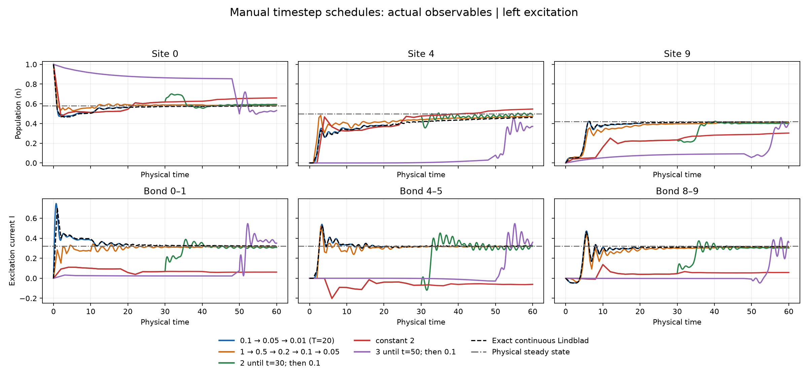
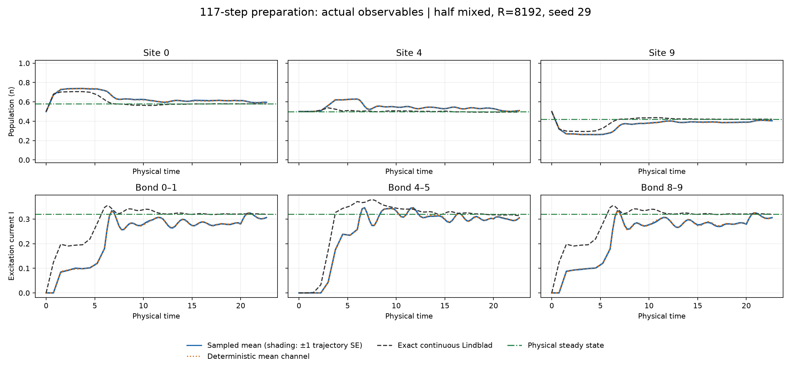
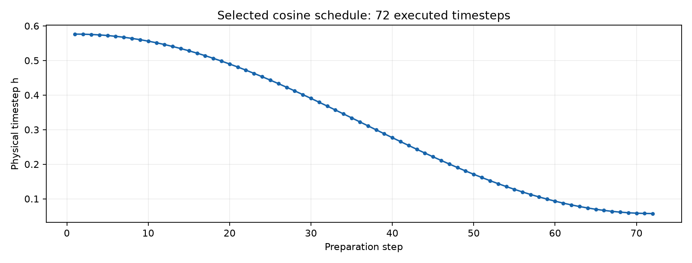
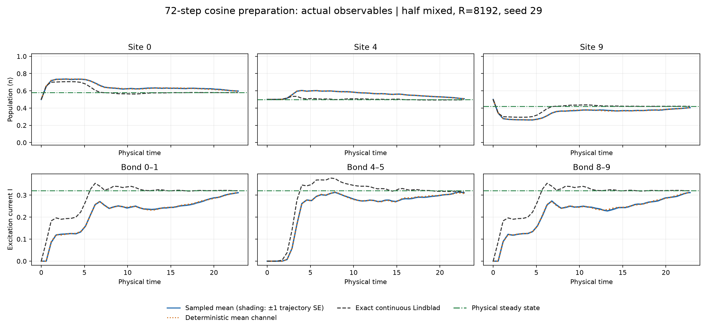
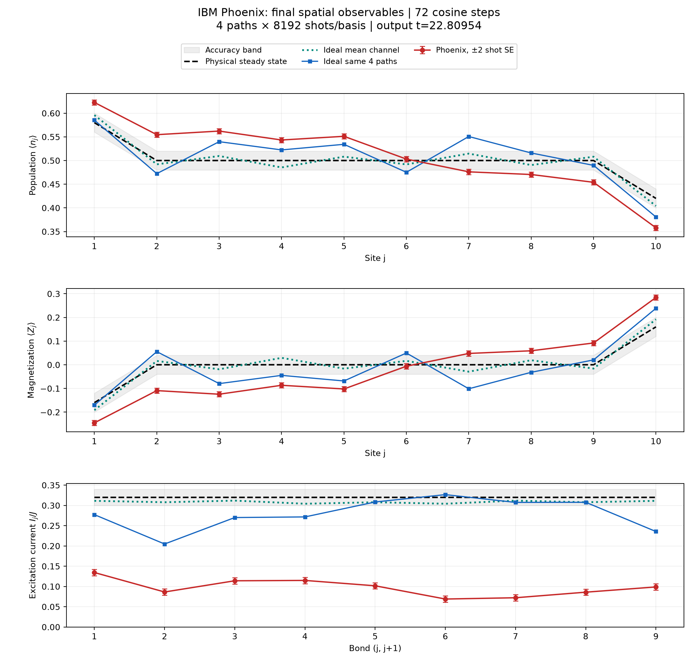

# Variable Trotter timesteps for Model3: from manual refinement to cosine annealing

This report reviews the saved Model3 experiments on preparing a nonequilibrium steady state with fewer randomized Lie–Trotter steps. The strongest saved result is an automatically selected **72-step cosine schedule**. It passes the configured ideal, local-observable accuracy tests at tolerance **0.02** for three independent trajectory seeds. Compilation of four representative paths gives **1125–1131 native layers and 1440 CZ gates per circuit** on FakeKingston.

The progression also exposed two limits: a visually flat curve can have substantial finite-step bias, and a successful ideal schedule can still perform poorly on hardware. The saved four-trajectory IBM Phoenix run does **not** meet the 0.02 target.

All numerical results below come from existing saved runs and their analysis files. No schedules, trajectories, stationary solves, transpilation, or hardware jobs were rerun to prepare this report. The observable figures were regenerated from saved arrays, with the original data and experiment plots preserved. Plots show actual populations and currents; numerical error checks remain in the tables. Site and bond indices in the new time-series figures are zero-based.

## 1. Physical model and the accuracy being measured

The main schedule comparisons use a ten-site boundary-driven XX chain,

$$
H=\frac{J}{2}\sum_{j=1}^{N-1}(X_jX_{j+1}+Y_jY_{j+1}),
\qquad N=10,\quad J=\gamma=1,
$$

with reservoir populations $p_L=0.9$ and $p_R=0.1$. Dissipation is confined to the endpoints, with jump operators

$$
L_{L,+}=\sqrt{\gamma p_L}\,\sigma_1^+,
\quad L_{L,-}=\sqrt{\gamma(1-p_L)}\,\sigma_1^-,
\quad L_{R,+}=\sqrt{\gamma p_R}\,\sigma_N^+,
\quad L_{R,-}=\sqrt{\gamma(1-p_R)}\,\sigma_N^-.
$$

Here $\sigma^+=|1\rangle\langle0|$ pumps an excitation. The observables are the populations $n_j=(1-Z_j)/2$ and excitation currents

$$
I_j=\frac{J}{2}\langle Y_jX_{j+1}-X_jY_{j+1}\rangle.
$$

For these parameters, the physical steady-state populations are $(0.58,0.5,\ldots,0.5,0.42)$ and every steady bond current is $I_{j,*}=0.32$. The interior population profile is flat; this homogeneous XX model does not produce a gradual bulk gradient simply by increasing the chain length.

Each simulated step applies the Hamiltonian factors on even then odd bonds, followed by one randomly selected boundary dilation. The default branch probabilities are $(0.45,0.05,0.05,0.45)$, with probability-compensated dilation strengths. A variable schedule changes the physical timestep $h_k$, and therefore the gate angles, at each step. The complete executed timestep list and branch choices are saved.

The common local-observable metric is

$$
d(A,B)=\max\left\{\max_j|n_j(A)-n_j(B)|,
\max_j\frac{|I_j(A)-I_j(B)|}{J}\right\}.
$$

It checks **all ten sites and all nine bonds**, even when figures display only three representatives. Tolerance 0.02 is an absolute tolerance in this metric, not a 2% relative current error or a bound on full-state trace distance.

Three quantities must be distinguished:

- **Physical relaxation:** how far continuous Lindblad evolution remains from its physical steady state.
- **Finite-step error:** the difference introduced by the Hamiltonian splitting and finite-step reservoir dilation. The deterministic mean channel averages over every jump branch and exposes this error without trajectory sampling noise.
- **Sampling error:** the discrepancy between a finite collection of random trajectories and that deterministic mean. Hardware measurements add further preparation and measurement fluctuations, as well as device errors.

The mean schedule is planned using the known covariance dynamics and physical stationary covariance. It is therefore **reference-assisted classical planning**, rather than feedback from noisy hardware measurements.

## 2. Experiment3: manual schedules and the first automatic controller

### Manual refinement demonstrated the benefit and cost of smaller late steps

The initial runs used manually supplied piecewise timesteps, $R=64$, and three initial preparations: empty, filled, and a left-site excitation. A particularly useful comparison shares exactly the same coarse history, with $h=2$ through physical time 30, and then changes only the remaining timestep.

| Timestep after time 30 | Total steps to time 60 | Final population error, mean versus exact transient | Final current error / J, mean versus exact transient |
|---:|---:|---:|---:|
| 2 | 30 | 0.119655 | 0.461831 |
| 1 | 45 | 0.147608 | 0.214004 |
| 0.1 | 315 | 0.028613 | 0.019418 |

Refining to 0.1 reduced the final current error by approximately 23.8 times, but required 10.5 times as many total steps. The population error did not improve monotonically under every coarse-step change. This demonstrates why choosing a large initial timestep alone is insufficient: the accumulated state and subsequent cleanup both matter.



*Figure 1. Actual deterministic mean-channel populations (top row, sites 0, 4, 9) and currents (bottom row, bonds 0–1, 4–5, 8–9) for five manual schedules, all starting from the same left-site excitation. Colors identify schedules, black dashed curves show the saved exact Lindblad evolution, and gray dash-dot lines mark physical stationary values. A separate panel for each observable avoids replacing it by a maximum error over changing sites. The fine schedule ends at time 20; the others end at 60. This is not an equal-horizon or equal-cost ranking. The same comparison is available for [vacuum](Model3/analysis/variable_schedule/manual_observables_vacuum.png) and [filled](Model3/analysis/variable_schedule/manual_observables_filled.png) preparations. [Vector PDF](Model3/analysis/variable_schedule/manual_observables_left_excitation.pdf).*

None of the saved $N=10$ manual runs reached even a sampled crossing of the 0.01 stationary tolerance for any of the three preparations. Their continuous references also had not reached that tolerance: the worst exact stationary distance at time 60 was approximately 0.03956. Thus, some of the apparent late-time limitation was genuine slow physical relaxation, not just Trotter error.

Source: [manual-run analysis and controlled comparisons](Model3/Experiment3/analysis/ExistingRunsAnalysis.md).

### The first budget controller converged in mean but was expensive

The first automatic method separately allocated the 0.01 tolerance to stationary timestep bias (0.003), relaxation toward the current channel's fixed point (0.003), and sampling (0.004). It halved the nominal timestep as the state approached the current finite-step stationary state.

The saved run used the sequence $0.5,0.25,0.125,0.0625,0.03125,0.015625$, with state-dependent switch times. It required **3530 steps**, reaching physical time **165**, and established a passing deterministic window over $[155,165]$.

| Saved diagnostic | Value |
|---|---:|
| Maximum physical mean error in the accepted window | 0.00548987 |
| Final channel's stationary bias | 0.00249408 |
| Maximum sampled stationary error, R=64 | 0.01267674 |
| Maximum sampled-to-mean discrepancy | 0.01225594 |
| Maximum descriptive two standard errors | 0.01334133 |

The controller converged, but the complete run was correctly labeled `sampling_budget_not_met`. Refining timesteps could not repair insufficient trajectory sampling. The thousands of steps also made the controller unattractive for a shallow circuit.

This run is an accuracy-oriented predecessor, not a directly comparable baseline for the later 72-step result: it used a tighter target, three different preparations, separate bias/relaxation budgets, and a sampled trailing window. The later experiments use a half-mixed preparation and a different acceptance rule.

Sources: [Experiment3 controller description](Model3/Experiment3/Experiment3.md) and [saved automatic replay](Model3/Experiment3/results/classical_randomized_N10_J1_g1_R64_4d6752bb9fae.json).

## 3. Experiment4: optimize the preparation within a step budget

Experiment4 shifted the objective toward the fewest executable steps within an error budget. It compared constant and piecewise decreasing timesteps, different diagonal product preparations, and a 500-step cap.

### Initial 0.01 tests failed; simply permitting larger steps did not solve the problem

At total tolerance 0.01, the deterministic allowance was 0.006. The best saved initial candidate had mean trailing-window error 0.015683, while the best tested constant-step baseline had error 0.0204892. Adaptation improved the tested mean error, but neither met the requested target.

Allowing steps up to 3 did not automatically improve the selected winner. Some wider schedule families even returned worse results because the narrow beam search discarded useful intermediate paths. These were limitations of the tested heuristic, not proofs that coarse steps or a 500-step preparation could never work.

The long final cleanup stage was the dominant cost: 92–98% of steps in those selected candidates used $h=0.0625$. Optimizing only the coarse beginning addressed a small fraction of the total depth.

Source: [analysis of the initial budgeted runs](Model3/Experiment4/analysis/ExistingRunsAnalysis.md).

### Relaxing the target to 0.02 produced a passing 490-step result

With mean allowance 0.016 and sampling allowance 0.004, the selected half-mixed preparation used

$$
20\times0.5\;\longrightarrow\;20\times0.25\;\longrightarrow\;450\times0.0625.
$$

It ended at time 43.125 and passed a sampled trailing window of ten physical-time units at $R=8192$, seed 29. Its maximum mean error was 0.015682747, sampled physical error 0.016963471, sampling distance 0.002717680, and maximum two-SE value 0.001934807.

At $R=4096$, the same schedule met the total physical tolerance but failed its separate sampling-distance allowance. The trajectory count required for a passing result therefore depends on the schedule and assessment window.

Source: [executed tolerance-0.02 validation](Model3/Experiment4/analysis/Tolerance002Run.md).

### Forward validation and a stronger search reduced preparation to 117 steps

The revised task was to stop the circuit at a suitable output and then test its stability **classically**. Starting from that output, the deterministic mean continued at the **same final timestep** for at least ten additional physical-time units. Every future mean node had to remain within 0.016. Sampling was assessed at the circuit output only.

This avoids putting the entire validation window into the preparation circuit. It does, however, change the criterion: future sampled trajectories are not tested. The reduction from 490 steps must not be presented as an improvement under an identical sampled trailing-window requirement.

With retained baselines, a wider beam, and finer switching choices, the best saved preparation became:

| Stage | Steps | Timestep | Physical duration |
|---|---:|---:|---:|
| Coarse relaxation | 8 | 0.75 | 6 |
| Intermediate evolution | 56 | 0.25 | 14 |
| Cleanup | 53 | 0.05 | 2.65 |
| **Total** | **117** | | **22.65** |

The forward mean maximum was **0.01592229**. All three $R=8192$ seeds passed, with sampled output errors between 0.01551024 and 0.01720871. The additional 200 mean-only continuation steps were not included in the circuit.



*Figure 2. Actual values during the 117-step preparation, with one panel per selected site or bond. Blue solid curves are sampled means, blue shading is ±1 trajectory standard error, orange dotted curves are deterministic mean-channel values, black dashed curves are the saved exact continuous evolution, and green dash-dot lines are physical stationary targets. The plot ends where the circuit stops at time 22.65. Forward validation remains documented by the numerical checks above; no additional observable evolution was computed for this figure. [Vector PDF](Model3/analysis/variable_schedule/forward117_observables.pdf).*

The successful first timestep, 0.75, is coarser than 0.5, but the main improvement is the coordinated intermediate evolution and shorter cleanup. Maximizing the first timestep was not the objective that delivered the best result.

Source: [forward-window search, seed checks, and stopping-rule comparison](Model3/Experiment4/analysis/ForwardWindowStudy.md).

## 4. Experiments6–7: automatic selection without a manual timestep grid

The later controllers retain half-mixed preparation, the same physical channel, total tolerance 0.02, mean allowance 0.016, sampling allowance 0.004, and the ten-unit forward mean window. Schedule planning is independent of trajectory seed and count.

The half-mixed state has independent occupation probability 0.5 at every site and zero initial current. It is a simple product mixture, not the correlated steady state.

### Experiment6: state-dependent, receding-horizon control

At each decision, Experiment6 proposed a single timestep, forecast repeated mean steps, assessed progress per circuit step, and penalized the candidate's stationary bias. It optimized continuously in log timestep, committed at most four steps, and repeated the calculation from the updated state.

An early prototype selected very small steps without enough physical progress and failed at its 500-step cap. The revised score and automatic horizon extension produced a passing **273-step** preparation at time **15.3977123**, with forward mean error **0.01408550**. All three $R=8192$ seeds passed.

This established autonomous, budget-driven scheduling, but did not beat the separately searched 117-step preparation. Its final timestep reached $10^{-4}$, requiring **100,000 classical continuation steps** to cover the forward window. Those checks were planning work, not extra circuit layers.

Source: [Experiment6 method, prototype failure, and verified result](Model3/Experiment6/Experiment6.md).


## 5. the cosine annealing scheduler

### Mathematical schedule and automatic parameter choice

For $K>1$, the schedule is

$$
h_k=h_f+\frac{h_0-h_f}{2}
\left[1+\cos\left(\frac{\pi k}{K-1}\right)\right],
\qquad k=0,\ldots,K-1.
$$

It begins at $h_0$, decreases monotonically, and ends at a positive floor $h_f$. There are no restarts. For $K=1$, the implementation uses $h_f$.

The scheduler jointly searches the preparation length and endpoint timesteps. Its target is the smallest feasible $K$, subject to the actual mean output and a constant-$h_f$ forward continuation remaining within the mean allowance. If $C_K$ denotes the output covariance, the validation constraint is

$$
\max_{\ell=0,\ldots,L}
d\left(\Phi_{h_f}^{\ell}(C_K),C_*\right)\leq0.016,
\qquad L=\left\lceil\frac{10}{h_f}\right\rceil.
$$

The default search permits up to 500 preparation steps, total preparation time up to 200, and timestep bounds $10^{-4}\leq h_f\leq h_0\leq1$. Seeded differential evolution uses optimizer seed 1729, 80 initial iterations, and population multiplier 10. A 1% margin in the search encourages solutions below the nominal mean boundary.

For speed, candidate forecasts inspect a sparse set of future nodes using accelerated mean-channel propagation. Every retained forecast and accepted output is then independently checked by direct mean stepping at **every** future integration node. Sparse forecasting alone cannot qualify a schedule.

The analogy with learning-rate annealing is the smooth reduction from a coarse initial update to fine final updates. This implementation is **not stochastic gradient descent**: no trajectory noise or stochastic gradient selects the timesteps. It fits the schedule offline against a deterministic physical model, then gives the same schedule to every trajectory. Cosine is not replanned after each prefix; the saved winner executes the full fitted schedule without truncation.

Source: [schedule formulas, search settings, and validation implementation](Model3/Experiment7/Experiment7.md).

### The selected 72-step schedule

The saved optimizer selected

$$
K=72,\qquad h_0=0.576267723009639,
\qquad h_f=0.05733068985582982,
$$

or explicitly,

$$
h_k=0.05733068985582982+
\frac{0.576267723009639-0.05733068985582982}{2}
\left[1+\cos\left(\frac{\pi k}{71}\right)\right].
$$

The executed timesteps sum to **22.8095428632** physical-time units. The final check contains **175 mean-only steps**, ending at time **32.8424135879**. Both the output mean error and the largest forward mean error are **0.0159253878**, below 0.016.



*Figure 3. Each marker is one executed timestep, plotted against preparation-step number. The schedule starts at 0.57626772 and reaches its positive final floor of 0.05733069. Only the 72 circuit-preparation steps appear; the classical continuation is excluded. [Vector PDF](Model3/analysis/variable_schedule/cosine_timesteps.pdf).*

The saved seed checks are:

| Trajectory seed | Sampled physical output error | Sampled-to-mean distance | Maximum descriptive two SE | Status |
|---:|---:|---:|---:|---|
| 29 | 0.0171097482 | 0.0027222950 | 0.0026875628 | passed |
| 30 | 0.0174284472 | 0.0023533004 | 0.0026695123 | passed |
| 31 | 0.0168577158 | 0.0034083010 | 0.0026411832 | passed |

All rows use $R=8192$. Their physical errors fit 0.02, and both sampling diagnostics fit 0.004. The seed-31 sampling discrepancy is the largest, despite its smaller physical output error: realized sampling fluctuations can partially cancel deterministic error, so ranking only by the final physical error can hide sampling limitations.



*Figure 4. Actual values from the saved seed-29 replay: populations at sites 0, 4, 9 and currents on bonds 0–1, 4–5, 8–9. Blue solid curves are sampled means, shading is ±1 trajectory standard error, orange dotted curves are deterministic mean-channel values, black dashed curves are exact continuous Lindblad values, and green dash-dot lines are physical stationary targets. All axes show observable values, not errors. The exact transient is a separate diagnostic: acceptance is based on preparation of stationary observables, not a uniformly accurate transient trajectory. All ten sites and nine bonds still enter the tabulated accuracy checks. [Vector PDF](Model3/analysis/variable_schedule/cosine_observables.pdf).*

The corresponding actual output values at time 22.8095429 are:

| Observable (zero-based index) | Sampled, R=8192 | Deterministic mean | Exact Lindblad at the same time | Physical stationary value |
|---|---:|---:|---:|---:|
| Population, site 0 | 0.597110 | 0.595925 | 0.579490 | 0.580000 |
| Population, site 4 | 0.508593 | 0.508224 | 0.496561 | 0.500000 |
| Population, site 9 | 0.404630 | 0.404075 | 0.420510 | 0.420000 |
| Current, bond 0–1 | 0.311029 | 0.311260 | 0.320022 | 0.320000 |
| Current, bond 4–5 | 0.310493 | 0.307771 | 0.314104 | 0.320000 |
| Current, bond 8–9 | 0.311569 | 0.311260 | 0.320022 | 0.320000 |

The selected endpoint values for all plotted runs and preparations are also saved in [observable_endpoints.csv](Model3/analysis/variable_schedule/observable_endpoints.csv).

The result supports cosine as a compact schedule family for this model: it combines useful early physical evolution with finer late steps, and avoids the extremely small final timestep selected by the feedback policies. However, the experiments do not isolate smoothness as the cause of the improvement; joint endpoint/length optimization and the permitted schedule family also changed. The one-step advantage over two-stage feedback is modest and does not establish universal superiority.

Relative to the passing 117-step forward preparation, cosine uses **38.46% fewer steps**. Relative to the 273-step feedback result, it uses **73.63% fewer steps**. The improvement is demonstrated for this model, initialization, accuracy budget, and search configuration; global minimality is not established.

### Trajectory count remains a separate resource

Postprocessing prefixes of the saved cosine final covariances found:

| Trajectories | Worst physical output error across three seeds | Worst sampling distance | Worst two-SE value | Seeds passing all checks |
|---:|---:|---:|---:|---:|
| 1024 | 0.02104064 | 0.00846417 | 0.00784411 | 0/3 |
| 2048 | 0.01756926 | 0.00652313 | 0.00545482 | 0/3 |
| 4096 | 0.01736030 | 0.00322387 | 0.00387425 | 3/3 |
| 8192 | 0.01742845 | 0.00340830 | 0.00268756 | 3/3 |

Thus 4096 was the smallest **tested** count passing all three ideal prefix checks; 8192 gave smaller two-SE estimates. This is an exact-per-path covariance analysis with initial mixtures analytically averaged. It does not validate 8192 hardware trajectories measured with one shot each. One-shot measurements introduce additional variance, and increasing trajectory count does not remove systematic hardware error.

Source: [saved covariance-prefix assessment](Model3/Experiment5/analysis/hardware/ibm_phoenix_20261020T190507_427277Z/TrajectoryCounts.json).

## 6. Experiment5: how the shorter schedules translate into circuits

The saved schedules were compiled with two reusable boundary bath ancillas, giving **12 active qubits** for the ten-site chain. Half-mixed preparation uses local H gates followed by unconditioned Z measurements. Those preparation outcomes are ignored; leaving the resulting random computational states in place realizes the diagonal product mixture. The system is not reset after these measurements.

Each Trotter step includes its selected bath interaction and reset. Final Z, alternating XY, and alternating YX readouts provide the populations and all bond currents. These are three separate measurement settings per trajectory.

The FakeKingston comparisons use the same chain layout, optimization level 3, transpiler seed 11, and four saved trajectory indices, each with all three final readouts:

| Preparation | Full native depth | CZ gates / circuit | Two-qubit depth | Bath resets |
|---|---:|---:|---:|---:|
| 490-step piecewise schedule, trailing criterion | 7850–7855 | 9800 | 1960 | 490 |
| 117-step piecewise schedule, forward criterion | 1882–1887 | 2340 | 468 | 117 |
| 73-step two-stage feedback | 1176–1181 | 1460 | 292 | 73 |
| **72-step cosine** | **1125–1131** | **1440** | **288** | **72** |

Cosine also uses 8815–8850 unitary gates including RZ operations, compared with 14715–14761 for the 117-step schedule. RZ operations are counted even when implemented as virtual frame updates. Classical planning and continuation steps contribute no gates to these preparation circuits.

These native depths are unweighted Qiskit dependency-layer counts including preparation, resets, and final measurement. They are not scheduled durations or device-wide guarantees. The reported ranges cover the four compiled paths, not all 8192 trajectories. More trajectories or more shots increase total execution workload without increasing the depth of one trajectory circuit.

Sources: [490 versus 117 depth comparison](Model3/Experiment5/analysis/Forward117DepthComparison.md), [verified Experiment7 resources](Model3/Experiment7/runs/comparison_d3fd93cb452e/VerifiedComparison.md), and [per-path cosine compilation](Model3/Experiment7/runs/comparison_d3fd93cb452e/cosine/depth/depth_123bd5f8abc5/Depth.md).

## 7. Hardware evidence: ideal success has not yet transferred to Phoenix

The saved IBM Phoenix job `dbbrmpc24mrc73ciaq4g` executed the 72-step cosine schedule for **four trajectories**, with three measurement settings each and **8192 shots per setting**: 12 circuits and 98,304 total shots. The live-target compilation recorded 1127–1131 native layers and 1440 CZ gates per circuit.

| Comparison at the output | Maximum local error |
|---|---:|
| Ideal mean versus physical target | 0.01592539 |
| Ideal same four paths versus ideal mean | 0.10305054 |
| Ideal same four paths versus physical target | 0.11524821 |
| Hardware versus ideal same four paths | 0.25760607 |
| Hardware versus physical target | **0.25103027** |

The average measured bond current was **0.0974460**, compared with **0.2787983** for the ideal average of those same four paths, **0.3086359** for the ideal mean channel, and the physical target **0.32**. Hardware retained about **34.95%** of the same-path ideal average current.



*Figure 5. Final spatial populations, magnetizations, and currents. Black dashed lines are physical targets, green dotted lines are the ideal mean channel, blue squares are the ideal same four paths, and red points are Phoenix measurements. Red error bars show ±2 nominal shot standard errors conditional on those four paths; they do not include uncertainty from choosing only four trajectories. The current suppression is much larger than the displayed shot uncertainty. This existing spatial hardware figure labels sites 1–10, unlike the zero-based time-series figures above.*

The four-path ideal average already fails the sampling requirement, while hardware adds a substantial discrepancy relative to those identical paths. Extra shots on the same four paths cannot resolve either the missing trajectory diversity or systematic device error. This run does not isolate contributions from gates, resets, preparation, readout, or drift. A single output measurement also does not establish hardware stationarity.

The signed differences between hardware, same-path ideal, mean output, and physical target can be decomposed exactly, but the maximum norms in the table cannot be added as scalar error contributions.

Source: [saved Phoenix analysis](Model3/Experiment5/analysis/hardware/ibm_phoenix_20261020T190507_427277Z/Analysis.md). No result from the subsequently proposed 8192-trajectory, one-shot hardware configuration is claimed here.

## 8. Reproducing the cosine study on Windows

From the repository root in PowerShell, regenerate the cosine search, classical replay, validation, and plots with:

```powershell
.\.venv\Scripts\python.exe .\Model3\Experiment7\compare_schedules.py `
  --methods cosine `
  --R-values 8192 `
  --seeds 29 30 31
```

Defaults retain $N=10$, $J=\gamma=1$, half-mixed preparation, optimizer seed 1729, and the 0.02/0.016/0.004 accuracy allocation. The command prints its configuration-specific output directory. It performs classical computation only and submits no hardware jobs. Because it reruns a heuristic optimizer, inspect the newly selected schedule and validation results rather than assuming every numerical environment must reproduce exactly 72 steps.

The original three-seed comparison in this report is stored under [comparison_d3fd93cb452e](Model3/Experiment7/runs/comparison_d3fd93cb452e/Study.md), which also includes the two-stage method. A cosine-only rerun has a different configuration hash. Full replay JSON and QPY files may be absent from a fresh checkout because generated bulk data are excluded from Git; the figures and Markdown reports remain the portable record. See [the artifact policy](ARTIFACTS.md).

To regenerate only the report's observable figures from existing replay files, without running evolution or hardware jobs:

```powershell
.\.venv\Scripts\python.exe .\Model3\analysis\variable_schedule\plot_observables.py
```

This plotting script requires the saved manual, 117-step, and cosine replay files locally. Its [provenance record](Model3/analysis/variable_schedule/observable_figures.json) stores source hashes and confirms that original input files were unchanged.

## 9. Assessment of the cosine result

The saved evidence supports cosine annealing as the current preferred compact schedule for **ideal preparation of the tested Model3 stationary populations and currents**. Its endpoints and length are selected automatically; it passes all configured output and forward mean checks; and its reduced step count translates into lower measured native depth and fewer CZ gates in the compiled subset.

The central improvement is coordinated coarse-to-fine evolution under an output accuracy budget. The early experiments show why relying on visual plateaus or only increasing the maximum timestep is insufficient. The feedback comparisons show why the final timestep must also be assessed for useful progress and classical validation cost.

The remaining evidence gap is hardware accuracy. The available Phoenix run fails the target, and the existing ideal sampling results exclude measurement noise. Three successful ideal seeds and descriptive two-SE checks are not simultaneous confidence guarantees, and a finite forward window is not proof of permanent settling. Cosine is a demonstrated improvement in the tested preparation-cost tradeoff, with hardware fidelity and shot allocation still requiring separate validation.
